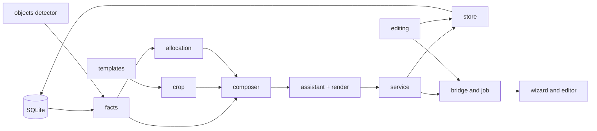
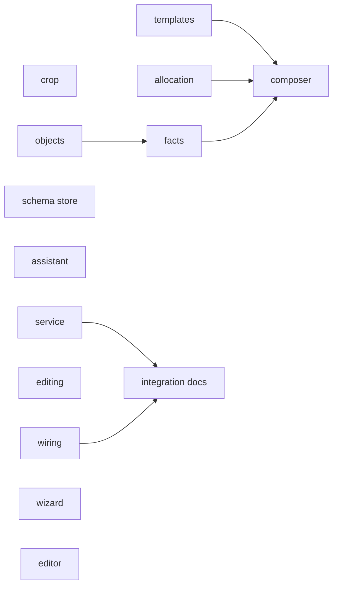

# Album layout implementation plan

**Goal:** "Create layout" wizard, deterministic spread composer with optional LM Studio editor, and a spread editor.
**Architecture:** pure Python modules in `src/ailbum/layout/`, persisted in SQLite, served by the JSON-lines bridge and `desktop_job`, rendered in `desktop/src/layout/`.
**Tech stack:** Python 3.10, numpy, OpenCV DNN, Pillow, Electron, React, TypeScript.
**Spec:** docs/plans/2026-11-07-album-layout-design.md
**Detail:** contracts
**Target-min:** 25

Global constraints:
- Formats, formulas, tables, JSON and RPC are binding as written in the spec, sections 1-6.
- Test command `uv run pytest`; lint `uv run ruff check .` (line length 100); renderer check `npm run build --prefix desktop`.
- No new Python dependencies. UI text is Russian. Comments only where logic is non-obvious.
- Dataclasses use `slots=True` and `from __future__ import annotations`, matching `models.py`.
- All composition is deterministic: ties break by lowest `image_id`, then lowest template id.

## Main diagram

## File structure

- `src/ailbum/layout/types.py`: shared dataclasses.
- `src/ailbum/layout/templates.py`: formats and template catalog.
- `src/ailbum/layout/crop.py`: crop solver.
- `src/ailbum/layout/allocation.py`: stories to spreads.
- `src/ailbum/layout/facts.py`: pool and protected regions from the database.
- `src/ailbum/layout/composer.py`: photo, template and cell choice.
- `src/ailbum/layout/assistant.py`: spread preview render and LM Studio choice.
- `src/ailbum/layout/store.py`: layout persistence and JSON contract.
- `src/ailbum/layout/service.py`: preflight and generate.
- `src/ailbum/layout/editing.py`: manual edits.
- `src/ailbum/cv/objects.py`: YOLOX detector.
- `desktop/src/layout/`: wizard, editor, styles.

## Task graph

```mermaid
%% schedule
gantt
  title Predicted schedule (mm:ss)
  dateFormat X
  axisFormat %M:%S
  section lane 1
  T13 spread editor :t13, 0, 194s
  T7 composer :t7, 219, 123s
  section lane 2
  T12 wizard and navigation :t12, 0, 184s
  section lane 3
  T5 schema and store :t5, 0, 144s
  section lane 4
  T1 types and templates :t1, 0, 142s
  section lane 5
  T8 assistant and preview :t8, 0, 136s
  T14 integration and docs :t14, 136, 141s
  section lane 6
  T11 bridge  job and IPC :t11, 0, 136s
  section lane 7
  T9 service :t9, 0, 111s
  section lane 8
  T10 editing :t10, 0, 111s
  section lane 9
  T2 crop solver :t2, 0, 109s
  T4 story allocation :t4, 109, 104s
  section lane 10
  T3 object detector :t3, 0, 105s
  T6 photo facts :t6, 105, 114s
```

critical path: T3 → T6 → T7 (5.7 min) · peak width 10 · predicted build 5.7 min · predicted total ≈ 9.2 min (target ✓)

## Package: layout core (pure library)

**Probe entry:** call=ailbum.layout.crop.solve_crop

### T1 types and templates · Complexity 3 (O-1) · Est. context 30k
**Owns:** src/ailbum/layout/__init__.py, src/ailbum/layout/types.py, src/ailbum/layout/templates.py, tests/test_layout_templates.py
**Components:** 2
**LOC owned:** 220
**Tests:** fast
**Model:** sonnet
**Est. time:** 3 min
**Produces:** ailbum.layout.types.Rect(x: float, y: float, w: float, h: float)
**Produces:** ailbum.layout.types.Region(bbox: Rect, weight: float, hard: bool, kind: str)
**Produces:** ailbum.layout.types.Cell(index: int, rect: Rect, safe: Rect, spine_band: Rect | None)
**Produces:** ailbum.layout.types.CropResult(rect: Rect, fit: float, violations: tuple[str, ...])
**Produces:** ailbum.layout.types.LayoutParams(orientation: str, spread_count: int, min_photos: int, max_photos: int, assistant: str = "auto")
**Produces:** ailbum.layout.templates.format_for(orientation: str) -> AlbumFormat
**Produces:** ailbum.layout.templates.templates_for(orientation: str, photo_count: int | None = None) -> list[Template]
e.g. format_for("vertical").spread_w_mm -> 426.0
e.g. len(templates_for("vertical", 3)) -> 2 (page_2h, page_2h_m)
**Review Focus:** `test_cells_stay_inside_spread`: all ids and orientations; `test_spine_band_only_when_crossing`: `wide_3` cell 0 has band, `pages` has none; `test_mirror_reflects_x`.
**Test code (contracts):** `test_page_2_3_has_6_cells`; `test_gap_is_5mm`: adjacent `grid_2x2` cells are 5.0 mm apart at the spine and horizontally; `test_wide_3_split`: cell 0 right edge is 0.65 of the trim width within 2 mm; `test_edge_cells_reach_bleed`: `pages` cell 0 x == 0.0; `test_inset_keeps_margin`: `inset_1_2` cell 0 x == 9.0 mm; `test_horizontal_catalog_excludes_grid_2x2`.
**Steps:** 1 failing test, 2 run: FAIL, 3 implement, 4 run: PASS
**Notes:** `Cell.rect` and `safe` are mm in the bleed box. Spine band: `spine_guard_mm` either side of the spread centre, only if the cell crosses it. Template catalog: spec section 2.

### T2 crop solver · Complexity 6 (O-n) · Est. context 30k
**Owns:** src/ailbum/layout/crop.py, tests/test_layout_crop.py
**Components:** 1
**LOC owned:** 150
**Tests:** fast
**Model:** sonnet
**Est. time:** 3 min
**Consumes:** ailbum.layout.types.Rect(x: float, y: float, w: float, h: float) (T1) · ailbum.layout.types.Region(bbox: Rect, weight: float, hard: bool, kind: str) (T1) · ailbum.layout.types.Cell(index: int, rect: Rect, safe: Rect, spine_band: Rect | None) (T1) · ailbum.layout.types.CropResult(rect: Rect, fit: float, violations: tuple[str, ...]) (T1)
**Produces:** ailbum.layout.crop.solve_crop(photo_aspect: float, regions: Sequence[Region], cell: Cell) -> CropResult
**Produces:** ailbum.layout.crop.evaluate_crop(rect: Rect, photo_aspect: float, regions: Sequence[Region], cell: Cell) -> CropResult
e.g. solve_crop(1.0, [], Cell(0, Rect(0,0,100,100), Rect(0,0,100,100), None)) -> CropResult(Rect(0,0,1,1), 1.0, ())
**Review Focus:** numeric: `test_extreme_aspect_panorama`: aspect 8.0 in a portrait cell stays inside 0..1; `test_face_wider_than_window`: reports `face_cut`, no exception; `test_zero_area_region_ignored`.
**Test code (contracts):** `test_face_at_left_slides_window_left`: aspect 1.5 into a square cell, hard face at x 0.05-0.15 gives rect.x == 0 and no violations; `test_landscape_in_portrait_fits_less_than_portrait`: same cell, aspect 1.5 fit < aspect 0.7 fit; `test_face_avoids_spine`: wide cell crossing the spine, face centred on it, result has no `face_on_spine` by using scale < 1 or sliding; `test_impossible_face_reports_violation`: fit reduced by 0.5; `test_soft_region_preferred`: window covers the object at the right; `test_evaluate_matches_solve`.
**Steps:** 1 failing test, 2 run: FAIL, 3 implement, 4 run: PASS
**Notes:** Formula: spec section 3.3. Map the safe rect and spine band from cell mm into photo fractions through the candidate window.

### T4 story allocation · Complexity 4 (O-n) · Est. context 25k
**Owns:** src/ailbum/layout/allocation.py, tests/test_layout_allocation.py
**Components:** 1
**LOC owned:** 110
**Tests:** fast
**Model:** sonnet
**Est. time:** 2 min
**Produces:** ailbum.layout.allocation.StoryGroup(story_ids: tuple[int, ...], unit_count: int, started_at: str | None, ended_at: str | None)
**Produces:** ailbum.layout.allocation.allocate_spreads(groups: Sequence[StoryGroup], spread_count: int, min_photos: int, max_photos: int) -> list[Allocation]
e.g. allocate_spreads([G((1,),12), G((2,),8)], 5, 3, 6) -> [Allocation((1,), 12, 3, False), Allocation((2,), 8, 2, False)]
e.g. allocate_spreads([G((1,),2), G((2,),10)], 3, 3, 6) -> [Allocation((1, 2), 12, 3, True)]
e.g. allocate_spreads([G((1,),5), G((2,),5), G((3,),5)], 2, 3, 6) -> [Allocation((1, 2), 10, 1, True), Allocation((3,), 5, 1, False)]
**Review Focus:** state: `test_untimed_story_merges_into_previous`; `test_single_group_gets_all_spreads`; `test_sum_equals_spread_count_for_many_shapes`.
**Test code (contracts):** the three examples above; `test_more_spreads_than_units_penalised_not_raised`: 2 groups of 3, 4 spreads gives sum 4.
**Steps:** 1 failing test, 2 run: FAIL, 3 implement, 4 run: PASS
**Notes:** `Allocation(story_ids, unit_count, spreads, merged)`. Rules: spec section 3.4.

### T7 composer · Complexity 8 (O-n) · Est. context 45k
**Owns:** src/ailbum/layout/composer.py, tests/test_layout_composer.py
**Components:** 1
**LOC owned:** 260
**Tests:** fast
**Model:** sonnet
**Est. time:** 5 min
**Consumes:** ailbum.layout.crop.solve_crop(photo_aspect: float, regions: Sequence[Region], cell: Cell) -> CropResult (T2) · ailbum.layout.facts.PhotoFacts(image_id: int, aspect: float, unit_key: str, story_id: int | None, taken_at: str | None, rank: float, selected: bool, regions: tuple[Region, ...]) (T6)
**Produces:** ailbum.layout.composer.compose_group(photos: Sequence[PhotoFacts], allocation: Allocation, params: LayoutParams) -> ComposedGroup
**Produces:** ailbum.layout.composer.best_variants(photos: Sequence[PhotoFacts], params: LayoutParams, limit: int = 3) -> list[SpreadDraft]
e.g. best_variants(three_units, LayoutParams("vertical", 1, 3, 3))[0].template_id -> "page_2h"
e.g. compose_group(six_units, Allocation((1,), 6, 2, False), LayoutParams("vertical", 2, 3, 3)).spreads[0].template_id -> "page_2h"
**Review Focus:** state: `test_each_unit_used_once`; `test_time_order_between_spreads`; `test_no_adjacent_repeat_when_alternative_exists`; numeric: `test_100_units_under_5s`.
**Test code (contracts):** `test_similar_picks_format_match`: unit with landscape and portrait members placed in a portrait cell uses the portrait one, `replaced_image_id` set when it was unselected; `test_selected_beats_equal_sibling`; `test_hero_gets_largest_cell`; `test_capacity_overflow_goes_unplaced`: 20 units, 2 spreads, max 6 gives 8 unplaced with reason `capacity`; `test_underfilled_marked`; `test_deterministic`.
**Steps:** 1 failing test, 2 run: FAIL, 3 implement, 4 run: PASS
**Notes:** Rules: spec section 3.1 and section 3.5. Also uses `templates_for` (T1) and `Allocation` (T4, fields story_ids, unit_count, spreads, merged). Cache `solve_crop` per (image_id, template_id, cell index). `SpreadDraft(template_id, story_ids, placements, score, warnings, alternatives)`; `PlacementDraft(cell_index, image_id, crop, fit, warnings, replaced_image_id)`; `ComposedGroup(spreads, unplaced)`.

## Package: data and detector (data pipeline)

**Probe entry:** call=ailbum.layout.store.load_layout

### T3 object detector · Complexity 4 (O-n) · Est. context 30k
**Owns:** src/ailbum/cv/objects.py, src/ailbum/model_download.py, tests/test_objects.py
**Components:** 1
**LOC owned:** 120
**Tests:** fast
**Model:** sonnet
**Est. time:** 2.5 min
**Produces:** ailbum.cv.objects.ObjectDetector.detect(image: np.ndarray) -> list[DetectedObject]
**Produces:** ailbum.cv.objects.DETECTOR_MODEL (str)
**Produces:** ailbum.cv.objects.ObjectDetector.available(models_dir: Path) -> bool
e.g. DetectedObject("person", 0.91, (0.1, 0.2, 0.3, 0.6)) (bbox is x, y, w, h fractions of the input image)
**Review Focus:** numeric: `test_decode_box_clipped_to_image`; `test_letterbox_scale_maps_back_for_portrait`; `test_no_detections_returns_empty`.
**Test code (contracts):** `test_decode_single_cell`: synthetic `(1, 8400, 85)` output with objectness 1 and person 0.9 at grid cell 0 gives one `person`; `test_below_threshold_filtered`: score 0.2 gives none; `test_model_listed_for_download`: `MODEL_SOURCES` holds filename and SHA-256 from spec section 5.
**Steps:** 1 failing test, 2 run: FAIL, 3 implement, 4 run: PASS
**Notes:** Preprocess and decode: spec section 5. Tests call the pure decode function, not the network. Labels: the 80 COCO names.

### T5 schema and store · Complexity 5 (O-n) · Est. context 40k
**Owns:** src/ailbum/database.py, docs/database.md, src/ailbum/layout/store.py, tests/test_layout_store.py
**Components:** 2
**LOC owned:** 230
**Tests:** fast
**Model:** sonnet
**Est. time:** 4 min
**Produces:** ailbum.layout.store.save_layout(connection: sqlite3.Connection, run_id: str, params: LayoutParams, spreads: Sequence[SpreadDraft], unplaced: list[dict], warnings: list[str], selection_hash: str, assistant_model: str | None) -> int
**Produces:** ailbum.layout.store.load_layout(connection: sqlite3.Connection, run_id: str) -> dict | None
**Produces:** ailbum.layout.store.selection_hash(connection: sqlite3.Connection, run_id: str) -> str
e.g. load_layout(conn, "missing") -> None
e.g. load_layout(conn, "r")["spreads"][0]["cells"][0]["placement"]["image_id"] -> 7
**Review Focus:** state: `test_migrate_v10_keeps_rows`; `test_save_replaces_previous_layout`; `test_delete_run_cascades`; `test_stale_after_selection_change`.
**Test code (contracts):** `test_round_trip_matches_contract`: every key in spec section 6 JSON present; `test_cell_fractions_from_template`; `test_story_title_joined_for_merged`: titles joined with " + ".
**Steps:** 1 failing test, 2 run: FAIL, 3 implement, 4 run: PASS
**Notes:** Bump `SCHEMA_VERSION` to 11, tables in spec section 6. Type hints use `TYPE_CHECKING` imports for `SpreadDraft`; read fields by attribute only.

### T6 photo facts · Complexity 5 (O-n) · Est. context 35k
**Owns:** src/ailbum/layout/facts.py, tests/test_layout_facts.py
**Components:** 1
**LOC owned:** 190
**Tests:** fast
**Model:** sonnet
**Est. time:** 3.5 min
**Consumes:** ailbum.cv.objects.DETECTOR_MODEL (str) (T3)
**Produces:** ailbum.layout.facts.PhotoFacts(image_id: int, aspect: float, unit_key: str, story_id: int | None, taken_at: str | None, rank: float, selected: bool, regions: tuple[Region, ...])
**Produces:** ailbum.layout.facts.load_pool(connection: sqlite3.Connection, run_id: str, detector: ObjectDetector | None, progress: Callable[[int, int], None] | None = None) -> list[PhotoFacts]
**Produces:** ailbum.layout.facts.build_regions(faces: Sequence[tuple[float, float, float, float]], objects: Sequence[DetectedObject], subject: Rect | None) -> tuple[Region, ...]
e.g. build_regions([(0.4, 0.4, 0.1, 0.1)], [], None)[0].bbox -> Rect(0.38, 0.365, 0.14, 0.15), hard True
e.g. load_pool(conn, "r", None)[0].unit_key -> "cluster:3"
**Review Focus:** state: `test_rotated_exif_swaps_aspect`: orientation 6, 4000x3000 gives aspect 0.75; `test_missing_file_excluded`; `test_cached_scan_not_rerun`; `test_scan_rerun_when_sha_changes`.
**Test code (contracts):** `test_unselected_sibling_in_pool`; `test_blurry_sibling_excluded`; `test_unrelated_unselected_excluded`; `test_background_face_is_soft`: 2% area of the largest; `test_saliency_only_without_faces_and_objects`; `test_rank_penalises_closed_eyes`; `test_singleton_unit_key`: `image:12`.
**Steps:** 1 failing test, 2 run: FAIL, 3 implement, 4 run: PASS
**Notes:** Rules: spec section 3.1, section 3.2 and section 5. Also calls `ObjectDetector.detect` (T3). Face pixels are normalized by rotated width and height. A fake detector stands in for the real one in tests.

## Package: services (data pipeline)

**Probe entry:** call=ailbum.layout.service.preflight

### T8 assistant and preview · Complexity 4 (O-n) · Est. context 30k
**Owns:** src/ailbum/layout/assistant.py, tests/test_layout_assistant.py
**Components:** 2
**LOC owned:** 170
**Tests:** fast
**Model:** sonnet
**Est. time:** 3 min
**Consumes:** ailbum.layout.composer.best_variants(photos: Sequence[PhotoFacts], params: LayoutParams, limit: int = 3) -> list[SpreadDraft] (T7)
**Produces:** ailbum.layout.assistant.LayoutAssistant.connect() -> bool
**Produces:** ailbum.layout.assistant.LayoutAssistant.choose(variants: Sequence[SpreadDraft], paths: Mapping[int, str], orientation: str, story_title: str) -> AssistantChoice | None
**Produces:** ailbum.layout.assistant.render_variants(variants: Sequence[SpreadDraft], paths: Mapping[int, str], orientation: str, max_side: int = 896) -> bytes
e.g. choose(three_variants, paths, "vertical", "Ужин") -> AssistantChoice(1, "лучше читается") for reply {"choice":"B","reason":"лучше читается"}
**Review Focus:** encoding: `test_reply_with_prose_around_json_parsed`; `test_choice_out_of_range_returns_none`; `test_timeout_returns_none`; `test_missing_photo_renders_placeholder`.
**Test code (contracts):** `test_connect_false_when_server_down`; `test_render_returns_jpeg_within_max_side`; `test_single_variant_makes_no_request`.
**Steps:** 1 failing test, 2 run: FAIL, 3 implement, 4 run: PASS
**Notes:** Reuse `_request_json` from `story_naming.py`. Spec section 4. Prompt in Russian.

### T9 service · Complexity 5 (O-n) · Est. context 40k
**Owns:** src/ailbum/layout/service.py, tests/test_layout_service.py
**Components:** 1
**LOC owned:** 170
**Tests:** fast
**Model:** sonnet
**Est. time:** 3 min
**Consumes:** ailbum.layout.facts.load_pool(connection: sqlite3.Connection, run_id: str, detector: ObjectDetector | None, progress: Callable[[int, int], None] | None = None) -> list[PhotoFacts] (T6) · ailbum.layout.allocation.allocate_spreads(groups: Sequence[StoryGroup], spread_count: int, min_photos: int, max_photos: int) -> list[Allocation] (T4) · ailbum.layout.composer.compose_group(photos: Sequence[PhotoFacts], allocation: Allocation, params: LayoutParams) -> ComposedGroup (T7) · ailbum.layout.store.save_layout(connection: sqlite3.Connection, run_id: str, params: LayoutParams, spreads: Sequence[SpreadDraft], unplaced: list[dict], warnings: list[str], selection_hash: str, assistant_model: str | None) -> int (T5) · ailbum.layout.assistant.LayoutAssistant.choose(variants: Sequence[SpreadDraft], paths: Mapping[int, str], orientation: str, story_title: str) -> AssistantChoice | None (T8)
**Produces:** ailbum.layout.service.preflight(database: Path, run_id: str, params: LayoutParams) -> dict
**Produces:** ailbum.layout.service.generate(database: Path, run_id: str, params: LayoutParams, models_dir: Path | None, progress: Callable[[str, str, int | None, int | None], None] | None = None) -> dict
e.g. preflight(db, "r", LayoutParams("vertical", 0, 3, 6))["errors"] -> ["Число разворотов должно быть не меньше 1"]
**Review Focus:** state: `test_generate_invalid_params_raises`; `test_assistant_off_never_connects`; `test_no_detector_model_warns`; `test_assistant_failure_keeps_engine_choice`.
**Test code (contracts):** `test_preflight_counts_units_not_photos`; `test_min_max_needed`: 10 spreads, 3-6 gives 30 and 60; `test_generate_spread_count_exact`; `test_preflight_skips_detector`.
**Steps:** 1 failing test, 2 run: FAIL, 3 implement, 4 run: PASS
**Notes:** Preflight must be instant, so it passes `detector=None` and no images are opened. Spreads are numbered in allocation order. LM Studio URL and model come from the run `config_json`.

### T10 editing · Complexity 5 (O-n) · Est. context 35k
**Owns:** src/ailbum/layout/editing.py, tests/test_layout_editing.py
**Components:** 1
**LOC owned:** 170
**Tests:** fast
**Model:** sonnet
**Est. time:** 3 min
**Consumes:** ailbum.layout.store.load_layout(connection: sqlite3.Connection, run_id: str) -> dict | None (T5) · ailbum.layout.composer.best_variants(photos: Sequence[PhotoFacts], params: LayoutParams, limit: int = 3) -> list[SpreadDraft] (T7)
**Produces:** ailbum.layout.editing.alternatives(database: Path, spread_id: int, cell_index: int) -> list[dict]
**Produces:** ailbum.layout.editing.set_photo(database: Path, spread_id: int, cell_index: int, image_id: int) -> dict
e.g. set_photo(db, 5, 0, 7)["spreads"][0]["cells"][0]["placement"]["image_id"] -> 7
**Produces:** ailbum.layout.editing.swap_cells(database: Path, spread_id: int, cell_a: int, cell_b: int) -> dict
**Produces:** ailbum.layout.editing.set_template(database: Path, spread_id: int, template_id: str) -> dict
**Produces:** ailbum.layout.editing.set_crop(database: Path, spread_id: int, cell_index: int, crop: dict) -> dict
**Produces:** ailbum.layout.editing.recompose_spread(database: Path, spread_id: int) -> dict
e.g. set_crop(db, 5, 0, {"x": 2, "y": 0, "w": 1, "h": 1}) raises ValueError
**Review Focus:** state: `test_set_photo_used_elsewhere_swaps`; `test_set_template_other_count_rejected`; `test_crop_wrong_aspect_rejected`; `test_unknown_spread_raises`.
**Test code (contracts):** `test_alternatives_sorted_by_fit_and_capped_24`; `test_set_crop_cutting_face_warns_not_rejects`; `test_swap_recomputes_both_crops`; `test_recompose_keeps_same_photos`; `test_edits_keep_detector_scan`.
**Steps:** 1 failing test, 2 run: FAIL, 3 implement, 4 run: PASS
**Notes:** Uses `evaluate_crop` and `solve_crop` (T2). Every mutation returns `load_layout`. Regions come from `load_pool` with `detector=None`, which reads cached scans.

### T11 bridge, job and IPC · Complexity 3 (O-1) · Est. context 35k
**Owns:** src/ailbum/desktop_bridge.py, src/ailbum/desktop_job.py, desktop/electron/main.cjs, desktop/electron/preload.cjs, desktop/src/types.ts, tests/test_layout_bridge.py
**Components:** 2
**LOC owned:** 170
**Tests:** fast
**Model:** sonnet
**Est. time:** 3 min
**Consumes:** ailbum.layout.service.preflight(database: Path, run_id: str, params: LayoutParams) -> dict (T9) · ailbum.layout.editing.set_photo(database: Path, spread_id: int, cell_index: int, image_id: int) -> dict (T10)
**Produces:** window.ailbum layout methods: layoutPreflight, getLayout, getLayoutTemplates, startLayout, getLayoutAlternatives, setLayoutPhoto, swapLayoutCells, setLayoutTemplate, setLayoutCrop, recomposeLayoutSpread
**Review Focus:** protocol: `test_bridge_routes_all_layout_actions`; `test_job_parser_accepts_layout_kind`; `test_invalid_params_json_emits_error_event`.
**Test code (contracts):** `test_dispatch_layout_get_null`: unknown run gives None; `test_dispatch_preflight_builds_params`.
**Steps:** 1 failing test, 2 run: FAIL, 3 implement, 4 run: PASS
**Notes:** The job calls `service.generate` (T9). RPC table and job arguments: spec section 6. TS types mirror the JSON contract. `DatabaseJob.kind` gains `"layout"`.

## Package: UI (web UI)

**Probe entry:** run=npm run build --prefix desktop

### T12 wizard and navigation · Complexity 4 (O-1) · Est. context 40k
**Owns:** desktop/src/App.tsx, desktop/src/layout/LayoutSection.tsx, desktop/src/layout/LayoutWizard.tsx, desktop/src/layout/layout.css
**Components:** 2
**LOC owned:** 260
**Tests:** slow
**Model:** sonnet
**Est. time:** 4 min
**Produces:** desktop/src/layout/LayoutSection.tsx: LayoutSection({ runId, onError }), which imports `LayoutEditor` from "./LayoutEditor" with props `{ layout, onChange, onRecreate, onError }`
**Review Focus:** protocol: wizard disables "Создать" while preflight has errors; encoding: story titles render as text; stale preflight responses are ignored.
**Test code (contracts):** `npm run build --prefix desktop` passes. If `LayoutEditor.tsx` does not exist yet, create no stub and run `tsc` only after T13; report this.
**Steps:** 1 build the section, 2 run build, 3 fix
**Notes:** Spec section 7. Debounce preflight by 250 ms. Reuse the `Photo`-section shell and existing CSS variables from `styles.css`.

### T13 spread editor · Complexity 6 (O-n) · Est. context 45k
**Owns:** desktop/src/layout/LayoutEditor.tsx, desktop/src/layout/SpreadView.tsx, desktop/src/layout/editor.css
**Components:** 2
**LOC owned:** 340
**Tests:** slow
**Model:** sonnet
**Est. time:** 5 min
**Produces:** desktop/src/layout/LayoutEditor.tsx: LayoutEditor({ layout, onChange, onRecreate, onError })
**Review Focus:** numeric: crop drag clamps to 0..1 and keeps the cell aspect; state: selection clears after `onChange`; protocol: stale banner calls `onRecreate`; image never shows blank when `crop.w` is 1.
**Test code (contracts):** `npm run build --prefix desktop` passes.
**Steps:** 1 build the views, 2 run build, 3 fix
**Notes:** Spec section 7. Image placement from crop: width `100/crop.w`%, left `-crop.x*100/crop.w`%, same for height. Guides from `format`; safe rect = `bleed_mm + safe_mm` inset. Persist crop on pointer up only.

### T14 integration and docs · Complexity 3 (O-n) · Est. context 30k
**Owns:** tests/test_layout_integration.py, docs/architecture.md, README.md
**Components:** 1
**LOC owned:** 120
**Tests:** slow
**Model:** sonnet
**Est. time:** 2.5 min
**Consumes:** ailbum.layout.editing.set_photo(database: Path, spread_id: int, cell_index: int, image_id: int) -> dict (T10)
**Review Focus:** state: `test_full_flow_on_synthetic_library`: generate, get through bridge, edit, stale flag after a selection change.
**Test code (contracts):** `test_real_detector_model_when_available`: skipped without the file; `test_every_placed_face_uncut_on_synthetic_faces`.
**Steps:** 1 failing test, 2 run, 3 fix, 4 docs from the delivered code
**Notes:** Runs the real `service.generate` (T9). Build the database through `save_analysis` with Pillow-generated JPEGs.

## Review Focus

- layout core: library. deep, numeric, state. Risks: faces on the spine, extreme aspect, non-determinism.
- data and detector: data pipeline. numeric, state, file. Risks: EXIF axes, migration on real databases, stale scans.
- services: data pipeline and protocol. encoding, state. Risks: untrusted model text, LM Studio down, generation with no selection.
- UI: web UI. protocol, encoding. Risks: crop math, job state shared with analysis.

## Self-review

Coverage: wizard T12, editor T13, similar-frame choice T6+T7, face protection T2+T6, objects T3, story multiples T4, assistant T8. Each spec section (Требования и решения, Шаблоны, Алгоритм, AI-ассистент, Детектор объектов, Данные и контракт, Интерфейс, Тестирование) is mapped by sections 1-8 to those tasks.
