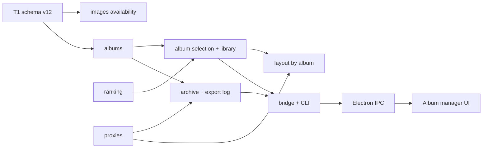
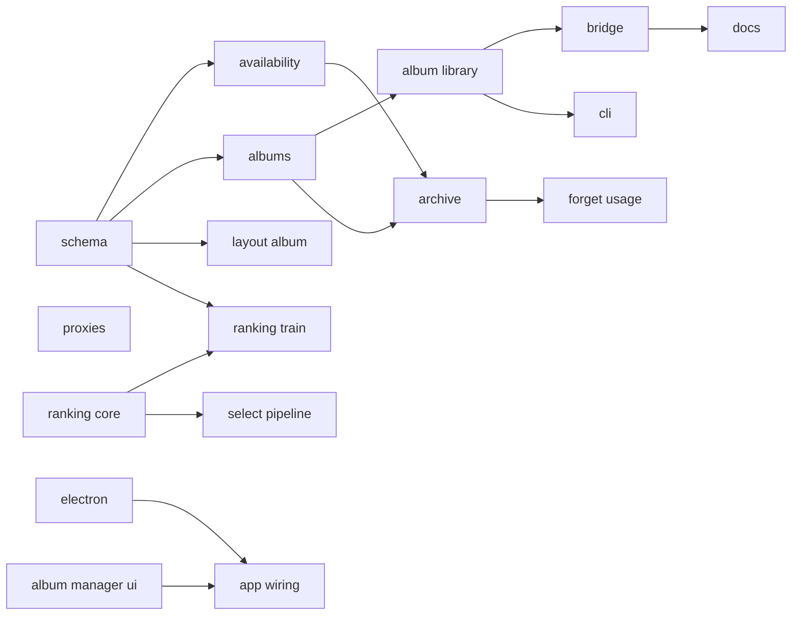

# Albums lifecycle + learned selection (ADR 0001 + ADR 0002)

**Goal:** album entity, originals availability/archive, proxies, export log, forget/usage (ADR 0001) and selection journal + NumPy ranker + target autofill (ADR 0002), schema v12, desktop album manager.
**Architecture:** Python core (`src/ailbum`), JSON-lines bridge, Electron + React renderer. Connection-level functions take `sqlite3.Connection`; Path-level wrappers open `database.connect`.
**Tech stack:** Python 3.10, SQLite, NumPy, Pillow, pytest; Electron, React 19, TypeScript.
**Spec:** docs/adr/0001-originals-lifecycle-and-persistent-knowledge.md, docs/adr/0002-learned-photo-selection.md
**Detail:** contracts
**Target-min:** 14

## Global constraints

- `SCHEMA_VERSION = 12`, one migration v11->v12 covering both ADRs. Detect by shape: `images` has column `missing` -> migrate. Fresh DB: `SCHEMA` creates final shape. Indexes on new columns of rebuilt tables are created after migration.
- Tables: `albums(id, public_id UNIQUE, title, purpose CHECK photobook_demo|print, status CHECK draft|ordered|archived, target_count DEFAULT 24, run_id REFERENCES analysis_runs ON DELETE SET NULL, ordered_at, archived_at, created_at, updated_at)`; `album_sources(album_id CASCADE, source_root, PK both)`; `album_photos(album_id CASCADE, image_id RESTRICT, position, added_at, PK(album_id,image_id))`; `album_exports(id, album_id CASCADE, layout_id, selection_hash, folder, count, missing_json, exported_at)`; `selection_events(id, album_id CASCADE, run_id SET NULL, image_id RESTRICT, action CHECK add|remove|seed, source CHECK auto|manual|backfill, created_at)`; `ranking_models(id, kind CHECK pairwise|pointwise, feature_version, model_json, metrics_json, active 0|1, trained_at)`.
- `images.availability TEXT NOT NULL DEFAULT 'present' CHECK present|missing|archived` replaces `missing`. `layouts.album_id INTEGER NOT NULL UNIQUE REFERENCES albums ON DELETE CASCADE`, `layouts.run_id` plain (no UNIQUE/CASCADE), `layouts.prompt TEXT`. FKs to `images(id)` from photo_analysis, faces, album_photos, layout_placements, selection_events: `ON DELETE RESTRICT`; image_object_scans keeps CASCADE.
- `selection_hash` algorithm unchanged (sha256 of sorted image ids joined by ","), now over `album_photos`.
- Tests use synthetic data only (tmp_path DBs). Never read `/Users/ivan/projects/ailbum/.ailbum` or any real photos.
- Proxies: `<db dir>/proxies/photos/<sha256>.jpg` long side 1600, JPEG q=82, EXIF-transposed; `<db dir>/proxies/faces/<face id>.jpg` 240 square, same crop as current `_face_thumbnail`.
- Ailbum never hard-deletes originals: Electron `shell.trashItem`, CLI `send2trash` if importable else macOS `osascript` Finder delete, else error.
- UI strings in Russian. Test command: `uv run pytest -q`; renderer: `npm run build --prefix desktop`.

## File structure

- `src/ailbum/migrations.py` - v11->v12 migration and backfill.
- `src/ailbum/database.py` - SCHEMA, connect, indexing, availability, sha identity.
- `src/ailbum/albums.py` - album CRUD, status, sources, run attach.
- `src/ailbum/album_library.py` - album_photos, events, target, seed/autofill, library projection.
- `src/ailbum/proxies.py` - proxy build and single image-source resolver.
- `src/ailbum/archive.py` - export log, archive, trash, feature-cache cleanup, confirm missing.
- `src/ailbum/forget.py` - forget and usage.
- `src/ailbum/ranking/{features,model,labels,store,train,select}.py` - ADR 0002.
- `src/ailbum/layout/*.py`, `src/ailbum/desktop_job.py` - album-keyed layout.
- `src/ailbum/desktop_bridge.py`, `src/ailbum/cli.py` - entry points.
- `desktop/electron/*.cjs`, `desktop/src/types.ts`, `desktop/src/AlbumManager.tsx`, `desktop/src/App.tsx`, `desktop/src/layout/*.tsx`.

```mermaid
%% schedule
gantt
  title Predicted schedule (mm:ss)
  dateFormat X
  axisFormat %M:%S
  section lane 1
  T1 schema v12 migration :t1, 0, 157s
  T9 labels  store  training :t9, 157, 172s
  T7 forget and usage :t7, 422, 109s
  T17 docs :t17, 535, 105s
  section lane 2
  T15 album manager component :t15, 0, 154s
  T16 app wiring :t16, 154, 147s
  T12 desktop bridge :t12, 425, 110s
  section lane 3
  T14 Electron IPC :t14, 0, 145s
  T11 layout keyed by album :t11, 157, 147s
  T13 CLI :t13, 425, 109s
  section lane 4
  T8 features and model :t8, 0, 142s
  T10 target selection and pipeline winner :t10, 142, 136s
  section lane 5
  T5 proxies :t5, 0, 109s
  T3 albums core :t3, 157, 115s
  T4 album selection and library :t4, 272, 153s
  section lane 6
  T2 availability and content identity :t2, 157, 107s
  T6 export log and archive :t6, 272, 150s
```

critical path: T1 → T3 → T4 → T12 → T17 (10.7 min) · peak width 6 · predicted build 10.7 min · predicted total ≈ 14.2 min (target ✗ 14.0)

## Core

**Probe entry:** call=ailbum.albums.create_album · run=python -m ailbum

### T1 schema v12 migration · Complexity 7 · Est. context 55k
**Owns:** src/ailbum/migrations.py, tests/test_migration_v12.py, src/ailbum/database.py, tests/test_database.py
**Components:** 2
**LOC owned:** 330
**Tests:** fast
**Model:** sonnet
**Produces:** migrations.migrate_v12(connection: sqlite3.Connection) -> None
**Review Focus:** `test_migrate_keeps_rows`: v11 DB with 2 runs (one with 3 photo_selections + layout, one with only desktop_run_settings target 40) -> 2 draft albums, album_photos keep positions, layout.album_id set, run_id kept, photo_selections/desktop_run_settings dropped, user_version 12; `test_backfill_counts_differences`: final {1,2,4}, auto {1,2,3} -> events add 4, remove 3 with source backfill; `test_restrict_blocks_image_delete`: DELETE FROM images with faces raises IntegrityError; `test_migrate_idempotent`: second connect no-op; `test_missing_maps_to_availability`: missing=1 -> 'missing'; `test_fresh_db_v12`.
**Notes:** rebuild via create-new/copy/drop/rename with `PRAGMA foreign_keys=OFF` then `foreign_key_check`. Album title = basename of run source, sources = [run.source]. Fix existing test_database version asserts to 12. Old desktop functions in database.py may break; T2 removes them.

### T2 availability and content identity · Complexity 5 · Est. context 40k
**Owns:** src/ailbum/database.py, tests/test_availability.py
**Components:** 1
**LOC owned:** 140
**Tests:** fast
**Model:** sonnet
**Produces:** database.mark_source_missing(connection: sqlite3.Connection, source_root: str) -> None
**Notes:** also remove get_desktop_library, set_desktop_favorite, set_desktop_target, _initialize_desktop_selection (replaced by album_library); bridge imports are fixed by T12.
**Review Focus:** `test_index_never_touches_archived`; `test_present_to_missing`; `test_sha_match_relinks_single`: archived row sha X at /a, index /b sha X -> same id, path /b, present; `test_sha_two_matches_new_row`; summary counts present/missing/archived.

### T3 albums core · Complexity 5 · Est. context 42k
**Owns:** src/ailbum/albums.py, tests/test_albums.py
**Components:** 1
**LOC owned:** 200
**Tests:** fast
**Model:** sonnet
**Produces:** albums.create_album(connection: sqlite3.Connection, title: str, sources: list[str], run_id: str | None = None, target_count: int = 24) -> int · albums.get_album(connection: sqlite3.Connection, album_id: int) -> dict · albums.list_albums(connection: sqlite3.Connection) -> list[dict] · albums.set_status(connection: sqlite3.Connection, album_id: int, status: str) -> dict · albums.delete_album(connection: sqlite3.Connection, album_id: int, forget_decisions: bool = False) -> None · albums.attach_run(connection: sqlite3.Connection, run_id: str, sources: list[str]) -> int · albums.require_draft(connection: sqlite3.Connection, album_id: int) -> None
e.g. get_album(c, 1) -> {"id": 1, "public_id": "uuid", "title": "Турция", "purpose": "photobook_demo", "status": "draft", "target_count": 24, "run_id": "r1", "sources": ["/p"], "photo_count": 3, "ordered_at": None, "archived_at": None, "updated_at": "..."}
e.g. attach_run(c, "r2", ["/p"]) -> 1 when draft album 1 has sources ["/p"]; else creates a new album and returns its id
**Review Focus:** transitions draft->ordered (sets ordered_at), ordered->draft, ordered->archived; others ValueError; `test_delete_archived_requires_flag`; delete keeps images/faces; require_draft raises "Альбом заказан" for ordered.

### T4 album selection and library · Complexity 6 · Est. context 55k
**Owns:** src/ailbum/album_library.py, tests/test_album_library.py
**Components:** 2
**LOC owned:** 300
**Tests:** fast
**Model:** sonnet
**Consumes:** ranking.select.select_for_target(candidates: list[Candidate], target: int, keep: list[int]) -> list[int] (T10)
**Produces:** album_library.set_photo(connection: sqlite3.Connection, album_id: int, image_id: int, selected: bool, source: str = "manual") -> dict · album_library.selection_hash(connection: sqlite3.Connection, album_id: int) -> str · album_library.set_target(connection: sqlite3.Connection, album_id: int, target_count: int) -> dict · album_library.autofill(connection: sqlite3.Connection, album_id: int) -> dict · album_library.get_library(database: Path, album_id: int | None = None) -> dict
e.g. set_photo(c, 1, 7, True) -> {"album_id": 1, "image_id": 7, "favorite": True, "changed": True, "selected_count": 4}
e.g. get_library(db, None) -> {"database": "...", "album": {...get_album...}, "albums": [...], "run": {...} | None, "target_count": 24, "selected_count": 4, "stories": [...], "photos": [{"id": 7, "availability": "archived", "favorite": True, ...}]}
**Review Focus:** event written only on real change; non-draft album raises; first open of album with run and no photos/events seeds exactly target_count via select_for_target with source auto action seed; autofill keeps manual photos; archived/missing photos listed with availability.

### T5 proxies · Complexity 4 · Est. context 32k
**Owns:** src/ailbum/proxies.py, tests/test_proxies.py
**Components:** 1
**LOC owned:** 150
**Tests:** fast
**Model:** sonnet
**Produces:** proxies.build_proxies(database: Path, image_ids: list[int]) -> dict · proxies.image_source(database: Path, image: Mapping) -> Path | None · proxies.face_thumbnail(database: Path, face_id: int) -> bytes
e.g. build_proxies(db, [1, 2]) -> {"built": [1], "failed": [{"image_id": 2, "error": "..."}]}
e.g. image_source(db, {"path": "/x.jpg", "sha256": "ab", "availability": "archived"}) -> Path("<db dir>/proxies/photos/ab.jpg") if it exists, else None
**Review Focus:** proxy re-opened and verified before counted built; EXIF orientation 6 rotates; face proxy from original else from photo proxy scaled bbox; existing proxy reused.

### T6 export log and archive · Complexity 7 · Est. context 55k
**Owns:** src/ailbum/archive.py, src/ailbum/layout/export.py, tests/test_archive.py
**Components:** 2
**LOC owned:** 280
**Tests:** fast
**Model:** sonnet
**Consumes:** proxies.build_proxies(database: Path, image_ids: list[int]) -> dict (T5)
**Produces:** export.export_originals(database: Path, album_id: int, folder: Path) -> dict · archive.prepare_archive(database: Path, album_id: int) -> dict · archive.complete_archive(database: Path, album_id: int, trashed: list[str]) -> dict · archive.trash_paths(paths: list[str]) -> list[str] · archive.confirm_missing(database: Path, image_ids: list[int]) -> int
e.g. prepare_archive(db, 1) -> {"album_id": 1, "needs_export": False, "trash": ["/p/a.jpg"], "blocked": [{"image_id": 5, "reason": "входит в черновик «Лето»"}]}
e.g. complete_archive(db, 1, ["/p/a.jpg"]) -> {"archived": 1, "status": "archived", "cache_removed": 1}
**Review Focus:** draft becomes ordered on prepare; needs_export True when no export with current hash and empty missing; image without built proxy never in trash; shared image blocked while any containing album is draft; cache file removed only when no present image shares sha; trashed path not in the album ignored.

### T7 forget and usage · Complexity 4 · Est. context 35k
**Owns:** src/ailbum/forget.py, tests/test_forget.py
**Components:** 1
**LOC owned:** 150
**Tests:** fast
**Model:** sonnet
**Produces:** forget.plan_forget(database: Path, album_id: int | None, source: str | None) -> dict · forget.forget(database: Path, album_id: int | None, source: str | None) -> dict · forget.usage(database: Path) -> dict
e.g. usage(db) -> {"database_bytes": 1024, "proxies_bytes": 0, "feature_cache_bytes": 0, "images": {"present": 2, "missing": 0, "archived": 1}}
**Review Focus:** forget deletes in FK order without disabling FKs; recomputes centroids; person with no faces deleted; proxies removed.

## Ranking (ADR 0002)

**Probe entry:** call=ailbum.ranking.select.select_for_target

### T8 features and model · Complexity 5 · Est. context 38k
**Owns:** src/ailbum/ranking/__init__.py, src/ailbum/ranking/features.py, src/ailbum/ranking/model.py, tests/test_ranking_core.py
**Components:** 2
**LOC owned:** 220
**Tests:** fast
**Model:** sonnet
**Produces:** features.FEATURE_VERSION: int · features.from_record(record: PhotoRecord, group_size: int, group_rank: int) -> np.ndarray · features.from_rows(connection: sqlite3.Connection, run_id: str) -> dict[int, np.ndarray] · model.LogisticModel.fit(x: np.ndarray, y: np.ndarray, l2: float = 1.0) -> LogisticModel · model.LogisticModel.score(x: np.ndarray) -> np.ndarray · model.LogisticModel.to_json() -> dict · model.LogisticModel.from_json(data: dict) -> LogisticModel
**Review Focus:** missing values 0 plus presence flag; from_record and from_rows give equal vectors for the same photo; standardization with zero variance column; fit separable data converges without NaN.

### T9 labels, store, training · Complexity 6 · Est. context 48k
**Owns:** src/ailbum/ranking/labels.py, src/ailbum/ranking/store.py, src/ailbum/ranking/train.py, tests/test_ranking_train.py
**Components:** 3
**LOC owned:** 260
**Tests:** fast
**Model:** sonnet
**Produces:** labels.group_pairs(events: list[dict], final: set[int], groups: dict[int, list[int]]) -> list[tuple[int, int]] · store.active_model(connection: sqlite3.Connection, kind: str) -> LogisticModel | None · train.train(connection: sqlite3.Connection) -> dict · train.status(connection: sqlite3.Connection) -> dict · train.evaluate(connection: sqlite3.Connection) -> dict
e.g. status(c) -> {"pairs": 12, "albums": 1, "pairwise": None, "pointwise": None, "reason": "нужно не меньше 50 пар из 2 альбомов"}
**Review Focus:** only touched groups give pairs; pointwise labels only albums with >=5 manual/backfill events; leave-one-album-out with sha256 duplicates kept on one side; activation only if accuracy >= max(quality); stale feature_version ignored. Synthetic eyes-open test from ADR 0002.

### T10 target selection and pipeline winner · Complexity 5 · Est. context 40k
**Owns:** src/ailbum/ranking/select.py, src/ailbum/pipeline.py, tests/test_ranking_select.py
**Components:** 2
**LOC owned:** 170
**Tests:** fast
**Model:** sonnet
**Produces:** select.Candidate(image_id: int, score: float, story_id: int | None, similar_cluster: int | None, embedding: np.ndarray | None) · select.select_for_target(candidates: list[Candidate], target: int, keep: list[int]) -> list[int]
e.g. select_for_target([Candidate(1, .9, 1, None, None), Candidate(2, .8, 1, None, None), Candidate(3, .5, 2, None, None)], 2, []) -> [1, 3]
e.g. select_for_target(same, 2, [2]) -> [2, 3]
**Review Focus:** penalty 0.5 x max cosine to taken; one per story first; same similar_cluster not twice while others remain; no model -> pipeline winners unchanged (existing pipeline tests untouched); manifest records `selection_model`.
**Notes:** pipeline loads `store.active_model(conn, "pairwise")` only when `database` is set; import lazily.

## Layout and entry points

**Probe entry:** run=python -m ailbum.desktop_bridge

### T11 layout keyed by album · Complexity 6 · Est. context 60k
**Owns:** src/ailbum/layout/store.py, src/ailbum/layout/service.py, src/ailbum/layout/editing.py, src/ailbum/layout/facts.py, src/ailbum/layout/assistant.py, src/ailbum/desktop_job.py, tests/test_layout_store.py, tests/test_layout_service.py, tests/test_layout_editing.py, tests/test_layout_facts.py, tests/test_layout_integration.py, tests/test_layout_assistant.py, tests/test_layout_bridge.py
**Components:** 2
**LOC owned:** 260
**Tests:** fast
**Model:** sonnet
**Produces:** store.load_layout(connection: sqlite3.Connection, album_id: int) -> dict | None · service.preflight(database: Path, album_id: int, params: LayoutParams) -> dict · service.generate(database: Path, album_id: int, params: LayoutParams, models_dir: Path | None = None, progress=None) -> dict
**Review Focus:** facts read run from albums.run_id and selection from album_photos; availability != present uses `proxies.image_source`, not `Path.exists`; save_layout stores prompt; editing on ordered album raises; stale flag unchanged for migrated layout; desktop_job `--album-id`, run_analysis calls `albums.attach_run`.

### T12 desktop bridge · Complexity 5 · Est. context 45k
**Owns:** src/ailbum/desktop_bridge.py, tests/test_desktop_bridge.py
**Components:** 1
**LOC owned:** 160
**Tests:** fast
**Model:** sonnet
**Produces:** bridge actions `library.bootstrap{album_id?}`, `favorite.set{album_id,image_id,favorite}`, `target.set{album_id,target_count}`, `selection.autofill{album_id}`, `album.list`, `album.status{album_id,status}`, `album.rename{album_id,title}`, `album.delete{album_id,forget_decisions}`, `album.prepare_archive{album_id}`, `album.complete_archive{album_id,trashed}`, `album.confirm_missing{image_ids}`, `album.usage`, `layout.*{album_id}`, `face.thumbnail` via proxies
**Review Focus:** library photos carry `media_path` = image_source or null; errors returned as `{"error"}`.

### T13 CLI · Complexity 4 · Est. context 38k
**Owns:** src/ailbum/cli.py, tests/test_cli_albums.py
**Components:** 1
**LOC owned:** 150
**Tests:** fast
**Model:** sonnet
**Produces:** `ailbum album list|show|order|reopen|delete [--forget-decisions]|archive <id>`, `ailbum forget --album|--source [--yes]`, `ailbum db usage`, `ailbum ranking train|status|evaluate`; `analyze` calls attach_run
**Review Focus:** archive prints blocked reasons and refuses when needs_export; forget without --yes only prints the plan.

## Desktop

**Probe entry:** run=npm run build --prefix desktop

### T14 Electron IPC · Complexity 5 · Est. context 40k
**Owns:** desktop/electron/main.cjs, desktop/electron/preload.cjs, desktop/src/types.ts
**Components:** 1
**LOC owned:** 150
**Tests:** slow
**Model:** sonnet
**Produces:** `window.ailbum` methods `bootstrap(albumId?)`, `setFavorite(albumId, imageId, favorite)`, `setTarget(albumId, n)`, `autofill(albumId)`, `listAlbums()`, `setAlbumStatus(albumId, status)`, `renameAlbum(albumId, title)`, `deleteAlbum(albumId, forgetDecisions)`, `archiveAlbum(albumId)` -> `{archived, blocked, needsExport}`, `confirmMissing(imageIds)`, `getUsage()`, layout methods take `albumId`
**Review Focus:** archiveAlbum: prepare -> if needs_export ask folder and export -> `shell.trashItem` each -> complete with only successfully trashed; media protocol serves `media_path`.

### T15 album manager component · Complexity 5 · Est. context 40k
**Owns:** desktop/src/AlbumManager.tsx, desktop/src/albums.css
**Components:** 1
**LOC owned:** 220
**Tests:** slow
**Model:** sonnet
**Produces:** `AlbumManager({albums, activeId, usage, onOpen, onStatus, onRename, onDelete, onArchive})` React component
**Review Focus:** list grouped Черновики / Заказаны / В архиве with photo counts; actions: Открыть, Отметить заказанным, Вернуть в работу, Освободить место (confirm with counts), Удалить черновик (confirm); archived album text "оригиналы в Корзине, превью сохранены".

### T16 app wiring · Complexity 5 · Est. context 60k
**Owns:** desktop/src/App.tsx, desktop/src/layout/*.tsx, desktop/src/styles.css
**Components:** 1
**LOC owned:** 160
**Tests:** slow
**Model:** sonnet
**Consumes:** AlbumManager component (T15) · window.ailbum methods (T14)
**Produces:** albums section in the app; runId -> albumId across layout components
**Review Focus:** non-draft album read-only (favorites and layout edits disabled); "Дополнить автоматически" button in SelectionTray; missing photos marked "нет файла" with "Подтвердить удаление".

### T17 docs · Complexity 2 · Est. context 25k
**Owns:** docs/database.md, docs/architecture.md, README.md
**Components:** 1
**LOC owned:** 120
**Tests:** fast
**Model:** sonnet
**Produces:** docs for schema v12, album lifecycle, CLI commands
**Review Focus:** none

## Review Focus

- Core (data pipeline/state): migration atomicity, FK RESTRICT, status transitions, sha relink.
- Archive (file I/O): never delete outside trash, paths with Cyrillic and spaces, proxy verified before trash.
- Ranking (numeric): NaN on constant features, leakage across albums.
- UI (web UI): read-only states, XSS none (React).

## Self-review

ADR 0001 sections 1-9 -> T1-T7, T11-T16; ADR 0002 points 1-7 -> T1, T4, T8-T10, T13, T16. Rulings in progress.md.
