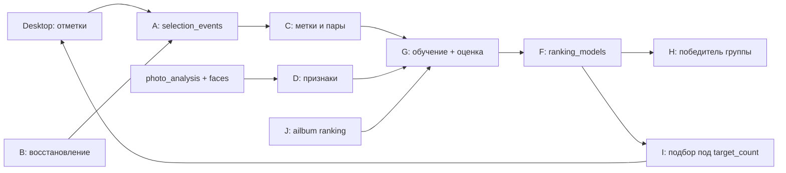
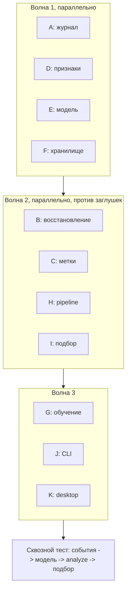

# Обучаемый отбор фотографий: план на ревью

## Summary

Сейчас отбор устроен двумя жёсткими правилами. В группе похожих кадров побеждает кадр
с максимальным `quality` (0.8 резкость + 0.2 экспозиция,
`src/ailbum/pipeline.py:288`). В альбом попадают все победители групп, а
`target_count` при этом не учитывается (`src/ailbum/database.py:1273`). Ручные
правки в desktop копятся в `photo_selections`, но при снятии отметки строка удаляется,
и отрицательный сигнал теряется. План: (0) записывать каждое решение пользователя,
(1) собирать единый вектор признаков кадра, (2) обучить попарный ранкер для выбора
лучшего кадра в группе, (3) подбирать набор ровно под `target_count` с учётом
разнообразия. Всё работает локально на NumPy, без новых зависимостей. Пока данных
мало или модель не обыгрывает текущее правило, поведение не меняется.

## What you will get

- Журнал `selection_events`: каждое добавление и снятие кадра с отметкой, кто это
  сделал (анализатор или человек). Для старых баз журнал однократно восстанавливается
  из существующих запусков.
- Команды `ailbum ranking train`, `ailbum ranking status` и `ailbum ranking evaluate`.
  Они обучают модели на ваших решениях, показывают объём данных и сравнивают модель
  с текущим правилом на отложенных запусках.
- Новый `analyze` выбирает лучший кадр в группе по модели, если она активна. Иначе
  остаётся `max(quality)`. В манифесте записано, чем был сделан выбор.
- Первичный выбор в desktop заполняется ровно `target_count` кадрами, а не всеми
  победителями групп: по оценке модели, не больше похожих кадров подряд, с покрытием
  сюжетов.
- Кнопка "Дополнить автоматически" в ленте выбора: заполняет свободные места до
  `target_count` и не трогает ручные кадры.

## What will be built

| Part | What it does (one sentence) | Size | Built by |
|---|---|---|---|
| A. Журнал решений | Таблица `selection_events` (схема v11) и запись в неё из `set_desktop_favorite` и первичного заполнения | S | a careful helper |
| B. Восстановление журнала | Одна миграция: восстанавливает события для старых запусков по разнице между `photo_selections` и `photo_analysis.selected` | S | a careful helper |
| C. Метки | Чистая функция: из событий и итогового выбора строит пары "A лучше B" внутри групп и метки "взят / не взят" по запуску | M | a careful helper |
| D. Признаки | Один вектор признаков кадра (около 20 чисел) с фиксированной версией; одинаково строится из `PhotoRecord` в pipeline и из строк БД при обучении | M | a careful helper |
| E. Модель | Логистическая регрессия с L2 на NumPy: попарный режим для групп, поточечный для альбома; нормализация и веса сериализуются в JSON | M | a careful helper |
| F. Хранилище моделей | Таблица `ranking_models`: тип, версия признаков, веса, метрики, флаг активности | S | a fast helper |
| G. Обучение и оценка | Обучение с оценкой leave-one-run-out; модель активируется, только если не хуже базового правила | M | a careful helper |
| H. Выбор в pipeline | В `analyze` победитель группы выбирается по активной модели, `quality` разбивает ничьи и служит фолбэком | S | a careful helper |
| I. Подбор под цель | Жадный подбор: оценка минус штраф за CLIP-сходство с уже взятыми, сначала по одному кадру на сюжет | M | a careful helper |
| J. CLI | Подкоманды `ranking train / status / evaluate` | S | a fast helper |
| K. Desktop | Действие моста `selection.autofill` и кнопка в `SelectionTray` | S | a careful helper |

## How it fits together

## How it gets built

A идёт до B, потому что миграция пишет в новую таблицу. Остальные части тестируются
на заглушках с фиксированными примерами, поэтому реально ждут друг друга только A,
затем B, а потом сквозной тест.

## Decisions you can change

- Какие группы дают обучающие пары: только те, где человек хотя бы раз что-то менял
  (по умолчанию) | все группы. Если брать все, модель выучит текущее правило,
  потому что нетронутый первичный выбор совпадает с ним.
- Отрицательные метки для альбома: только запуски, где есть хотя бы 5 ручных
  событий (по умолчанию) | все запуски.
- Порог включения ранкера в группе: не меньше 50 пар не меньше чем из 2 запусков
  (по умолчанию) | другое число.
- Условие активации модели: точность leave-one-run-out не ниже `max(quality)` на тех же
  группах (по умолчанию) | активировать всегда.
- Первичный выбор desktop: ровно `target_count` кадров (по умолчанию) | как сейчас,
  все победители групп. Первый вариант меняет поведение и для новых запусков без
  модели: тогда оценкой служит `quality`.
- Разнообразие: штраф за CLIP-сходство 0.5 и по одному кадру на сюжет, пока хватает
  мест (по умолчанию) | без штрафа. Если у запуска нет CLIP-эмбеддингов, разнообразие
  обеспечивается только через `similar_cluster` и сюжет.
- Когда обучать: вручную командой `ailbum ranking train` (по умолчанию) |
  автоматически перед каждым `analyze`.
- Модель: логистическая регрессия на NumPy (по умолчанию) | LightGBM в extra `ml`.
  LightGBM сильнее на нелинейностях, но это новая зависимость, а данных на один
  каталог мало.

## Risks

- Мало данных: сотни меток на одного пользователя. Поэтому модели линейные, с L2,
  есть порог включения и фолбэк на текущее правило.
- Смещение от первичного выбора: человек часто оставляет рекомендацию как есть.
  Поэтому нетронутые кадры не считаются ни положительными, ни отрицательными
  метками; учатся только на явных действиях.
- Утечка между запусками: одно изображение может встречаться в нескольких запусках.
  Оценка делит данные по запускам, а дубликаты по `sha256` попадают целиком либо в
  обучение, либо в проверку.
- Смена признаков: у модели хранится `feature_version`. Несовместимая модель
  игнорируется, и выбор возвращается к `quality`.
- Пропуски: при отсутствии CLIP или лиц соответствующие признаки равны 0, и
  добавляется флаг "нет данных". Модель не падает, а предсказание становится
  менее точным.
- Миграция v10 -> v11 на живой базе: только добавление таблиц и строк. Покрывается
  тестом в стиле существующих тестов миграций (`tests/test_database.py:106`).

## Out of scope

- Обучаемые границы сюжетов. Там глобальная динамическая сегментация
  (`src/ailbum/stories.py:255`), а не решение по парам. Сначала стоит подобрать
  константы через `evaluate-stories`; это отдельный план.
- Обучаемый порог размытия.
- Неявные сигналы: просмотр, время на кадре, открытие серии.
- Общая модель для нескольких пользователей и облачное обучение.
- Изменение кластеризации лиц и похожих кадров.

## How we will know it works

- После добавления и снятия кадра в desktop `ailbum db` показывает два события с
  `source = manual`. Повторное добавление того же кадра событие не пишет.
- На старой базе после открытия появляются восстановленные события. Их число равно
  числу расхождений между `photo_selections` и `selected`.
- `ailbum ranking status` показывает число пар и запусков и сообщает, почему модель
  ещё не обучена.
- На синтетическом каталоге, где человек всегда выбирает кадр с открытыми глазами,
  ранкер после обучения выбирает такой кадр, а `max(quality)` нет.
- `ailbum ranking evaluate` печатает top-1 в группах и precision@target для модели и
  для базового правила на одних и тех же отложенных запусках.
- Новый запуск в desktop открывается ровно с `target_count` кадрами. "Дополнить
  автоматически" после ручных правок сохраняет все ручные кадры.
- Без активной модели `analyze` выбирает те же кадры, что и сейчас. Существующие
  тесты pipeline проходят без изменений.

## Rough time and cost

11 частей: 4 маленькие, 6 средних, 1 маленькая UI. Примерно 1.5-2.5 часа работы
агентов плюс финальное ревью. Оценка грубая, пока машинный план не прошёл lint.
