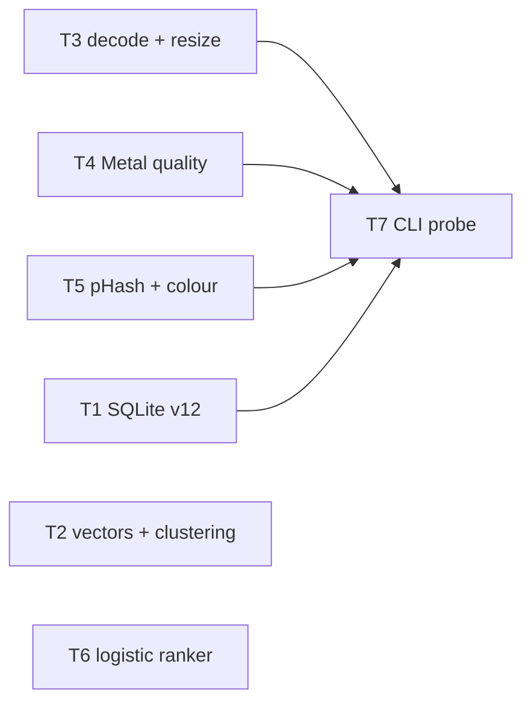
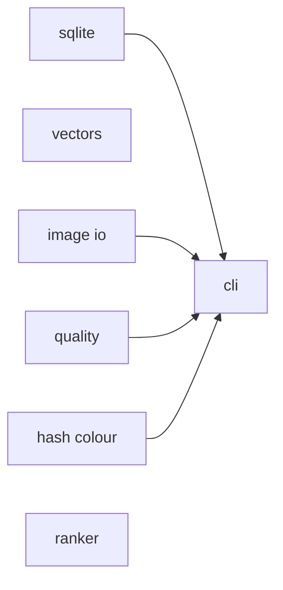

# Swift + Metal migration, phase 1: core foundations

**Goal:** SwiftPM package `swift/` with library `AilbumCore` and CLI `ailbum-swift`, porting SQLite v12 access, image decode, quality metrics (Metal), pHash/colour features, clustering and the logistic ranker with numeric parity to Python.
**Architecture:** one library target + one executable target. Pure value types, no globals except a lazily created `MetalContext.shared`. Metal kernels are Swift string constants compiled at runtime.
**Tech stack:** Swift 6.3 (language mode 5), SwiftPM, Swift Testing, Metal, Accelerate (vDSP/vImage/LAPACK), ImageIO, SQLite3 C API.
**Spec:** docs/plans/2026-11-07-swift-metal-migration-design.md
**Detail:** contracts
**Target-min:** 12

## Global constraints

- Layout: `swift/Package.swift` (tools 6.0, `platforms: [.macOS(.v14)]`, `swiftLanguageModes: [.v5]`), targets `AilbumCore` (links `sqlite3`, resource `Resources/schema.sql` via `.copy`), executable `ailbum-swift` (depends on AilbumCore), test target `AilbumCoreTests`.
- Shared type in `swift/Sources/AilbumCore/Image/RGBImage.swift` (Wave 0): `public struct RGBImage: Equatable { public let width: Int; public let height: Int; public var pixels: [UInt8] }` interleaved RGB, row-major, `pixels.count == width*height*3`, plus `public init(width:height:pixels:)` that precondition-checks the count.
- Error type in `swift/Sources/AilbumCore/AilbumError.swift` (Wave 0): `public enum AilbumError: Error, Equatable { case sqlite(String); case schemaTooOld(Int); case decode(String); case metal(String) }`.
- Test command: `.superlite/test-cmd.json` (full `swift test --package-path swift` with CLT framework flags). Never use XCTest.
- Parity (design section 4): golden values come from running the Python reference on the same synthetic input via `uv run python -c` in the repo root, pasted into the Swift test as literals. Tests build synthetic images in code; never read real photos or `.ailbum/`.
- Python's images are BGR; Swift's are RGB. Gray = `round(0.299 R + 0.587 G + 0.114 B)` to UInt8 (OpenCV BGR2GRAY).
- Do not modify anything outside `swift/`.

## File structure

One file per component, paths as listed in each task's Owns.

## Task graph

```mermaid
%% schedule
gantt
  title Predicted schedule (mm:ss)
  dateFormat X
  axisFormat %M:%S
  section lane 1
  T1 SQLite v12 access :t1, 0, 147s
  T7 CLI probe :t7, 147, 141s
  section lane 2
  T4 Metal quality metrics :t4, 0, 145s
  section lane 3
  T3 Image decode and resize :t3, 0, 142s
  section lane 4
  T2 Vectors and clustering :t2, 0, 123s
  section lane 5
  T5 pHash and colour features :t5, 0, 111s
  section lane 6
  T6 Logistic ranker :t6, 0, 109s
```

critical path: T1 → T7 (4.8 min) · peak width 6 · predicted build 4.8 min · predicted total ≈ 8.3 min (target ✓)

## Package: AilbumCore (library / data pipeline: numeric, encoding, state, file)

**Probe entry:** run=swift run --package-path swift ailbum-swift

### T1 SQLite v12 access · Complexity 5 · Est. context 40k
**Owns:** swift/Sources/AilbumCore/Database/SQLite.swift, swift/Sources/AilbumCore/Database/Schema.swift, swift/Sources/AilbumCore/Resources/schema.sql, swift/Tests/AilbumCoreTests/DatabaseTests.swift
**Components:** 2
**LOC owned:** 260
**Tests:** fast
**Model:** sonnet
**Consumes:** none
**Produces:** Database.open(path: String) throws -> Database · Database.execute(_ sql: String, _ args: [SQLValue]) throws -> Void · Database.query(_ sql: String, _ args: [SQLValue]) throws -> [[String: SQLValue]] · Database.userVersion() throws -> Int · Database.transaction(_ body: () throws -> Void) throws -> Void
e.g. `try Database.open(path: tmp).userVersion()` -> `12`
e.g. `try db.query("SELECT COUNT(*) AS n FROM images", [])` -> `[["n": .integer(0)]]`
**Review Focus:** `testRejectsOldSchema`: a file with `PRAGMA user_version = 11` and table `images(id, missing)` throws `AilbumError.schemaTooOld(11)`; `testTransactionRollback`: body throwing after an INSERT leaves 0 rows; `testUnicodePath`: path `.../Фото альбом/a.sqlite3` opens; `testBlobRoundTrip`: `.blob(Data([0,255,1]))` reads back identical.
**Test code:** `testFreshSchema`: open new path -> userVersion 12, `sqlite_master` contains tables albums, images, faces, people, layouts, selection_events, ranking_models; `testForeignKeysOn`: `PRAGMA foreign_keys` -> 1; `testWAL`: `PRAGMA journal_mode` -> "wal"; `testOpenV12Twice`: second open keeps rows.
**Steps:** 1 failing tests, 2 run: FAIL, 3 implement, 4 run: PASS
**Notes:** `SQLValue` enum: `null, integer(Int64), real(Double), text(String), blob(Data)`, Equatable. `schema.sql` = the `SCHEMA` string of `src/ailbum/database.py` copied verbatim (extract with a one-off `uv run python -c "from ailbum.database import SCHEMA; print(SCHEMA)"`) plus `CREATE INDEX IF NOT EXISTS idx_images_availability ON images(availability);`. Open order: create parent dir, `foreign_keys=ON`, `journal_mode=WAL`; if `user_version` is between 1 and 11 throw `schemaTooOld` (legacy DBs are migrated once by Python 0.3); else run schema.sql and set `user_version=12`. `Database` is a final class closing the handle in deinit.

### T2 Vectors and clustering · Complexity 2 · Est. context 26k
**Owns:** swift/Sources/AilbumCore/Vectors.swift, swift/Tests/AilbumCoreTests/VectorsTests.swift
**Components:** 2
**LOC owned:** 130
**Tests:** fast
**Kind:** mechanical
**Model:** haiku
**Consumes:** none
**Produces:** Vectors.encode(_ v: [Float]) -> Data? · Vectors.decode(_ d: Data, dimension: Int) -> [Float] · Vectors.clusterCosine(_ features: [[Float]], threshold: Float) -> [[Int]]
**Review Focus:** `testDecodeZeroVector`: decode of 4 zero floats returns 4 zeros (no NaN); `testCompleteLinkNoChain`: features `[1,0]`, `[0.8,0.6]`, `[0.28,0.96]` threshold 0.75 -> `[[0,1],[2]]`.
**Test code:** `testEncodeEmpty`: `encode([])` -> nil; `testRoundTrip`: `decode(encode([3,4])!, dimension: 2)` -> `[0.6, 0.8]` (normalized, accuracy 1e-6); `testLittleEndianBytes`: `encode([1])!` == `Data([0,0,128,63])`; `testClusterEmpty`: `[]` -> `[]`; `testClusterIdentical`: `[[1,0],[2,0],[0,1]]`, 0.9 -> `[[0,1],[2]]`; `testUnionFindComponents`: union(0,2), union(3,4) on 5 -> `[[0,2],[1],[3,4]]`.
**Steps:** 1 failing tests, 2 run: FAIL, 3 implement, 4 run: PASS
**Notes:** port `src/ailbum/cv/clustering.py` and `_encode_embedding`/`_decode_embedding` from `src/ailbum/database.py` line for line. Ties: first pair found in (left, right) scan order with `>=` replaces the best, exactly as Python. Expose `public struct UnionFind` with `find`, `union`, `components()`.

### T3 Image decode and resize · Complexity 4 · Est. context 36k
**Owns:** swift/Sources/AilbumCore/Image/ImageLoader.swift, swift/Sources/AilbumCore/Image/Resize.swift, swift/Tests/AilbumCoreTests/ImageLoaderTests.swift
**Components:** 2
**LOC owned:** 220
**Tests:** fast
**Model:** sonnet
**Consumes:** none
**Produces:** ImageLoader.load(path: String) throws -> RGBImage · ImageLoader.takenAt(path: String) -> Date? · ImageLoader.discover(root: String, recursive: Bool) -> [String] · Resize.forAnalysis(_ image: RGBImage, maxSide: Int) -> (RGBImage, Double) · Resize.area(_ image: RGBImage, width: Int, height: Int) -> RGBImage
e.g. `Resize.forAnalysis(img4000x3000, maxSide: 1600)` -> `(1600x1200 image, 0.4)`
e.g. `Resize.forAnalysis(img800x600, maxSide: 1600)` -> `(same image, 1.0)`
**Review Focus:** `testOrientation6`: a 4x2 JPEG written with ImageIO and `kCGImagePropertyOrientation = 6` loads as 2x4 with the original top-left pixel at top-right; `testDecodeGarbage`: bytes "nope" in `x.jpg` throws `AilbumError.decode`; `testDiscoverSuffixes`: dir with `a.JPG`, `b.webp`, `c.txt`, `sub/d.tiff` -> sorted `[a.JPG, b.webp, sub/d.tiff]` (non-recursive: no sub); `testAreaParity`: 6x4 gradient `pixels[i] = UInt8((i*37) % 256)` area-resized to 3x2 equals the `cv2.resize(..., INTER_AREA)` golden output exactly (integer factor).
**Test code:** `testRoundScale`: 1001x500, maxSide 500 -> width 500, height 250, scale 500/1001; `testTakenAtExif`: JPEG with `DateTimeOriginal "2024:05:01 10:20:30"` -> local `Date` 2024-05-01 10:20:30; `testTakenAtFallback`: no EXIF -> file mtime.
**Steps:** 1 failing tests, 2 run: FAIL, 3 implement, 4 run: PASS
**Notes:** decode with `CGImageSourceCreateThumbnailAtIndex` using `kCGImageSourceCreateThumbnailWithTransform: true` and `kCGImageSourceThumbnailMaxPixelSize` = max(w,h) so orientation is applied; draw into an sRGB 8-bit RGBX `CGContext`, drop X. Suffixes `jpg jpeg png webp tif tiff` case-insensitive, paths returned sorted by full path. `Resize.area` = OpenCV INTER_AREA: exact box average for integer factors, fractional pixel-coverage weights otherwise, result rounded to UInt8. `forAnalysis`: `scale = min(1, maxSide/max(w,h))`, size `round(w*scale)` (Python banker's rounding is irrelevant: use `.toNearestOrEven`).

### T4 Metal quality metrics · Complexity 6 · Est. context 42k
**Owns:** swift/Sources/AilbumCore/Metal/MetalContext.swift, swift/Sources/AilbumCore/CV/Quality.swift, swift/Tests/AilbumCoreTests/QualityTests.swift
**Components:** 2
**LOC owned:** 240
**Tests:** fast
**Model:** sonnet
**Consumes:** Resize.forAnalysis(_ image: RGBImage, maxSide: Int) -> (RGBImage, Double) (T3)
**Produces:** Quality.sharpness(_ image: RGBImage, maxSide: Int) throws -> Double · Quality.exposure(_ image: RGBImage, maxSide: Int) -> Double · Quality.score(sharpness: Double, exposure: Double) -> Double
e.g. `Quality.score(sharpness: 1000, exposure: 1)` -> `1.0`
e.g. `Quality.score(sharpness: 0, exposure: 0.5)` -> `0.1`
**Review Focus:** `testSharpnessUniform`: 64x64 all 128 -> 0.0; `testSharpnessParity`: 64x48 image with `R=G=B=UInt8((x*x + 3*y) % 256)` matches Python `sharpness_score` golden within rel 1e-3; `testExposureParity`: same image vs `exposure_score` within 1e-4; `testExposureBlack`: 16x16 black -> 0.0; `testNegativeSharpnessClamped`: `score(sharpness: -5, exposure: 1)` -> 0.2.
**Test code:** as Review Focus plus `testMetalAvailable`: `MetalContext.shared` creates a pipeline for kernel `laplacian` without throwing.
**Steps:** 1 failing tests, 2 run: FAIL, 3 implement, 4 run: PASS
**Notes:** sharpness pipeline (match `src/ailbum/cv/quality.py`): resize maxSide (default 1600), gray UInt8, 3x3 Gaussian (OpenCV sigma for ksize 3: kernel [1,2,1]/4 separable, rounded back to UInt8), Laplacian ksize 1 kernel [[0,1,0],[1,-4,1],[0,1,0]] in float, variance over all pixels. OpenCV border is BORDER_REFLECT_101 for both filters; implement it in the kernel. Blur + Laplacian in Metal compute kernels (float32 buffers), variance reduced in Double on CPU with vDSP. Exposure on CPU: L of OpenCV 8-bit BGR2LAB (sRGB gamma removal, `Y = 0.212671R+0.715160G+0.072169B`, `L = Y>0.008856 ? 116*cbrt(Y)-16 : 903.3*Y`, scaled `L*255/100`, rounded to UInt8) then /255; default maxSide 800. `MetalContext` throws `AilbumError.metal` when no device. Call `Resize.forAnalysis` only when `max(w,h) > maxSide` so tests do not depend on T3.

### T5 pHash and colour features · Complexity 4 · Est. context 32k
**Owns:** swift/Sources/AilbumCore/CV/HashColor.swift, swift/Tests/AilbumCoreTests/HashColorTests.swift
**Components:** 1
**LOC owned:** 170
**Tests:** fast
**Model:** sonnet
**Consumes:** none
**Produces:** HashColor.features(_ image: RGBImage) -> (phash: [Bool], histogram: [Float]) · HashColor.hamming(_ a: [Bool], _ b: [Bool]) -> Int · HashColor.similarity(_ a: [Float], _ b: [Float]) -> Float
e.g. `HashColor.features(black 256x256)` -> `(phash: 64 x false, histogram: [1.0, 0, 0, ...] (384 bins))`
e.g. `HashColor.hamming([true,false,true], [true,true,false])` -> `2`
e.g. `HashColor.similarity([0.6,0.8], [0.6,0.8])` -> `1.0`
**Review Focus:** `testPhashParity`: 32x32 image `R=x*8, G=y*8, B=(x+y)*4` (UInt8) gives the exact 64-bit hash of Python `extract_hash_color_features` (no resize needed); `testHistogramParity`: 256x256 image `R=x, G=y, B=255-x` histogram matches Python within 1e-4 per bin; `testHistogramUnitNorm`: L2 norm 1 within 1e-5; `testBlackImageHistogram`: all-zero image -> bin 0 = 1.0, rest 0.
**Test code:** as Review Focus plus `testLengths`: phash 64, histogram 384.
**Steps:** 1 failing tests, 2 run: FAIL, 3 implement, 4 run: PASS
**Notes:** DCT must equal `cv2.dct` (orthonormal DCT-II, 2D: rows then columns; scale sqrt(1/N) for k=0, sqrt(2/N) otherwise); a direct 32x32 matrix product in Float is fine. Median of `values[1..<64]` (63 values, middle element); hash bit = value > median. HSV = OpenCV 8-bit: H in 0..179 (`H/2`), S,V 0..255; histogram 24 H-bins over [0,180) x 16 S-bins over [0,256), flattened H-major, then L2-normalised (denominator max(norm,1e-8)). Resize to 32x32 and 256x256 with `Resize.area` first; tests use those sizes so resize is identity; skip the `Resize.area` call when the size already matches so tests do not depend on T3.

### T6 Logistic ranker · Complexity 4 · Est. context 30k
**Owns:** swift/Sources/AilbumCore/Ranking/LogisticModel.swift, swift/Tests/AilbumCoreTests/LogisticModelTests.swift
**Components:** 1
**LOC owned:** 150
**Tests:** fast
**Model:** sonnet
**Consumes:** none
**Produces:** LogisticModel.fit(x: [[Double]], y: [Double], l2: Double) -> LogisticModel · LogisticModel.score(_ x: [[Double]]) -> [Double] · LogisticModel.toJSON() -> [String: Any] · LogisticModel.fromJSON(_ d: [String: Any]) throws -> LogisticModel
**Review Focus:** `testFitParity`: x `[[0,1],[1,0],[2,2],[3,1],[0,0],[4,3]]`, y `[0,0,1,1,0,1]`, l2 1.0 -> weights, bias, mean, std equal Python `LogisticModel.fit` within 1e-8; `testConstantFeature`: a constant column gets std 1.0, no NaN; `testScoreClip`: input giving logit 1000 scores exactly `1/(1+exp(-30))`; `testJSONFromPython`: a dict produced by Python `to_json()` loads and scores identically.
**Test code:** as Review Focus plus `testJSONKeys`: keys `weights, bias, mean, std, feature_version, feature_names`.
**Steps:** 1 failing tests, 2 run: FAIL, 3 implement, 4 run: PASS
**Notes:** port `src/ailbum/ranking/model.py` exactly: population std (ddof 0), 50 Newton steps, stop when max |step| < 1e-8, bias unpenalised, `1e-9*I` jitter; solve with Accelerate `dgesv_` or Gaussian elimination with partial pivoting. `feature_version` and `feature_names` are stored as given (defaults 0 and `[]` in Swift; the Python feature constants port in phase 4).

### T7 CLI probe · Complexity 3 · Est. context 30k
**Owns:** swift/Sources/ailbum-swift/main.swift, swift/Tests/AilbumCoreTests/CLITests.swift
**Components:** 1
**LOC owned:** 120
**Tests:** slow
**Model:** sonnet
**Consumes:** ImageLoader.load(path: String) throws -> RGBImage (T3) · Quality.sharpness(_ image: RGBImage, maxSide: Int) throws -> Double (T4) · Quality.score(sharpness: Double, exposure: Double) -> Double (T4) · HashColor.features(_ image: RGBImage) -> (phash: [Bool], histogram: [Float]) (T5) · Database.open(path: String) throws -> Database (T1) · Database.query(_ sql: String, _ args: [SQLValue]) throws -> [[String: SQLValue]] (T1)
**Produces:** none
**Review Focus:** `testQualityJSON`: `ailbum-swift quality <png>` prints one JSON line with keys `path, width, height, sharpness, exposure, quality, phash` (phash = 16 lowercase hex chars, bit 0 = MSB); `testMissingFile`: exit code 2, stderr starts with `ошибка:`; `testDbStats`: `ailbum-swift db-stats <new db>` prints `{"images":0,"people":0,"albums":0}`; `testUsage`: no args -> exit 64 with usage text.
**Test code:** as Review Focus; tests build the binary path from `swift build --package-path swift --show-bin-path` and run it with `Process`.
**Steps:** 1 failing tests, 2 run: FAIL, 3 implement, 4 run: PASS
**Notes:** also calls `Quality.exposure` (T4). Hand-rolled arg parsing, `JSONSerialization` with `.sortedKeys`.

## Predicted schedule

## Review Focus

- AilbumCore (data pipeline): numeric (parity vs Python, border handling, rounding), encoding (blob endianness, Unicode paths), state (schema gate, transactions), file (EXIF orientation, unreadable files). 

## Self-review

Coverage: section 1 decisions and section 2 toolchain facts are Global constraints; phase 1 of section 3 maps to T1-T7; section 4 parity is in every numeric task; geometry, models, pipeline and app are later plans. Every Consumes matches a Produces. Edges only to T7 (integration, runs real code).
