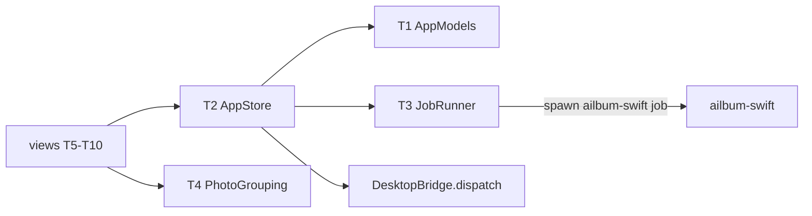
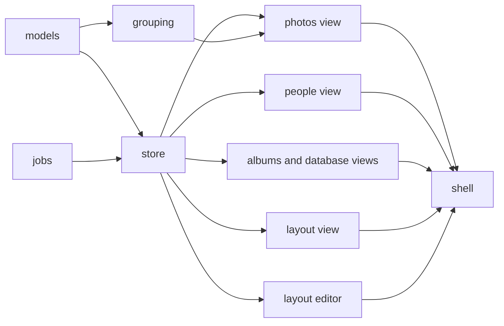

# Swift + Metal migration, phase 5b: native SwiftUI app

**Goal:** replace the Electron app (desktop/src/App.tsx, AlbumManager.tsx, layout/*.tsx, electron/main.cjs) with a native SwiftUI app `AilbumApp` that has the same four sections (Отбор фотографий, Люди и лица, Раскладка, Альбомы) plus the database manager, calling `DesktopBridge.dispatch` in-process and running jobs as `ailbum-swift job` subprocesses.
**Architecture:** testable core in `swift/Sources/AilbumCore/UI/` (Codable models, `AppStore` state + actions, `JobRunner`, `PhotoGrouping`); views only in `swift/Sources/AilbumApp/`, one file per section. Views never touch the db directly: every action is a `store` method that mirrors one `window.ailbum.*` call in desktop/electron/preload.cjs and the matching handler in main.cjs.
**Tech stack:** Swift 6.3 (mode 5), SwiftUI + Observation (macOS 14), AppKit panels, ImageIO, Swift Testing.
**Spec:** docs/plans/2026-11-07-swift-metal-migration-design.md
**Detail:** contracts
**Target-min:** 14

## Global constraints

- Phase 1-5a rules hold: Russian UI texts copied verbatim from the .tsx/.cjs source, temp dirs and synthetic data only, never read `.ailbum` or real photos, never touch the real Trash or network, edit only `swift/`.
- Existing APIs are called, never edited: `DesktopBridge.dispatch(database:action:payload:)`, `DesktopJob.*`, `LibraryBrowser.create(database:)`, `JSONValue`, `Database`.
- Payload keys are the snake_case keys main.cjs sends (`album_id`, `image_id`, `spread_id`, `cell_index`...). Models are `public struct ...: Codable, Equatable, Sendable` with field names from desktop/src/types.ts (snake_case via CodingKeys or `.convertFromSnakeCase`), decoded from `JSONValue` by `AppModels.decode`.
- Core types in AilbumCore are `public`; AilbumCore never imports SwiftUI (Observation and AppKit are allowed).
- Test seams: internal `nonisolated(unsafe) static var` in the task's own file, suites `.serialized`.
- Verify: `swift test --package-path swift -Xswiftc -F/Library/Developer/CommandLineTools/Library/Developer/Frameworks -Xlinker -F/Library/Developer/CommandLineTools/Library/Developer/Frameworks -Xlinker -rpath -Xlinker /Library/Developer/CommandLineTools/Library/Developer/Frameworks -Xlinker -rpath -Xlinker /Library/Developer/CommandLineTools/Library/Developer/usr/lib --filter <Suite>`; view tasks verify with `swift build --package-path swift --product AilbumApp` plus the first two -F flags above.

## File structure

Core: `swift/Sources/AilbumCore/UI/{AppModels,AppStore,JobRunner,PhotoGrouping}.swift`, tests `swift/Tests/AilbumCoreTests/{AppModels,AppStore,JobRunner,PhotoGrouping}Tests.swift`. Views: `swift/Sources/AilbumApp/{PhotosSection,PeopleSection,AlbumsSection,DatabaseSection,LayoutSection,LayoutEditor,AppShell}.swift`; `AilbumApp.swift` and `LibraryViews.swift` are replaced by T10.

## Task graph

```mermaid
%% schedule
gantt
  title Predicted schedule (mm:ss)
  dateFormat X
  axisFormat %M:%S
  section lane 1
  T1 App models :t1, 0, 139s
  T2 App store :t2, 139, 168s
  T7 Albums and database sections :t7, 307, 155s
  T10 App shell :t10, 462, 110s
  section lane 2
  T3 Job runner :t3, 0, 113s
  T4 Photo grouping :t4, 139, 118s
  T5 Photos section :t5, 307, 144s
  section lane 3
  T8 Layout section :t8, 307, 141s
  section lane 4
  T9 Layout editor :t9, 307, 136s
  section lane 5
  T6 People section :t6, 307, 128s
```

critical path: T1 → T2 → T7 → T10 (9.5 min) · peak width 5 · predicted build 9.5 min · predicted total ≈ 13.0 min (target ✓)

Ruling: sequential - Swift views cannot compile against unwritten types, so views wait for the core and the shell waits for the views - cost: about one task length of extra wall time.

## Core

**Probe entry:** call=AilbumCore.AppStore

### T1 App models · Complexity 3 · Est. context 40k
**Owns:** swift/Sources/AilbumCore/UI/AppModels.swift, swift/Tests/AilbumCoreTests/AppModelsTests.swift
**Components:** 1
**LOC owned:** 380
**Tests:** fast
**Model:** sonnet
**Consumes:** DesktopBridge.dispatch, JSONValue
**Produces:** AppModels.decode<T: Decodable>(_ type: T.Type, _ value: JSONValue) throws -> T · structs Photo, Story, Album, Usage, ArchiveResult, Library, DatabaseSummary, LayoutParams, LayoutPreflight, LayoutTemplateInfo, LayoutAlternative, LayoutVariant, LayoutPromptInfo, LayoutPlacement, LayoutCell, LayoutSpread, Layout, FavoriteResult, PersonSummary, Face, PeopleLibrary, FaceCollection (every type in desktop/src/types.ts except DatabaseJob)
e.g. `decode(Library.self, dispatch(db, "library.bootstrap", [:]))` on a temp db with 2 indexed images -> `library.photos.count == 2`, `library.album == nil`
e.g. `decode(Album.self, ["id": 1, "title": "Турция", "status": "draft", ...])` -> `Album(id: 1, title: "Турция", status: .draft, ...)`
**Review Focus:** encoding - optional fields (`| null`) are optionals; string unions are enums with raw values; `Record<string, unknown>` is `[String: JSONValue]`; decoding never fails on extra keys.
**Steps:** 1 failing tests (decode bootstrap, album list, people bootstrap, layout.get on temp dbs built via existing test helpers; one test per union enum), 2 FAIL, 3 implement, 4 PASS
**Notes:** reuse the db fixtures pattern of DesktopBridgeTests.swift. `LayoutParams` is also Encodable to the exact keys LayoutWizard.tsx sends.

### T3 Job runner · Complexity 4 · Est. context 32k
**Owns:** swift/Sources/AilbumCore/UI/JobRunner.swift, swift/Tests/AilbumCoreTests/JobRunnerTests.swift
**Components:** 1
**LOC owned:** 180
**Tests:** fast
**Model:** sonnet
**Consumes:** Process, JSONValue
**Produces:** struct JobState(status: JobStatus, kind: String?, stage: String?, detail: String, current: Int?, total: Int?, error: String?, result: JSONValue?) · enum JobStatus { idle, running, complete, error } · final class JobRunner(executable: URL) with start(kind: String, database: String, sources: [String], albumId: Int?, params: JSONValue?, onUpdate: @escaping @Sendable (JobState) -> Void) throws, cancel(), var isRunning: Bool · JobRunner.defaultExecutable() -> URL (sibling `ailbum-swift` of Bundle.main.executableURL)
e.g. start(kind: "index", ...) first update -> `JobState(status: .running, kind: "index", stage: "Подготовка добавления", detail: "")`
e.g. stdout line `{"type":"progress","stage":"Анализ","current":3,"total":10}` -> update `stage "Анализ", current 3, total 10`
e.g. exit code 2 after `{"type":"error","error":"Нет фото"}` -> `status .error, error "Нет фото"`
**Review Focus:** state, protocol - port startDatabaseJob in main.cjs line by line: argument list, stage labels, non-JSON line becomes `detail`, stderr tail fallback, "Фоновый процесс завершился с кодом N", second start while running throws "Уже выполняется добавление или анализ фотографий", cancel terminates and suppresses the exit update.
**Steps:** 1 failing tests driving a temp `/bin/sh` script as the executable, 2 FAIL, 3 implement, 4 PASS
**Notes:** read lines on a background queue; `--models-dir` comes from `AILBUM_MODELS_DIR` or `ModelStore` default, as main.cjs runtimeModelsPath.

### T4 Photo grouping · Complexity 4 · Est. context 38k
**Owns:** swift/Sources/AilbumCore/UI/PhotoGrouping.swift, swift/Tests/AilbumCoreTests/PhotoGroupingTests.swift
**Components:** 1
**LOC owned:** 220
**Tests:** fast
**Model:** sonnet
**Consumes:** Photo, Story, AppModels.decode (T1)
**Produces:** PhotoGrouping.dateLabel(_ value: String) -> String · PhotoGrouping.storyPeriodLabel(_ story: Story) -> String · PhotoGrouping.score(_ photo: Photo) -> Double · PhotoGrouping.isPortrait(_ photo: Photo) -> Bool · PhotoGrouping.stackRepresentative(_ photos: [Photo]) -> Photo? · PhotoGrouping.columnCount(width: Double) -> Int · PhotoGrouping.sections(photos: [Photo], stories: [Story], expandedSeries: Set<String>) -> [GridSection]
e.g. `columnCount(width: 1200)` -> the value columnCount in App.tsx returns for 1200
e.g. `dateLabel("2026-07-28T20:49:55")` -> ru-RU day label as DAY_FORMAT prints it
**Review Focus:** numeric, encoding - port App.tsx lines 52-135, 1162-1432 helpers exactly (series key, stack order, story header rows); ru_RU locale fixed, time zone of the string kept.
**Steps:** 1 failing tests with values worked out from the TS code, 2 FAIL, 3 implement, 4 PASS

### T2 App store · Complexity 6 · Est. context 55k
**Owns:** swift/Sources/AilbumCore/UI/AppStore.swift, swift/Tests/AilbumCoreTests/AppStoreTests.swift
**Components:** 2
**LOC owned:** 420
**Tests:** fast
**Model:** sonnet
**Consumes:** AppModels.decode (T1) · JobRunner, JobState (T3) · DesktopBridge.dispatch
**Produces:** @MainActor @Observable public final class AppStore(database: String?, jobRunner: JobRunner) with state `database, library, albums, usage, people, error, job: JobState, pending: Set<Int>` and async methods, one per preload.cjs entry: openDatabase(path:), createDatabase(path:), bootstrap(albumId:), setFavorite, setTarget, autofill, listAlbums, setAlbumStatus, renameAlbum, deleteAlbum, archiveAlbum(chooseFolder: () async -> URL?), confirmMissing, getUsage, getPeople, getFaces, setPersonName, mergePerson, assignFace, createPersonFromFace, getDatabaseSummary, startDatabaseJob(kind:sources:), cancelDatabaseJob, layout* (all 15 layout entries, startLayout via job kind "layout"), exportLayout · AppStore.thumbnail(imageId: Int) async -> CGImage? · AppStore.original(imageId: Int) async -> CGImage? · AppStore.faceThumbnail(faceId: Int) async -> CGImage?
**Review Focus:** state, file - bridge calls run off the main actor; `database:choose/create` refuse while a job runs ("Дождитесь завершения текущей операции"); bootstrap resets media maps; archive flow exactly as main.cjs album:archive with a `trashItem` seam (tests never touch the real Trash); thumbnails 720x480 via ImageIO, NSCache limit 300 as THUMBNAIL_CACHE_LIMIT; face thumbnails from `face.thumbnail` base64; last database in UserDefaults key `ailbum.database`.
**Steps:** 1 failing tests (bootstrap, favorite toggle, album rename/delete, archive with fake trash, job refusal) on temp dbs, 2 FAIL, 3 implement, 4 PASS
**Notes:** App.tsx state handlers (lines 136-390) define what each action reloads afterwards; port that, e.g. setFavorite updates the photo in `library` and `pending`.

## Views

**Probe entry:** run=swift build --package-path swift --product AilbumApp

All view tasks: SwiftUI only, `@Bindable var store: AppStore`, layout and texts from the named .tsx, no tests, verify with the build command; Kind design, Tests fast, Model sonnet, Components 1.

### T5 Photos section · Complexity 5 · Est. context 50k
**Owns:** swift/Sources/AilbumApp/PhotosSection.swift
**Components:** 1
**LOC owned:** 420
**Tests:** fast
**Model:** sonnet
**Consumes:** AppStore (T2) · PhotoGrouping.sections (T4)
**Produces:** struct PhotosSection: View (init(store: AppStore))
**Review Focus:** state - port VirtualPhotoGrid, PhotoCard, PhotoViewer, SelectionTray, EmptyState and the target/autofill toolbar of App.tsx (lines 393-636, 1147-1720); LazyVGrid with sections, thumbnails loaded by `.task` per cell, viewer as sheet with arrow-key navigation, missing photos confirm.
**Steps:** 1 implement, 2 build: PASS

### T6 People section · Complexity 4 · Est. context 40k
**Owns:** swift/Sources/AilbumApp/PeopleSection.swift
**Components:** 1
**LOC owned:** 300
**Tests:** fast
**Model:** sonnet
**Consumes:** AppStore (T2)
**Produces:** struct PeopleSection: View (init(store: AppStore))
**Review Focus:** state - port PeopleEditor and FaceCard (App.tsx 819-1146): person list, rename, merge confirm, unassigned faces, assign / create person, pending faces.
**Steps:** 1 implement, 2 build: PASS

### T7 Albums and database sections · Complexity 4 · Est. context 42k
**Owns:** swift/Sources/AilbumApp/AlbumsSection.swift, swift/Sources/AilbumApp/DatabaseSection.swift
**Components:** 2
**LOC owned:** 320
**Tests:** fast
**Model:** sonnet
**Consumes:** AppStore (T2)
**Produces:** struct AlbumsSection: View (init(store: AppStore)) · struct DatabaseSection: View (init(store: AppStore))
**Review Focus:** state, file - AlbumManager.tsx (status, rename, delete with forget, archive result note, usage) and DatabaseManager (App.tsx 638-818): NSOpenPanel/NSSavePanel with sqlite3/sqlite/db, folder chooser with multi-select and drag-and-drop of folders, job progress bar and Отменить.
**Steps:** 1 implement, 2 build: PASS

### T8 Layout section · Complexity 5 · Est. context 48k
**Owns:** swift/Sources/AilbumApp/LayoutSection.swift
**Components:** 1
**LOC owned:** 400
**Tests:** fast
**Model:** sonnet
**Consumes:** AppStore (T2)
**Produces:** struct LayoutSection: View (init(store: AppStore)) · struct SpreadView: View (init(store: AppStore, spread: LayoutSpread, onSelectCell: (Int) -> Void))
**Review Focus:** state - port LayoutSection, LayoutWizard (preflight, prompt labels), LayoutViewer, AlbumPreview, SpreadView (cells placed by normalized rects, crop applied); export reveals the folder with NSWorkspace.
**Steps:** 1 implement, 2 build: PASS
**Notes:** LayoutSection shows `LayoutEditor(store:spread:)` from T9 for a chosen spread; until T9 lands, reference it by that exact name.

### T9 Layout editor · Complexity 5 · Est. context 45k
**Owns:** swift/Sources/AilbumApp/LayoutEditor.swift
**Components:** 1
**LOC owned:** 360
**Tests:** fast
**Model:** sonnet
**Consumes:** AppStore (T2)
**Produces:** struct LayoutEditor: View (init(store: AppStore, spread: LayoutSpread))
**Review Focus:** state - port LayoutEditor.tsx: alternatives, similar, variants, swap by drag, template switch, crop drag, recompose with prompt; draws cells itself (does not use SpreadView).
**Steps:** 1 implement, 2 build: PASS

### T10 App shell · Complexity 3 · Est. context 34k
**Owns:** swift/Sources/AilbumApp/AppShell.swift, swift/Sources/AilbumApp/AilbumApp.swift, swift/Sources/AilbumApp/LibraryViews.swift
**Components:** 1
**LOC owned:** 160
**Tests:** fast
**Model:** sonnet
**Consumes:** PhotosSection, PeopleSection, AlbumsSection, DatabaseSection, LayoutSection (T5-T8) · AppStore (T2)
**Produces:** struct AppShell: View (init(store: AppStore))
**Review Focus:** state - NavigationSplitView sidebar with the four section titles from App.tsx line 446 plus database manager, album picker, error banner, job progress strip; keep the AppDelegate activation fix in AilbumApp.swift; delete LibraryViews.swift (git rm).
**Steps:** 1 implement, 2 build: PASS, 3 full test suite: PASS

## Review Focus

- Core (state, protocol, file): store actions send the same actions and keys as main.cjs; job events and errors as main.cjs; no real Trash.
- Views (state, encoding): Russian texts verbatim; nothing blocks the main thread; no direct db access.

## Self-review

Ruling: views call the bridge in-process through AppStore, jobs stay subprocesses - cancel stays "terminate", same as 5a - cost: needs `ailbum-swift` next to the app binary (5c bundles it).
Ruling: no UI tests; view tasks are accepted on a clean build plus the core tests - cost: view bugs surface in manual use.
