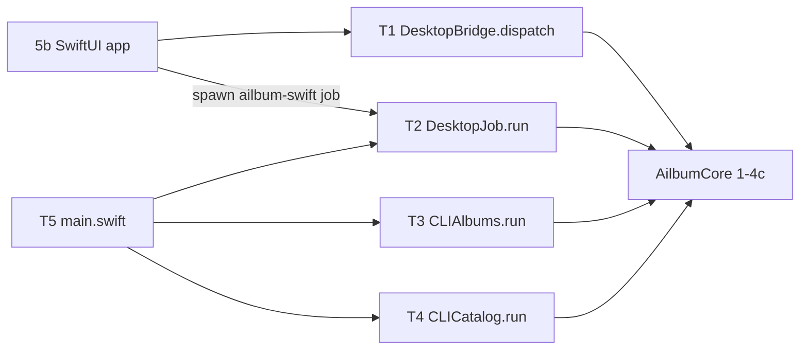
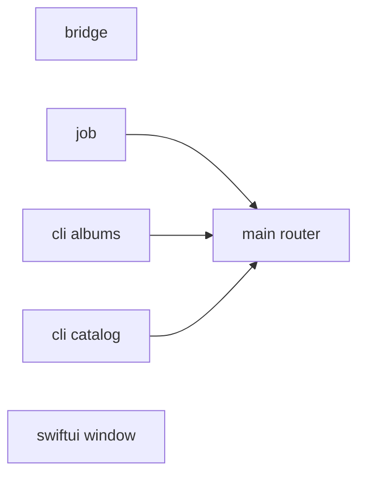

# Swift + Metal migration, phase 5a: desktop bridge, jobs, CLI

**Goal:** port src/ailbum/desktop_bridge.py, desktop_job.py and cli.py to Swift so the SwiftUI app (5b) and the command line run without Python; port tests/test_desktop_bridge.py, test_layout_bridge.py, test_cli_albums.py.
**Architecture:** new folder `swift/Sources/AilbumCore/App/`, one enum namespace per Python module. The bridge keeps the Python action strings and `JSONValue` payloads, so 5b view models call `DesktopBridge.dispatch` exactly where React called `window.ailbum.*`. Jobs keep the JSON-lines event protocol and run as `ailbum-swift job ...` subprocesses, so cancel stays "terminate the process". CLI handlers live in the library (testable with injected `out`/`input` closures); `main.swift` only routes.
**Tech stack:** Swift 6.3 (mode 5), Foundation, Swift Testing.
**Spec:** docs/plans/2026-11-07-swift-metal-migration-design.md
**Detail:** contracts
**Target-min:** 12

## Global constraints

- Phase 1-4c rules hold: port rule, Russian messages verbatim, `AilbumError.invalid` for ValueError, temp dirs and synthetic data only, never read `.ailbum` or real photos, never touch the real Trash or network, edit only `swift/`. Each task ports its named pytest tests one to one (lowerCamelCase, same inputs and asserted values, unique names in the test target).
- Existing APIs are called, never edited: `AlbumLibrary.*`, `Albums.*`, `Archive.*`, `Forget.*`, `PeopleStore.*`, `CatalogQueries.*`, `Proxies.*`, `Catalog.indexLibrary`, `Pipeline.analyzeLibrary`, `LayoutService.*`, `Editing.*`, `LayoutStore.loadLayout`, `LayoutExport.exportOriginals`, `Templates.*`, `RankingTrain.*`, `StoryEvaluation.*`, `Compare.images`, `ModelStore.available`.
- JSON output: `JSONValue` encoded UTF-8 unescaped, keys sorted (ruling from 4a). Bridge responses are one compact line; CLI `_dump` is pretty-printed with 2-space indent.
- Test seams: internal `nonisolated(unsafe) static var` overrides in the task's own file, suites `.serialized`.
- Verify: `swift test --package-path swift -Xswiftc -F/Library/Developer/CommandLineTools/Library/Developer/Frameworks -Xlinker -F/Library/Developer/CommandLineTools/Library/Developer/Frameworks -Xlinker -rpath -Xlinker /Library/Developer/CommandLineTools/Library/Developer/Frameworks -Xlinker -rpath -Xlinker /Library/Developer/CommandLineTools/Library/Developer/usr/lib --filter <Suite>`.

## File structure

`swift/Sources/AilbumCore/App/{DesktopBridge,DesktopJob,CLIAlbums,CLICatalog}.swift`, tests `swift/Tests/AilbumCoreTests/{DesktopBridge,DesktopJob,CLIAlbums,CLICatalog}Tests.swift`, router `swift/Sources/ailbum-swift/main.swift`.

## Task graph

```mermaid
%% schedule
gantt
  title Predicted schedule (mm:ss)
  dateFormat X
  axisFormat %M:%S
  section lane 1
  T4 CLI catalog :t4, 0, 136s
  T5 Main router :t5, 136, 93s
  section lane 2
  T1 Desktop bridge :t1, 0, 128s
  section lane 3
  T2 Desktop job :t2, 0, 121s
  section lane 4
  T3 CLI albums :t3, 0, 119s
```

critical path: T4 → T5 (3.8 min) · peak width 4 · predicted build 3.8 min · predicted total ≈ 7.3 min (target ✓)

## Bridge and jobs

**Probe entry:** call=AilbumCore.DesktopBridge.dispatch

### T1 Desktop bridge · Complexity 5 · Est. context 40k
**Owns:** swift/Sources/AilbumCore/App/DesktopBridge.swift, swift/Tests/AilbumCoreTests/DesktopBridgeTests.swift
**Components:** 1
**LOC owned:** 300
**Tests:** fast
**Model:** sonnet
**Consumes:** existing APIs listed in Global constraints
**Produces:** DesktopBridge.dispatch(database: String, action: String, payload: JSONValue) throws -> JSONValue · DesktopBridge.respond(database: String, line: String) -> String
e.g. `dispatch(database: db, action: "ping", payload: [:])` -> `["ok": true]`
e.g. `respond(database: db, line: "{\"id\":7,\"action\":\"nope\"}")` -> `{"error":"Unknown desktop action: nope","id":7}`
e.g. `dispatch(database: db, action: "layout.get", payload: ["album_id": 1])` -> `.null` when no layout
**Review Focus:** protocol, encoding - port all 8 tests of tests/test_desktop_bridge.py and test_bridge_routes_all_layout_actions, test_dispatch_preflight_builds_params, test_dispatch_layout_get_null, test_dispatch_templates of tests/test_layout_bridge.py; every action name and payload key identical to desktop_bridge.py; prompt cut to MAX_PROMPT code points; `face.thumbnail` base64; `respond` never throws, a non-object line gives `"id": null`.
**Steps:** 1 failing tests, 2 run: FAIL, 3 implement, 4 run: PASS
**Notes:** port desktop_bridge.py whole except argparse/stdin loop; `respond` is one JSON-lines round trip. Routing test may use an internal seam that records calls.

### T2 Desktop job · Complexity 5 · Est. context 38k
**Owns:** swift/Sources/AilbumCore/App/DesktopJob.swift, swift/Tests/AilbumCoreTests/DesktopJobTests.swift
**Components:** 1
**LOC owned:** 240
**Tests:** fast
**Model:** sonnet
**Consumes:** Catalog.indexLibrary, Pipeline.analyzeLibrary, Albums.attachRun, LayoutService.generate, PipelineConfig
**Produces:** DesktopJob.run(_ args: [String], emit: (JSONValue) -> Void) -> Int32 · DesktopJob.progressEvent(_ message: String, defaultStage: String) -> JSONValue · DesktopJob.layoutParams(_ raw: String) throws -> LayoutParams
e.g. `progressEvent("[3/10] a.jpg", defaultStage: "Анализ фотографий")` -> `["type": "progress", "stage": "Анализ фотографий", "current": 3, "total": 10, "detail": "a.jpg"]`
e.g. `run(["layout", "--database", db, "--album-id", "1", "--params", "["], emit: e)` -> 2, last event `type` "error"
**Review Focus:** protocol, state - port test_job_parser_accepts_layout_kind, test_invalid_params_json_emits_error_event, test_layout_job_runs_generate_and_reports_progress, test_export_originals_copies_in_album_order, test_analysis_job_attaches_run of tests/test_layout_bridge.py; args `kind --database --source (repeatable) --output --models-dir --album-id --params`; error event text `"<Type>: <message>"` with Python type names (`ValueError`, `TypeError`); index progress `(i, n)` becomes the `[i/n]` event with stage "Добавление фотографий"; analysis reuses the latest completed run's source/output/config.
**Steps:** 1 failing tests, 2 run: FAIL, 3 implement, 4 run: PASS
**Notes:** port desktop_job.py whole; generate/analyze via internal override seams in tests.

## Command line

**Probe entry:** run=swift run --package-path swift ailbum-swift

### T3 CLI albums · Complexity 4 · Est. context 36k
**Owns:** swift/Sources/AilbumCore/App/CLIAlbums.swift, swift/Tests/AilbumCoreTests/CLIAlbumsTests.swift
**Components:** 1
**LOC owned:** 230
**Tests:** fast
**Model:** sonnet
**Consumes:** Albums.*, Archive.*, Forget.*, RankingTrain.*, LayoutExport.exportOriginals
**Produces:** CLIAlbums.run(_ args: [String], out: (String) -> Void, input: () -> String?) throws -> Int32?
e.g. `run(["album", "list", "--database", db], out: o, input: { nil })` -> 0, o got "1\tdraft\tТурция 2026\t0/5"
e.g. `run(["index", "x"], out: o, input: { nil })` -> nil (not an album command)
**Review Focus:** protocol, state - port tests 1-8 of tests/test_cli_albums.py (all but test_analyze_attaches_album); commands `album list|show|order|reopen|delete|archive|export`, `forget`, `ranking`, `db usage`; archive exit 1 on needs_export; prompt answers y/yes/д/да, EOF cancels ("Отменено"); `--yes`; usage MB with one decimal; trash via an internal seam, never the real Trash.
**Steps:** 1 failing tests, 2 run: FAIL, 3 implement, 4 run: PASS
**Notes:** port those cli.py handlers and their argparse options/defaults (`--database` default `.ailbum/ailbum.sqlite3`).

### T4 CLI catalog · Complexity 5 · Est. context 44k
**Owns:** swift/Sources/AilbumCore/App/CLICatalog.swift, swift/Tests/AilbumCoreTests/CLICatalogTests.swift
**Components:** 1
**LOC owned:** 360
**Tests:** fast
**Model:** sonnet
**Consumes:** Pipeline.analyzeLibrary, PipelineConfig, Albums.attachRun, Catalog.indexLibrary, CatalogQueries.*, PeopleStore.*, Compare.images, StoryEvaluation.evaluateDatabase, ModelStore.available
**Produces:** CLICatalog.run(_ args: [String], out: (String) -> Void) throws -> Int32?
e.g. `run(["db", "stats", "--database", db], out: o)` -> 0
e.g. `run(["album", "list"], out: o)` -> nil
**Review Focus:** protocol, encoding - port test_analyze_attaches_album of tests/test_cli_albums.py plus one test per command (synthetic JPEGs); commands `analyze` (every option and default of cli.py), `index`, `db stats|list|show`, `people list|show|name|merge|compose`, `models`, `compare`, `evaluate`; text tables and messages identical to cli.py.
**Steps:** 1 failing tests, 2 run: FAIL, 3 implement, 4 run: PASS
**Notes:** `models` prints CoreML availability per model instead of downloading (models are built by swift/Tools/convert_models.py).

### T5 Main router · Complexity 2 · Est. context 20k
**Owns:** swift/Sources/ailbum-swift/main.swift
**Components:** 1
**LOC owned:** 60
**Tests:** fast
**Model:** sonnet
**Consumes:** DesktopJob.run (T2) · CLIAlbums.run (T3) · CLICatalog.run (T4)
**Produces:** none
**Review Focus:** protocol - `ailbum-swift job <args>` calls DesktopJob.run printing each event as one compact JSON line, exit with its code; then CLIAlbums.run, then CLICatalog.run; legacy `quality`, `db-stats`, `analyze-image` keep their current code; `AilbumError` prints `ошибка: <message>` to stderr, exit 2; no match prints usage, exit 64.
**Steps:** 1 edit main.swift, 2 `swift build --package-path swift`, 3 run `album list --database <temp db>` and `job layout --database <temp db>` by hand
**Notes:** `compare` now goes to CLICatalog (Python output format).

## Preview app

**Probe entry:** call=AilbumCore.LibraryBrowser.albums

### T6 Minimal SwiftUI window · Complexity 4 · Est. context 36k
**Owns:** swift/Package.swift, swift/Sources/AilbumCore/UI/LibraryBrowser.swift, swift/Sources/AilbumApp/AilbumApp.swift, swift/Sources/AilbumApp/LibraryViews.swift, swift/Tests/AilbumCoreTests/LibraryBrowserTests.swift
**Components:** 2
**LOC owned:** 260
**Tests:** fast
**Model:** sonnet
**Consumes:** Albums.list, AlbumLibrary.getLibrary, Proxies.imageSource, Database
**Produces:** LibraryBrowser.albums(database: String) throws -> [AlbumRow] · LibraryBrowser.photos(database: String, albumId: Int?) throws -> [PhotoTile] · struct AlbumRow(id: Int, title: String, status: String, selected: Int, target: Int) · struct PhotoTile(imageId: Int, path: String?, selected: Bool)
e.g. `albums(database: db)` on a fresh db with album "Турция 2026" target 5 -> `[AlbumRow(id: 1, title: "Турция 2026", status: "draft", selected: 0, target: 5)]`
e.g. `photos(database: db, albumId: nil)` on a db with 2 indexed images -> 2 tiles, `path` from Proxies.imageSource
**Review Focus:** state, file - LibraryBrowser is plain Swift (no SwiftUI import), tested with a temp db and synthetic JPEGs; the app opens a database via NSOpenPanel (`.sqlite3`) or a "Создать базу" NSSavePanel, remembers the last path in UserDefaults key `ailbum.database`, shows a sidebar of albums ("Все фото" first) and a LazyVGrid of thumbnails loaded off the main thread (NSImage, downscaled to 256 px), selected photos marked. Read-only: no edits to the db beyond `Database` open/initialize.
**Steps:** 1 failing LibraryBrowser tests, 2 run: FAIL, 3 implement LibraryBrowser and views, 4 run: PASS, 5 `swift build --package-path swift --product AilbumApp`
**Notes:** new `.executableTarget(name: "AilbumApp", dependencies: ["AilbumCore"])`; `@main struct AilbumApp: App` in AilbumApp.swift (not main.swift); call `NSApplication.shared.setActivationPolicy(.regular)` and `activate` in init so `swift run AilbumApp` shows a focused window without a bundle. Field names of `getLibrary`/`Albums.list` JSON: read the Swift sources.

## Review Focus

- Bridge and jobs (protocol): action names, payload keys, event shapes and error texts identical to Python; a bad request never kills the bridge.
- CLI (protocol, state): argument defaults, exit codes, interactive confirmation, no real Trash.

## Self-review

Coverage: design section 3 phase 5 row, IPC/CLI part (5a); SwiftUI app is 5b, packaging and Python/Electron removal are 5c. Edges only into the router.

Ruling: phase 5 split into 5a bridge/jobs/CLI, 5b SwiftUI app, 5c packaging - each is a reviewable unit - cost: none.
Ruling: jobs stay subprocesses with JSON-lines events - cancel = terminate, same as Electron - cost: one process spawn per job.
Ruling: `models` command reports CoreML availability, no download - the design ships no ONNX - cost: none.
