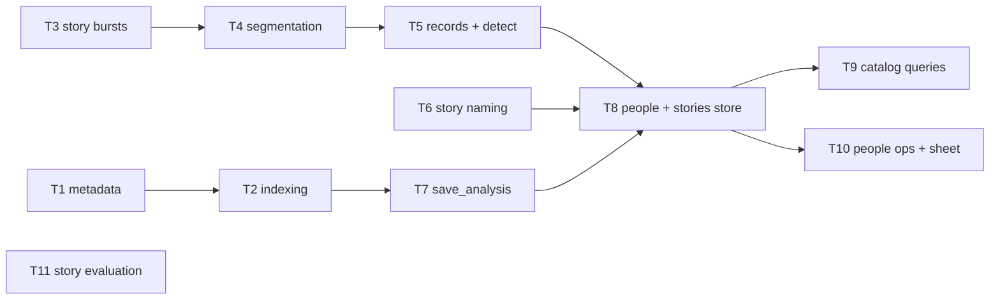
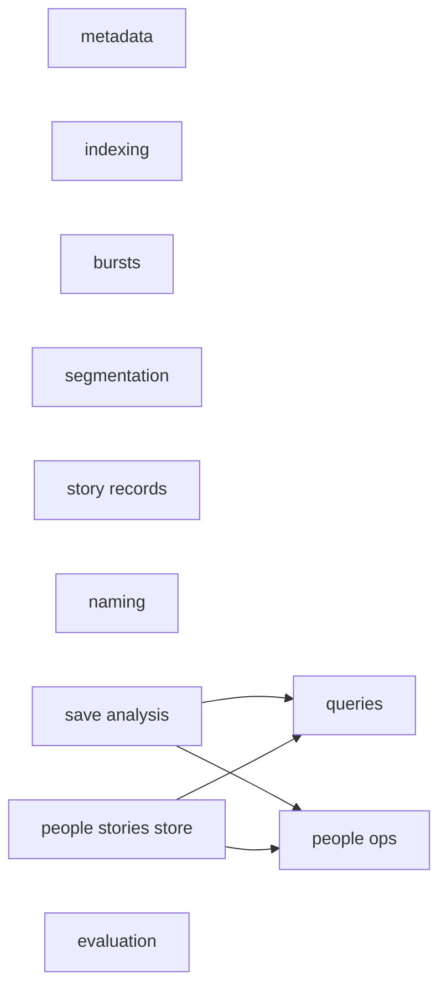

# Swift + Metal migration, phase 4a: catalog, stories, analysis store

**Goal:** port the catalog and analysis persistence of src/ailbum (metadata, catalog, stories, story_naming, story_evaluation, people, and database.py beyond `connect`) to AilbumCore, with their pytest suites ported to Swift Testing.
**Architecture:** one Swift enum namespace per Python module; connection-level functions take `_ db: Database`, path-level ones take `database: String` and open it. Python dict/list results become `JSONValue` with the same keys and values, so phase 5 can serialise them unchanged.
**Tech stack:** Swift 6.3 (mode 5), SQLite3 (phase 1 `Database`), ImageIO, Foundation URLSession, Swift Testing.
**Spec:** docs/plans/2026-11-07-swift-metal-migration-design.md
**Detail:** contracts
**Target-min:** 14

## Global constraints

- Phase 1-3 rules hold; design section 1 decisions, section 2 toolchain, section 3 phase 4 row, section 4 parity. Phase 4 is split into 4a (this plan), 4b (albums, ranking, proxies, archive, forget, feature cache, pipeline) and 4c (layout).
- **Port rule:** each task ports the named Python functions line for line: same SQL, same ordering, same rounding, same Russian error messages. `ValueError`/`LookupError`/`RuntimeError` -> `throw AilbumError.invalid(message)`. Each task ports the named pytest tests one to one (same names in lowerCamelCase, same inputs and asserted values); tests use temp dirs only.
- **Wave 0** (`swift/Sources/AilbumCore/JSONValue.swift`, `swift/Sources/AilbumCore/Records.swift`, AilbumError):
  - `public enum JSONValue: Equatable, Codable { case null, bool(Bool), int(Int), double(Double), string(String), array([JSONValue]), object([String: JSONValue]) }` with `ExpressibleBy{Nil,Boolean,Integer,Float,String,Array,Dictionary}Literal`, `subscript(key: String) -> JSONValue?`, `subscript(index: Int) -> JSONValue?`, accessors `intValue`, `doubleValue`, `stringValue`, `boolValue`, `arrayValue`, `objectValue`, `init(_ sql: SQLValue)` and `static func row(_ r: [String: SQLValue]) -> JSONValue` (blob -> null).
  - Records.swift: every dataclass of src/ailbum/models.py not already in Models/ModelTypes.swift, plus `ImageMetadata` from src/ailbum/metadata.py and `StoryPhoto` from src/ailbum/stories.py; fields lowerCamelCase, Python defaults as init defaults, `[Float]` for embeddings, `JSONValue` for `dict[str, object]`.
  - add `case invalid(String)` to `AilbumError`.
- Times: `Catalog.utcNow()` = Python `utc_now()` format; datetimes parsed like `datetime.fromisoformat`.

## File structure

`swift/Sources/AilbumCore/Catalog/` (metadata, indexing, analysis store, queries, people), `swift/Sources/AilbumCore/Stories/` (stories, naming, evaluation); paths in each task's Owns.

## Task graph

```mermaid
%% schedule
gantt
  title Predicted schedule (mm:ss)
  dateFormat X
  axisFormat %M:%S
  section lane 1
  T8 People assignment and story store :t8, 0, 142s
  T10 People operations and contact sheet :t10, 142, 180s
  section lane 2
  T7 save_analysis :t7, 0, 119s
  T9 Catalog queries :t9, 142, 111s
  section lane 3
  T1 Image metadata :t1, 0, 115s
  section lane 4
  T3 Story bursts and vectors :t3, 0, 115s
  section lane 5
  T4 Story segmentation :t4, 0, 115s
  section lane 6
  T2 Library indexing and availability :t2, 0, 114s
  section lane 7
  T5 Story records and detect :t5, 0, 111s
  section lane 8
  T6 LM Studio story naming :t6, 0, 111s
  section lane 9
  T11 Story evaluation :t11, 0, 109s
```

critical path: T8 → T10 (5.4 min) · peak width 9 · predicted build 5.4 min · predicted total ≈ 8.9 min (target ✓)

## Predicted schedule

## Package: Catalog (data pipeline: numeric, encoding, state, file)

**Probe entry:** run=swift run --package-path swift ailbum-swift

### T1 Image metadata · Complexity 4 · Est. context 32k
**Owns:** swift/Sources/AilbumCore/Catalog/Metadata.swift, swift/Tests/AilbumCoreTests/MetadataTests.swift
**Components:** 1
**LOC owned:** 200
**Tests:** fast
**Model:** sonnet
**Consumes:** none
**Produces:** Metadata.collect(path: String, source: String) throws -> ImageMetadata
e.g. `Metadata.collect(path: "<tmp>/IMG_20240501_102030.jpg" without EXIF, source: "<tmp>").takenAt` -> `"2024-05-01T10:20:30"`
**Review Focus:** port tests/test_database.py `test_collects_paths_hash_and_exif`, `test_uses_camera_filename_timestamp_when_exif_is_missing`, `test_filename_timestamp_survives_image_extraction_error`, `test_zero_zero_gps_is_treated_as_missing`; plus `testUnicodePath` (`Фото/кадр.jpg`).
**Steps:** 1 failing tests, 2 run: FAIL, 3 implement, 4 run: PASS
**Notes:** port src/ailbum/metadata.py whole (EXIF via ImageIO property dictionaries; keep the JSON keys Pillow produced in `exif_json`/`container_metadata_json` for the fields the code reads: DateTimeOriginal, DateTime, Make, Model, GPS*).

### T2 Library indexing and availability · Complexity 4 · Est. context 32k
**Owns:** swift/Sources/AilbumCore/Catalog/Indexing.swift, swift/Tests/AilbumCoreTests/IndexingTests.swift
**Components:** 1
**LOC owned:** 190
**Tests:** fast
**Model:** sonnet
**Consumes:** Metadata.collect(path: String, source: String) throws -> ImageMetadata (T1)
**Produces:** Catalog.upsertImage(_ db: Database, _ item: ImageMetadata) throws -> Int · Catalog.indexMetadata(database: String, source: String, metadata: [ImageMetadata]) throws -> JSONValue · Catalog.indexLibrary(source: String, database: String, recursive: Bool, progress: ((Int, Int) -> Void)?) throws -> JSONValue · Catalog.markSourceMissing(_ db: Database, sourceRoot: String) throws · Catalog.newRunId() -> String · Catalog.utcNow() -> String
e.g. `Catalog.upsertImage(db, meta(path "/p/1.jpg", sha "s1"))` on an empty DB -> `1`; same path again -> `1`
e.g. `Catalog.indexMetadata(database: d, source: "/p", metadata: [m1, m2])` -> `{"indexed": 2, ...}` with the keys of Python `index_metadata`
**Review Focus:** port tests/test_availability.py (all 5) and tests/test_database.py `test_index_library_creates_queryable_catalog`.
**Steps:** 1 failing tests, 2 run: FAIL, 3 implement, 4 run: PASS
**Notes:** port `_upsert_image`, `index_metadata`, `mark_source_missing`, `new_run_id`, `utc_now` (src/ailbum/database.py) and `index_library` (src/ailbum/catalog.py). Tests build ImageMetadata directly so they do not depend on T1 except `testIndexLibrary`, which writes real JPEGs.

### T3 Story bursts and vectors · Complexity 4 · Est. context 30k
**Owns:** swift/Sources/AilbumCore/Stories/StoryBursts.swift, swift/Tests/AilbumCoreTests/StoryBurstsTests.swift
**Components:** 1
**LOC owned:** 200
**Tests:** fast
**Model:** sonnet
**Consumes:** none
**Produces:** StoryBursts.build(_ photos: [StoryPhoto], parsed: [String: Date?]) -> [StoryBurst] · StoryBursts.attachVectors(_ bursts: inout [StoryBurst]) · StoryBursts.vectorDistance(_ a: [Double]?, _ b: [Double]?) -> Double · StoryBursts.distanceKm(_ a: StoryPhoto, _ b: StoryPhoto) -> Double? · StoryBursts.parseTime(_ value: String?) -> Date?
e.g. `StoryBursts.vectorDistance([1,0], [0,1])` -> the Python `_vector_distance` value for those inputs
e.g. `StoryBursts.distanceKm(photo at (0,0), photo at (0,1))` -> `111.19` (2 decimals)
**Review Focus:** golden values from Python for `_build_bursts`, `_attach_feature_vectors` on a 6-photo fixture (bursts, vector lengths and first 3 components within 1e-9), `_vector_distance` with nil sides, `_distance_km` with missing GPS -> nil, `_parse_time` naive/offset/invalid.
**Steps:** 1 failing tests, 2 run: FAIL, 3 implement, 4 run: PASS
**Notes:** `public struct StoryBurst` mirrors `_Burst` (lives in this file). Port src/ailbum/stories.py lines 14-36, 160-252, 530-627 (helpers `_normalized`, `_mean_vector`, `_time_key`, `_format_time`, `_distance_km_between_bursts`, `_large_geographic_jump`, `_visual_vector` too, as `static` internal funcs).

### T4 Story segmentation · Complexity 6 · Est. context 34k
**Owns:** swift/Sources/AilbumCore/Stories/StorySegmentation.swift, swift/Tests/AilbumCoreTests/StorySegmentationTests.swift
**Components:** 1
**LOC owned:** 200
**Tests:** fast
**Model:** sonnet
**Consumes:** StoryBursts.vectorDistance(_ a: [Double]?, _ b: [Double]?) -> Double (T3) · StoryBursts.distanceKm(_ a: StoryPhoto, _ b: StoryPhoto) -> Double? (T3)
**Produces:** StorySegmentation.segment(_ bursts: [StoryBurst], continuityMinutes: Int, maxDurationHours: Int) -> [(Int, Int)] · StorySegmentation.fallbackTimeGroups(_ photos: [StoryPhoto], parsed: [String: Date?], gapMinutes: Int, continuityMinutes: Int, maxDurationHours: Int) -> [[StoryPhoto]]
e.g. `fallbackTimeGroups` of photos at 10:00, 10:05, 14:30 with gap 120 -> `[[p1, p2], [p3]]`
**Review Focus:** golden ranges from Python `_segment_bursts` and `_refine_change_points` on two fixtures (a day with a 3 h gap; a long continuous day > 12 h); geographic jump splits; ties identical to Python.
**Steps:** 1 failing tests, 2 run: FAIL, 3 implement, 4 run: PASS
**Notes:** port lines 255-443 (`_segment_bursts`, `_refine_change_points`, `_fallback_time_groups`). Tests build `StoryBurst` values directly.

### T5 Story records and detect · Complexity 4 · Est. context 32k
**Owns:** swift/Sources/AilbumCore/Stories/Stories.swift, swift/Tests/AilbumCoreTests/StoriesTests.swift
**Components:** 1
**LOC owned:** 170
**Tests:** fast
**Model:** sonnet
**Consumes:** none
**Produces:** Stories.detect(_ photos: [StoryPhoto], gapMinutes: Int, continuityMinutes: Int, maxDurationHours: Int) -> [StoryRecord] · Stories.algorithmVersion: Int
e.g. `Stories.detect([], gapMinutes: 120, continuityMinutes: 360, maxDurationHours: 12)` -> `[]`
**Review Focus:** port all 10 tests of tests/test_stories.py.
**Steps:** 1 failing tests, 2 run: FAIL, 3 implement, 4 run: PASS
**Notes:** port `detect_stories` (all keyword parameters with Python defaults), `_story_records`, `_label_scores`, `_ranked_labels`, `_story_title`, `STORY_ALGORITHM_VERSION`. Calls `StoryBursts.build/attachVectors` (T3) and `StorySegmentation.segment/fallbackTimeGroups` (T4) by their Produces signatures. The stories tests run the whole algorithm, so they run after T3/T4 land; write them first and run them once those files exist.

### T6 LM Studio story naming · Complexity 4 · Est. context 30k
**Owns:** swift/Sources/AilbumCore/Stories/StoryNaming.swift, swift/Tests/AilbumCoreTests/StoryNamingTests.swift
**Components:** 1
**LOC owned:** 170
**Tests:** fast
**Model:** sonnet
**Consumes:** none
**Produces:** StoryNamer(backend: String, baseURL: String, model: String?, timeout: Double) · StoryNamer.refine(_ stories: [StoryRecord], photoPaths: [String: String]) -> [StoryRecord]
e.g. `StoryNamer(backend: "off", ...).refine(stories, photoPaths: [:])` -> stories unchanged
**Review Focus:** port all 3 tests of tests/test_story_naming.py with an injectable transport (`(URLRequest) throws -> Data`) instead of monkeypatching urlopen; `testParseTitle` cases of `_parse_title`; LM Studio down -> Russian error text identical to Python.
**Steps:** 1 failing tests, 2 run: FAIL, 3 implement, 4 run: PASS
**Notes:** port src/ailbum/story_naming.py (`_request_json`, `_image_data_url` with phase 1 ImageLoader + JPEG encode, `_evenly_spaced`, `_parse_title`, `_needs_vlm_title`). Synchronous URLSession wrapper with semaphore is fine.

### T7 save_analysis · Complexity 6 · Est. context 40k
**Owns:** swift/Sources/AilbumCore/Catalog/AnalysisStore.swift, swift/Tests/AilbumCoreTests/AnalysisStoreTests.swift
**Components:** 1
**LOC owned:** 230
**Tests:** fast
**Model:** sonnet
**Consumes:** Catalog.upsertImage(_ db: Database, _ item: ImageMetadata) throws -> Int (T2) · Catalog.utcNow() -> String (T2)
**Produces:** AnalysisStore.save(database: String, source: String, output: String, manifest: JSONValue, records: [PhotoRecord], people: [PersonRecord], metadata: [ImageMetadata], faceSimilarity: Double, stories: [StoryRecord]?) throws -> String
e.g. saving 2 records with 1 face each into a new DB -> a run id of 32 hex chars; `photo_analysis` has 2 rows, `faces` has 2 rows
**Review Focus:** row values equal to the Python `save_analysis` on the same fixture (golden: dump `photo_analysis`, `faces`, `analysis_runs` rows from Python as JSON); embeddings stored as little-endian float32 blobs (phase 1 `Vectors.encode`); re-saving the same source creates a new run and leaves earlier rows.
**Steps:** 1 failing tests, 2 run: FAIL, 3 implement, 4 run: PASS
**Notes:** port `save_analysis` lines 341-519 and helpers `_json`, `_encode_embedding`, `_tag_pairs`. It calls `AnalysisStore.assignPeople` and `AnalysisStore.storeStories`/`ensureStories` from T8 (internal statics in T8's file) - call them by those names; until T8 lands, the test fixture passes `people: []` and `stories: []`.

### T8 People assignment and story store · Complexity 6 · Est. context 38k
**Owns:** swift/Sources/AilbumCore/Catalog/PeopleAssignment.swift, swift/Tests/AilbumCoreTests/PeopleAssignmentTests.swift
**Components:** 2
**LOC owned:** 220
**Tests:** fast
**Model:** sonnet
**Consumes:** Stories.detect(_ photos: [StoryPhoto], gapMinutes: Int, continuityMinutes: Int, maxDurationHours: Int) -> [StoryRecord] (T5)
**Produces:** AnalysisStore.assignPeople(_ db: Database, runId: String, people: [PersonRecord], faceSimilarity: Double) throws · AnalysisStore.storeStories(_ db: Database, runId: String, stories: [StoryRecord]) throws · AnalysisStore.ensureStories(_ db: Database, runId: String) throws · AnalysisStore.refreshCentroid(_ db: Database, personId: Int) throws
e.g. `ensureStories(db, runId: "r1")` on a run with 0 photos -> no rows written
**Review Focus:** centroid = normalised mean of member embeddings (Python `_refresh_person_centroid`); a person matched across runs keeps its id when cosine >= faceSimilarity and the embedding model matches; `ensureStories` is a no-op when every photo has a story and the algorithm version is current.
**Steps:** 1 failing tests, 2 run: FAIL, 3 implement, 4 run: PASS
**Notes:** `extension AnalysisStore` in this file; port `_assign_people`, `_store_stories`, `_ensure_stories`, `_refresh_person_centroid`, `_embedding_model_for_person` (database.py 520-772). Tests insert rows with SQL directly. `ensureStories` calls `StoryNamer(backend:baseURL:model:timeout:).refine(_:photoPaths:)` (T6) with the run config's naming backend.

### T9 Catalog queries · Complexity 4 · Est. context 32k
**Owns:** swift/Sources/AilbumCore/Catalog/CatalogQueries.swift, swift/Tests/AilbumCoreTests/CatalogQueriesTests.swift
**Components:** 1
**LOC owned:** 170
**Tests:** fast
**Model:** sonnet
**Consumes:** AnalysisStore.save(database: String, source: String, output: String, manifest: JSONValue, records: [PhotoRecord], people: [PersonRecord], metadata: [ImageMetadata], faceSimilarity: Double, stories: [StoryRecord]?) throws -> String (T7)
**Produces:** CatalogQueries.summary(database: String) throws -> JSONValue · CatalogQueries.listImages(database: String, limit: Int) throws -> JSONValue · CatalogQueries.getImage(database: String, imageId: Int) throws -> JSONValue
**Review Focus:** keys and values equal to Python `database_summary`, `list_catalog_images`, `get_catalog_image` on the same saved fixture (golden JSON from Python); unknown image id -> the Python error text.
**Steps:** 1 failing tests, 2 run: FAIL, 3 implement, 4 run: PASS
**Notes:** port database.py 773-881 and `_analysis_result`, `_json_or_none`, `_face_result`.

### T10 People operations and contact sheet · Complexity 5 · Est. context 38k
**Owns:** swift/Sources/AilbumCore/Catalog/PeopleStore.swift, swift/Tests/AilbumCoreTests/PeopleStoreTests.swift
**Components:** 2
**LOC owned:** 230
**Tests:** slow
**Model:** sonnet
**Consumes:** AnalysisStore.save(database: String, source: String, output: String, manifest: JSONValue, records: [PhotoRecord], people: [PersonRecord], metadata: [ImageMetadata], faceSimilarity: Double, stories: [StoryRecord]?) throws -> String (T7)
**Produces:** PeopleStore.list(database: String, limit: Int) throws -> JSONValue · PeopleStore.get(database: String, personId: Int) throws -> JSONValue · PeopleStore.name(database: String, personId: Int, name: String?) throws -> JSONValue · PeopleStore.merge(database: String, targetId: Int, sourceIds: [Int]) throws -> JSONValue · PeopleStore.desktopPeople(database: String) throws -> JSONValue · PeopleStore.desktopFaces(database: String, personId: Int?) throws -> JSONValue · PeopleStore.setFacePerson(database: String, faceId: Int, personId: Int?) throws -> JSONValue · PeopleStore.createPersonFromFace(database: String, faceId: Int, name: String?) throws -> JSONValue · PeopleStore.composeSheet(database: String, personId: Int, output: String, faceSize: Int, columns: Int) throws -> JSONValue
**Review Focus:** port all 7 tests of tests/test_people.py (the desktop-bridge one calls `PeopleStore` directly instead of the bridge).
**Steps:** 1 failing tests, 2 run: FAIL, 3 implement, 4 run: PASS
**Notes:** port database.py 882-1135 and src/ailbum/people.py (`compose_person_faces`, contact sheet drawn with CoreGraphics, JPEG via ImageIO).

### T11 Story evaluation · Complexity 3 · Est. context 26k
**Owns:** swift/Sources/AilbumCore/Stories/StoryEvaluation.swift, swift/Tests/AilbumCoreTests/StoryEvaluationTests.swift
**Components:** 1
**LOC owned:** 150
**Tests:** fast
**Model:** sonnet
**Consumes:** none
**Produces:** StoryEvaluation.parseAnnotations(path: String) throws -> [AnnotatedStory] · StoryEvaluation.evaluateGroups(expected: [AnnotatedStory], predictions: [String: (Int, String)], runId: String?) -> JSONValue · StoryEvaluation.evaluateDatabase(database: String, annotations: String, runId: String?) throws -> JSONValue
e.g. `evaluateGroups(expected: [], predictions: [:], runId: nil)` -> the Python result for empty inputs
**Review Focus:** port all 3 tests of tests/test_story_evaluation.py; `_title_similarity` equals Python `difflib.SequenceMatcher.ratio` on 5 Russian title pairs (port Ratcliff/Obershelp exactly, including autojunk off/on as Python uses it).
**Steps:** 1 failing tests, 2 run: FAIL, 3 implement, 4 run: PASS
**Notes:** port src/ailbum/story_evaluation.py whole; `AnnotatedStory` lives in this file.

## Review Focus

- Catalog (data pipeline): numeric (story vectors, distances, centroids, rounding), encoding (JSON keys, Russian messages, blobs), state (runs, people identity across runs, story versions), file (EXIF, unicode paths). Cases are in each task.

## Self-review

Coverage: section 1 and section 2 are Global constraints; section 3 phase 4 row is split into 4a (T1-T11), 4b and 4c; section 4 parity via ported pytest suites and Python goldens. Edges only where tests run another task's code (T9/T10 on save + people assignment).

Ruling: LM Studio naming (design phase 5 row) moves to 4a because `_ensure_stories` calls it - cost: none.
