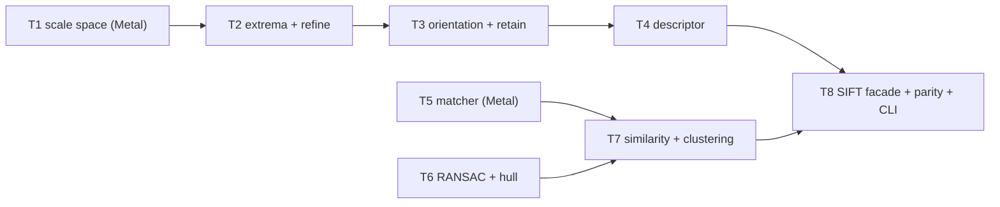
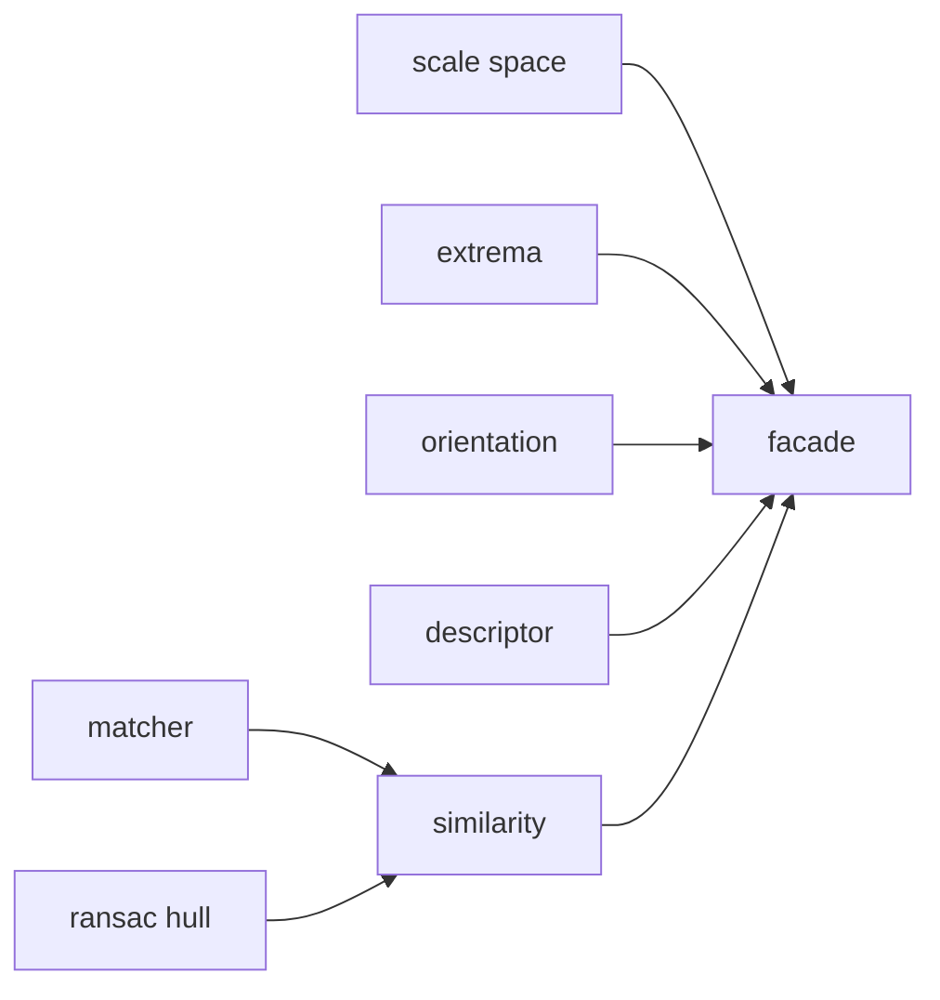

# Swift + Metal migration, phase 2: geometry (SIFT, matching, RANSAC)

**Goal:** port `extract_geometric_features`, `geometric_scene_similarity` and `cluster_similar_photos` (src/ailbum/cv/similarity.py) to AilbumCore: SIFT scale space and matching on Metal, detection/orientation/descriptor on CPU, deterministic RANSAC homography, convex-hull coverage.
**Architecture:** SIFT follows OpenCV 4.10 `sift.simd.hpp` (nOctaveLayers 3, sigma 1.6, firstOctave -1, edgeThreshold 10, contrastThreshold 0.02, descriptor 4x4x8). Stages exchange the Wave 0 value types below, so every stage is tested on hand-built inputs.
**Tech stack:** Swift 6.3 (mode 5), SwiftPM, Swift Testing, Metal (runtime-compiled kernels via `MetalContext.shared.pipeline`), Accelerate.
**Spec:** docs/plans/2026-11-07-swift-metal-migration-design.md
**Detail:** contracts
**Target-min:** 12

## Global constraints

- Phase 1 rules hold (`swift/` only, RGB order, Swift Testing, test command `.superlite/test-cmd.json`, goldens from Python via `uv run python -c`). Design section 3 phase 2 row and section 4 parity rule; SIFT is not bit-exact, so its parity is statistical (T8).
- Wave 0 file `swift/Sources/AilbumCore/Sift/SiftTypes.swift`, all `public`, memberwise `public init`:
  - `struct GrayImage: Equatable { let width: Int; let height: Int; var pixels: [Float] }` row-major, precondition count.
  - `struct ScaleSpace { let firstOctave: Int; let layers: Int; let sigma: Double; var gaussians: [[GrayImage]]; var dogs: [[GrayImage]] }` - `gaussians[o]` has `layers+3` images, `dogs[o]` has `layers+2`; octave index `o` is 0-based in arrays, real octave = `o + firstOctave`.
  - `struct SiftKeypoint: Equatable { var x: Float; var y: Float; var size: Float; var angle: Float; var response: Float; var octave: Int; var layer: Int; var subLayer: Float }` - x, y, size in input-image pixels; `octave` is the real octave (-1 = upsampled); `angle` -1 until assigned, else degrees in [0, 360) with OpenCV's convention `360 - bin angle`.
  - `struct GeometricFeatures { var keypoints: [SIMD2<Float>]; var descriptors: [Float]; let width: Int; let height: Int }` - descriptors row-major `n*128`.
  - `struct PhotoFeatures { var phash: [Bool]; var histogram: [Float]; var geometric: GeometricFeatures? }`
  - `struct GeometricSimilarity: Equatable { var score: Double; var mutualMatches: Int; var inliers: Int; var inlierRatio: Double; var coverageLeft: Double; var coverageRight: Double }` plus `static let empty` (all zero).
- Wave 0 also adds `resources: [.copy("Fixtures")]` to the `AilbumCoreTests` target and creates `swift/Tests/AilbumCoreTests/Fixtures/.keep`.
- RANSAC is deterministic: SplitMix64 seeded with `0x5EED`, unless a test passes another seed.

## File structure

One file per stage under `swift/Sources/AilbumCore/Sift/` and `swift/Sources/AilbumCore/CV/`, paths as in each task's Owns.

## Task graph

```mermaid
%% schedule
gantt
  title Predicted schedule (mm:ss)
  dateFormat X
  axisFormat %M:%S
  section lane 1
  T1 Metal scale space :t1, 0, 144s
  T8 SIFT facade  parity and CLI compare :t8, 254, 176s
  section lane 2
  T6 RANSAC homography and hull coverage :t6, 0, 140s
  T7 Geometric similarity and clustering :t7, 140, 114s
  section lane 3
  T5 Metal brute-force matcher :t5, 0, 137s
  section lane 4
  T2 Extrema and refinement :t2, 0, 115s
  section lane 5
  T4 SIFT descriptor :t4, 0, 113s
  section lane 6
  T3 Orientation and retention :t3, 0, 109s
```

critical path: T6 → T7 → T8 (7.2 min) · peak width 6 · predicted build 7.2 min · predicted total ≈ 10.7 min (target ✓)

## Predicted schedule

## Package: Geometry (numeric library: numeric, deep, state)

**Probe entry:** run=swift run --package-path swift ailbum-swift

### T1 Metal scale space · Complexity 6 · Est. context 40k
**Owns:** swift/Sources/AilbumCore/Sift/ScaleSpace.swift, swift/Sources/AilbumCore/Metal/SiftKernels.swift, swift/Tests/AilbumCoreTests/ScaleSpaceTests.swift
**Components:** 2
**LOC owned:** 230
**Tests:** fast
**Model:** sonnet
**Consumes:** none
**Produces:** ScaleSpace.grayFloat(_ image: RGBImage) -> GrayImage · ScaleSpace.build(_ gray: GrayImage, layers: Int, sigma: Double) throws -> ScaleSpace
e.g. `try ScaleSpace.build(GrayImage(64x64 zeros), layers: 3, sigma: 1.6).gaussians.count` -> `6`
e.g. same space: `gaussians[0][0].width` -> `128`, `gaussians[1][0].width` -> `64`, `dogs[0].count` -> `5`, `firstOctave` -> `-1`
**Review Focus:** `testBlurParity`: base level of a 32x32 image `v = Float((x*7 + y*13) % 256)` equals cv2 (INTER_LINEAR x2 upsample, then `GaussianBlur(sigma=sqrt(1.6^2-1))`) within 1e-2 per pixel; `testDogIsDifference`: `dogs[o][i] == gaussians[o][i+1] - gaussians[o][i]` exactly; `testOctaveDownsample`: `gaussians[1][0]` equals every second pixel of `gaussians[0][3]`; `testTinyImage`: 8x8 input gives at least 1 octave, no crash.
**Test code:** as Review Focus plus `testGrayFloat`: RGB (255,0,0) -> 76.0.
**Steps:** 1 failing tests, 2 run: FAIL, 3 implement, 4 run: PASS
**Notes:** `grayFloat` = phase 1 OpenCV gray (UInt8) as Float. nOctaves = `round(log2(min(w2,h2))) - 2 + 1` on the upsampled size w2,h2 (OpenCV formula with firstOctave -1). Per octave sigmas: `sig[0]=sigma`, `sig[i]=sqrt(t_i^2 - t_{i-1}^2)`, `t_i = sigma*2^(i/layers)`. Separable Gaussian in Metal, ksize = `round(sigma*8+1) | 1`, OpenCV `getGaussianKernel` weights, BORDER_REFLECT_101. Upsample: bilinear with half-pixel centres (`cv2.resize` INTER_LINEAR).

### T2 Extrema and refinement · Complexity 6 · Est. context 36k
**Owns:** swift/Sources/AilbumCore/Sift/Extrema.swift, swift/Tests/AilbumCoreTests/ExtremaTests.swift
**Components:** 1
**LOC owned:** 200
**Tests:** fast
**Model:** sonnet
**Consumes:** none
**Produces:** SiftDetector.findExtrema(_ space: ScaleSpace, contrastThreshold: Double, edgeThreshold: Double) -> [SiftKeypoint]
e.g. hand-built space (1 octave, firstOctave 0, 5 DoGs 24x24 zero, `dogs[0][2][12,12] = 40`, neighbours 0) -> one keypoint with `x≈12, y≈12, octave 0, layer 2, angle -1`
**Review Focus:** `testBorderSkipped`: the same peak at (3,12) yields nothing (border 5); `testEdgeRejected`: a ridge `dogs[0][2][r,12] = 40` for every r yields nothing (edge ratio 10); `testLowContrastRejected`: peak 0.05 yields nothing; `testMinimumPeak`: value -40 (a minimum) is detected; `testUpsampledOctaveScales`: same peak with firstOctave -1 gives x≈6, y≈6, size halved.
**Test code:** as Review Focus; tests build ScaleSpace by hand (gaussians may be zero images of the right sizes).
**Steps:** 1 failing tests, 2 run: FAIL, 3 implement, 4 run: PASS
**Notes:** OpenCV logic: prefilter threshold `floor(0.5*contrastThreshold/layers*255)`; extremum vs 26 neighbours (`>=` all for positive, `<=` all for negative); `adjustLocalExtrema` up to 5 iterations with `img_scale = 1/255`, first derivatives `*0.5*img_scale`, second `*img_scale`, cross `*0.25*img_scale`; stop when all offsets < 0.5; reject if moved outside border or `|offset| > INT_MAX/3`; `contr = D*img_scale + 0.5*dot(dD, offset)`, reject if `|contr|*layers < contrastThreshold`; edge reject unless `det > 0 && tr*tr*r < (r+1)^2*det`. `x = (c + xc) * 2^o`, `size = sigma*2^((layer+xi)/layers)*2^o*2` with array octave `o`, then for firstOctave -1 multiply x, y, size by 0.5; `response = |contr|`; `octave = o + firstOctave`.

### T3 Orientation and retention · Complexity 4 · Est. context 30k
**Owns:** swift/Sources/AilbumCore/Sift/Orientation.swift, swift/Tests/AilbumCoreTests/OrientationTests.swift
**Components:** 1
**LOC owned:** 150
**Tests:** fast
**Model:** sonnet
**Consumes:** none
**Produces:** SiftDetector.assignOrientations(_ kps: [SiftKeypoint], space: ScaleSpace) -> [SiftKeypoint] · SiftDetector.retainBest(_ kps: [SiftKeypoint], maxFeatures: Int) -> [SiftKeypoint]
e.g. `retainBest(kps with responses [0.1, 0.5, 0.3], maxFeatures: 2)` responses -> `[0.5, 0.3]`
e.g. keypoint on a horizontal ramp `v = x*4` (gradient +x) -> one keypoint with angle ≈ 0 (±5)
**Review Focus:** `testVerticalRamp`: `v = y*4` -> angle ≈ 270 (OpenCV flips y: `360 - 90`); `testTwoPeaks`: gradients split 50/50 between two directions -> two keypoints, same x,y; `testRetainZero`: maxFeatures 0 keeps all (OpenCV semantics); `testDuplicatesRemoved`: identical keypoints collapse to one.
**Test code:** as Review Focus.
**Steps:** 1 failing tests, 2 run: FAIL, 3 implement, 4 run: PASS
**Notes:** OpenCV `calcOrientationHist`: on `gaussians[octave-firstOctave][layer]`, point in octave coords `(x,y)*2^(-octave)`, `scl = size*0.5*2^(-octave)`, radius `round(3*1.5*scl)`, weight `exp(-(dx²+dy²)/(2*(1.5*scl)²))`, 36 bins, circular smoothing [1,4,6,4,1]/16, peaks >= 0.8*max that are local maxima, parabolic interpolation, `angle = 360 - bin*10`, snap `|angle-360| < 1e-4` to 0. Retention: sort by response desc (stable), cut to maxFeatures, after removing exact duplicates (x, y, size, angle).

### T4 SIFT descriptor · Complexity 5 · Est. context 34k
**Owns:** swift/Sources/AilbumCore/Sift/Descriptor.swift, swift/Tests/AilbumCoreTests/DescriptorTests.swift
**Components:** 1
**LOC owned:** 180
**Tests:** fast
**Model:** sonnet
**Consumes:** none
**Produces:** SiftDescriptor.compute(_ kps: [SiftKeypoint], space: ScaleSpace) -> [Float]
e.g. `SiftDescriptor.compute([], space: s)` -> `[]`
e.g. one keypoint on a flat image -> 128 zeros
**Review Focus:** `testNormClamp`: on a noisy patch every value is an integer in 0...255 and the pre-quantisation vector had no component > 0.2 of its norm; `testRotationInvariance`: a patch and its 90° rotation (keypoint angles differing by 90) give descriptors with cosine >= 0.95; `testNearBorder`: keypoint 2 px from the edge does not crash; `testCount`: 3 keypoints -> 384 floats.
**Test code:** as Review Focus.
**Steps:** 1 failing tests, 2 run: FAIL, 3 implement, 4 run: PASS
**Notes:** OpenCV `calcSIFTDescriptor`: d=4, n=8, `hist_width = 3*scl`, radius `round(hist_width*sqrt(2)*(d+1)*0.5)` clipped to the image diagonal, rotate by `-(360-angle)` degrees, trilinear interpolation into (d+2)x(d+2)x(n+2) then wrap orientation, weight `exp(-(xr²+yr²)/(0.5*d*d))`, clamp at `0.2*norm`, renormalise, value `min(max(round(v*512/norm), 0), 255)`. Compute keypoints in parallel with `DispatchQueue.concurrentPerform`.

### T5 Metal brute-force matcher · Complexity 5 · Est. context 32k
**Owns:** swift/Sources/AilbumCore/CV/Matcher.swift, swift/Sources/AilbumCore/Metal/MatcherKernels.swift, swift/Tests/AilbumCoreTests/MatcherTests.swift
**Components:** 2
**LOC owned:** 180
**Tests:** fast
**Model:** sonnet
**Consumes:** none
**Produces:** Matcher.mutualRatioMatches(left: [Float], right: [Float], dim: Int, ratio: Float) throws -> [(Int, Int)]
e.g. left `[[0,0],[10,10]]`, right `[[0,1],[10,11],[50,50]]`, dim 2, ratio 0.75 -> `[(0,0),(1,1)]`
e.g. left with 1 row -> `[]`
**Review Focus:** `testRatioRejectsAmbiguous`: left `[[0,0],[100,0]]`, right `[[1,0],[-1,0],[100,1]]` -> `[(1,2)]`; `testParityRandom`: 300x128 vs 280x128 LCG descriptors (integers 0...255) give exactly the pairs of Python's BFMatcher knn mutual-ratio code; `testLarge`: 4000x128 vs 4000x128 completes and matches a CPU reference on 50 sampled rows.
**Test code:** as Review Focus.
**Steps:** 1 failing tests, 2 run: FAIL, 3 implement, 4 run: PASS
**Notes:** port the forward/reverse knnMatch k=2 + ratio + mutual logic of `geometric_scene_similarity`; distance is L2 (not squared) for the ratio test. A kernel computes best and second-best per query row (squared distances in Float, threadgroup tiles of the train set); run it both directions. Ties: lower train index wins. Result sorted by left index.

### T6 RANSAC homography and hull coverage · Complexity 5 · Est. context 32k
**Owns:** swift/Sources/AilbumCore/CV/Homography.swift, swift/Sources/AilbumCore/CV/Hull.swift, swift/Tests/AilbumCoreTests/HomographyTests.swift
**Components:** 2
**LOC owned:** 200
**Tests:** fast
**Model:** sonnet
**Consumes:** none
**Produces:** Homography.ransacInliers(_ src: [SIMD2<Float>], _ dst: [SIMD2<Float>], threshold: Float, seed: UInt64) -> [Bool]? · Hull.coverage(_ points: [SIMD2<Float>], width: Int, height: Int) -> Double
e.g. `Hull.coverage([(0,0),(10,0),(10,10),(0,10),(5,5)], width: 20, height: 20)` -> `0.25`
e.g. 8 points mapped by translation (+5,+3) plus 2 points with dst off by 50 px, threshold 4 -> 8 `true` then 2 `false`
**Review Focus:** `testFewerThanFour`: 3 pairs -> nil; `testCollinear`: all points on one line -> nil; `testPerspective`: 30 points under a real homography with 1 px noise and 30% outliers -> every true inlier marked; `testDeterministic`: same seed twice -> same mask; `testCoverageDegenerate`: 2 points or width 0 -> 0.0.
**Test code:** as Review Focus.
**Steps:** 1 failing tests, 2 run: FAIL, 3 implement, 4 run: PASS
**Notes:** OpenCV `findHomography(RANSAC)`: 4-point samples (skip collinear triples), normalised DLT (Hartley) solved by SVD/eigen via Accelerate, inlier when squared reprojection error `<= threshold²`, adaptive iterations with confidence 0.995, max 2000, then refit on all inliers and recompute the mask. Hull: Andrew monotone chain, shoelace area, `coverage = area / (w*h)`; fewer than 3 points or w,h <= 0 -> 0.

### T7 Geometric similarity and clustering · Complexity 5 · Est. context 36k
**Owns:** swift/Sources/AilbumCore/CV/Similarity.swift, swift/Tests/AilbumCoreTests/SimilarityTests.swift
**Components:** 1
**LOC owned:** 190
**Tests:** fast
**Model:** sonnet
**Consumes:** Matcher.mutualRatioMatches(left: [Float], right: [Float], dim: Int, ratio: Float) throws -> [(Int, Int)] (T5) · Hull.coverage(_ points: [SIMD2<Float>], width: Int, height: Int) -> Double (T6)
**Produces:** Similarity.geometric(_ left: GeometricFeatures?, _ right: GeometricFeatures?) throws -> GeometricSimilarity · Similarity.isGeometricCandidate(hash: Int, color: Float) -> Bool · Similarity.cluster(_ photos: [PhotoFeatures], hashDistance: Int, histogramThreshold: Float, geometricThreshold: Float?, captureTimes: [String?]?, neighborWindow: Int, timeWindowMinutes: Int) throws -> [[Int]]
e.g. `Similarity.isGeometricCandidate(hash: 30, color: 0.7)` -> `true`; `(hash: 30, color: 0.5)` -> `false`
e.g. `Similarity.geometric(nil, f)` -> `.empty`
**Review Focus:** `testScoreFormula`: 100 one-hot-like descriptors matched 1:1 with keypoints on a 20x20 grid spanning half of a 200x200 frame, identity transform -> inliers 100, ratio 1, coverage ≈0.2025 each, score = `(1-exp(-100/80)) * 1 * sqrt(min(.2025/.25,1)^2)` within 1e-3; `testFewMutual`: 3 matches -> mutualMatches 3, score 0; `testWindowByTime`: indices 0 and 20 at "2024-05-01T10:00:00" and "...T10:10:00" are compared, at "...T10:30:00" are not; `testHashColorUnion`: phash equal + histogram dot 1 -> one group without geometric call; `testInvalidWindow`: neighborWindow 0 throws; `testTimesLengthMismatch`: throws.
**Test code:** as Review Focus.
**Steps:** 1 failing tests, 2 run: FAIL, 3 implement, 4 run: PASS
**Notes:** port `geometric_scene_similarity` (ratio 0.75, reprojection 4.0, seed 0x5EED), `is_geometric_candidate` (24, 0.65), `cluster_similar_photos`, `_within_geometric_window`, `_timestamp` from src/ailbum/cv/similarity.py line for line; uses phase 1 `UnionFind` and `HashColor.hamming/similarity`. Timestamps: ISO 8601 with optional offset; naive values are local time. Throw `AilbumError.decode` for invalid arguments. Also calls `Homography.ransacInliers(src, dst, threshold: 4, seed: 0x5EED)` (T6, returns `[Bool]?`, nil = no model).

### T8 SIFT facade, parity and CLI compare · Complexity 5 · Est. context 44k
**Owns:** swift/Sources/AilbumCore/Sift/SIFT.swift, swift/Sources/ailbum-swift/main.swift, swift/Tests/AilbumCoreTests/SiftParityTests.swift, swift/Tests/AilbumCoreTests/Fixtures/make_sift_fixtures.py, swift/Tests/AilbumCoreTests/Fixtures/sift_a.png, swift/Tests/AilbumCoreTests/Fixtures/sift_b.png, swift/Tests/AilbumCoreTests/Fixtures/sift_c.png, swift/Tests/AilbumCoreTests/Fixtures/sift_golden.json
**Components:** 2
**LOC owned:** 200
**Tests:** slow
**Model:** sonnet
**Consumes:** ScaleSpace.build(_ gray: GrayImage, layers: Int, sigma: Double) throws -> ScaleSpace (T1) · SiftDescriptor.compute(_ kps: [SiftKeypoint], space: ScaleSpace) -> [Float] (T4) · Similarity.geometric(_ left: GeometricFeatures?, _ right: GeometricFeatures?) throws -> GeometricSimilarity (T7)
**Produces:** SIFT.extract(_ image: RGBImage, maxFeatures: Int, maxSide: Int) throws -> GeometricFeatures
**Review Focus:** `testKeypointParity`: on sift_a.png Swift keypoint count within ±20% of cv2 and >= 75% of cv2's top 200 keypoints have a Swift keypoint within 1.5 px with size within 20%; `testDescriptorParity`: for those pairs median cosine(Swift, cv2 descriptor) >= 0.9; `testSceneParity`: `Similarity.geometric(a, b).score` within 0.1 of cv2's `geometric_scene_similarity` and >= 0.55; `testUnrelated`: a vs c score < 0.1; `testCompareCLI`: `ailbum-swift compare a.png b.png` prints one JSON line with keys `score, mutual_matches, inliers, inlier_ratio, coverage_left, coverage_right` (rounded to 4 places as `GeometricSimilarity.to_dict`).
**Test code:** as Review Focus; the fixture script (run once with `uv run python`) builds a 320x240 textured image a (seeded noise blobs + shapes), b = a under a 6° rotation, 0.9 scale and (12,7) shift via cv2.warpAffine, c = an unrelated seeded image, saves lossless PNGs and writes cv2 keypoints (x, y, size, angle, response), descriptors and the a/b, a/c scores to sift_golden.json.
**Steps:** 1 failing tests, 2 run: FAIL, 3 implement, 4 run: PASS
**Notes:** `extract` mirrors `extract_geometric_features` (maxFeatures 4000, maxSide 1600, contrastThreshold 0.02): `Resize.forAnalysis` (max(1, round)) -> `ScaleSpace.grayFloat` -> build(3, 1.6) -> findExtrema(0.02, 10) -> assignOrientations -> `SiftDetector.retainBest` -> compute; width/height of the resized gray image. `SiftDetector.findExtrema(space, contrastThreshold:, edgeThreshold:)` (T2) and `SiftDetector.assignOrientations(kps, space:)` (T3) return `[SiftKeypoint]`. Keep the existing `quality` and `db-stats` CLI commands unchanged.

## Review Focus

- Geometry (numeric library): numeric (Gaussian kernels, REFLECT_101, subpixel refinement, angle convention, quantisation), deep (large keypoint sets, 4000x4000 matching), state (deterministic RANSAC, Metal buffer reuse). Cases are in each task.

## Self-review

Coverage: section 1 and section 2 are Global constraints inherited from phase 1; design section 3 phase 2 row maps to T1-T8; section 4 parity is per task (statistical for SIFT in T8). Edges only where tests run another task's code (T7 on T5/T6, T8 on all). No two parallel tasks share a file.
