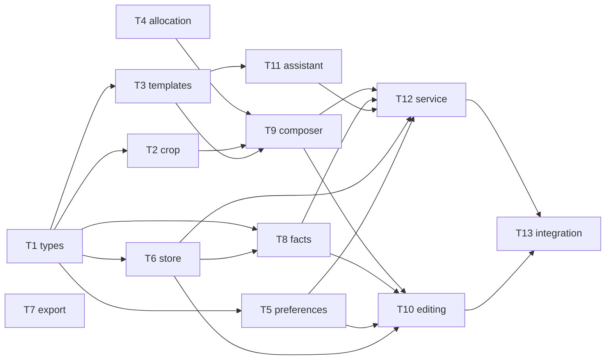
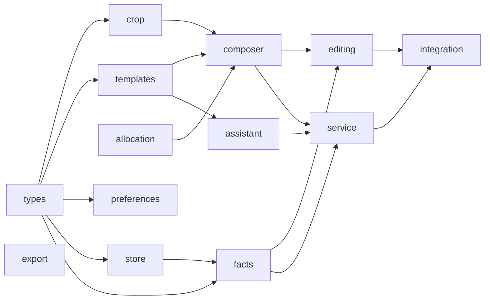

# Swift + Metal migration, phase 4c: layout engine

**Goal:** port src/ailbum/layout (types, crop, templates, allocation, preferences, store, export, facts, composer, editing, assistant, service) to AilbumCore, with its pytest suites ported to Swift Testing.
**Architecture:** same as 4a/4b: one Swift enum namespace per Python module under `Layout/`; connection-level functions take `_ db: Database`, path-level ones take `database: String`; Python dicts become `JSONValue` with the same keys; frozen dataclasses become `Equatable` structs.
**Tech stack:** Swift 6.3 (mode 5), SQLite3 (`Database`), ImageIO/CoreGraphics/CoreText, Swift Testing.
**Spec:** docs/plans/2026-11-07-swift-metal-migration-design.md
**Detail:** contracts
**Target-min:** 16

## Global constraints

- Phase 1-4b rules hold (port rule, Russian messages verbatim, `AilbumError.invalid` for ValueError, temp dirs only, never read `.ailbum` or real photos, edit only `swift/`). Each task ports the named pytest file one to one (lowerCamelCase names, same inputs and asserted values; unique names across the test target).
- Existing APIs to call (do not change their files): `Albums.*`, `AlbumLibrary.selectionHash`, `Proxies.photoProxy/imageSource/build`, `YOLOX.detect`, `ImageLoader.load`, `Resize.area`, `Catalog.utcNow()`, `StoryNamer` (copy its transport pattern, do not call its private methods).
- Python goldens: `HF_HUB_OFFLINE=1 PYTHONPATH=src uv run python ...` on synthetic inputs only.
- Test seams: internal `nonisolated(unsafe) static var` overrides (detector, assistant transport), never network or user dirs.
- Not ported: tests/test_layout_bridge.py (desktop bridge is phase 5).

## File structure

`swift/Sources/AilbumCore/Layout/` one file per Python module (LayoutTypes, Crop, Templates, Allocation, Preferences, LayoutStore, LayoutExport, Facts, Composer, Editing, LayoutAssistant, LayoutService); tests in `swift/Tests/AilbumCoreTests/Layout*Tests.swift`; paths in each task's Owns.

## Task graph

```mermaid
%% schedule
gantt
  title Predicted schedule (mm:ss)
  dateFormat X
  axisFormat %M:%S
  section lane 1
  T4 Allocation :t4, 0, 110s
  T8 Facts :t8, 225, 122s
  T10 Editing :t10, 358, 147s
  T13 Layout integration :t13, 504, 152s
  section lane 2
  T7 Export originals :t7, 0, 105s
  T9 Composer :t9, 227, 131s
  T12 Layout service :t12, 358, 132s
  section lane 3
  T1 Layout types :t1, 0, 104s
  T3 Templates :t3, 104, 123s
  T11 Layout assistant :t11, 227, 119s
  section lane 4
  T6 Layout store :t6, 104, 122s
  section lane 5
  T2 Crop :t2, 104, 118s
  section lane 6
  T5 Preferences :t5, 104, 101s
```

critical path: T1 → T3 → T9 → T10 → T13 (10.9 min) · peak width 6 · predicted build 10.9 min · predicted total ≈ 14.4 min (target ✓)

## Layout core

**Probe entry:** call=AilbumCore.Crop.solve

### T1 Layout types · Complexity 2 · Est. context 22k
**Owns:** swift/Sources/AilbumCore/Layout/LayoutTypes.swift, swift/Tests/AilbumCoreTests/LayoutTypesTests.swift
**Components:** 1
**LOC owned:** 110
**Tests:** fast
**Model:** sonnet
**Consumes:** none
**Produces:** struct Rect(x: Double, y: Double, w: Double, h: Double) · struct Region(bbox: Rect, weight: Double, hard: Bool, kind: String) · struct Cell(index: Int, rect: Rect, safe: Rect, spineBand: Rect?) · struct CropResult(rect: Rect, fit: Double, violations: [String]) · struct LayoutParams(orientation: String, spreadCount: Int, minPhotos: Int, maxPhotos: Int, assistant: String = "auto", prompt: String = "") · struct PhotoFacts(imageId: Int, aspect: Double, unitKey: String, storyId: Int?, takenAt: String?, rank: Double, selected: Bool, regions: [Region]) · struct PlacementDraft(cellIndex: Int, imageId: Int, crop: Rect, fit: Double, warnings: [String], replacedImageId: Int?) · struct SpreadDraft(templateId: String, storyIds: [Int], placements: [PlacementDraft], score: Double, warnings: [String] = [], alternatives: [SpreadDraft] = [], assistantReason: String? = nil)
e.g. `LayoutParams(orientation: "vertical", spreadCount: 10, minPhotos: 1, maxPhotos: 4).assistant` -> `"auto"`
e.g. `SpreadDraft(templateId: "t", storyIds: [1], placements: [], score: 0).alternatives` -> `[]`
**Review Focus:** `testLayoutParamsDefaults` (assistant "auto", prompt ""), `testSpreadDraftDefaults` (warnings [], alternatives [], assistantReason nil), `testRectEquality` (`Rect(x:0,y:0,w:1,h:1) == Rect(x:0,y:0,w:1,h:1)`).
**Steps:** 1 failing tests, 2 run: FAIL, 3 implement, 4 run: PASS
**Notes:** all structs `public`, `Equatable`, `Sendable`, memberwise public inits; `SpreadDraft` is recursive through an array (allowed). Python sources: layout/types.py, PhotoFacts in facts.py, drafts in composer.py.

### T2 Crop · Complexity 5 · Est. context 30k
**Owns:** swift/Sources/AilbumCore/Layout/Crop.swift, swift/Tests/AilbumCoreTests/LayoutCropTests.swift
**Components:** 1
**LOC owned:** 220
**Tests:** fast
**Model:** sonnet
**Consumes:** Rect, Region, Cell, CropResult (T1)
**Produces:** Crop.evaluate(rect: Rect, photoAspect: Double, regions: [Region], cell: Cell) -> CropResult · Crop.solve(photoAspect: Double, regions: [Region], cell: Cell) -> CropResult
**Review Focus:** numeric - port all 13 tests of tests/test_layout_crop.py; SCALES (1.0, 0.9, 0.8), STEPS 11, HARD_COVER 0.98, EPS 1e-9 identical; violation strings identical; tie order of candidate positions identical.
**Steps:** 1 failing tests, 2 run: FAIL, 3 implement, 4 run: PASS
**Notes:** port layout/crop.py whole.

### T3 Templates · Complexity 5 · Est. context 32k
**Owns:** swift/Sources/AilbumCore/Layout/Templates.swift, swift/Tests/AilbumCoreTests/LayoutTemplatesTests.swift
**Components:** 1
**LOC owned:** 260
**Tests:** fast
**Model:** sonnet
**Consumes:** Rect, Cell (T1)
**Produces:** struct AlbumFormat(orientation: String, pageWmm: Double, pageHmm: Double, bleedMm: Double = 3, safeMm: Double = 3, gapMm: Double = 5, spineGuardMm: Double = 8) with spreadWmm, spreadHmm · struct Template(id: String, photoCount: Int, orientation: String, cells: [Cell]) · Templates.formatFor(_ orientation: String) throws -> AlbumFormat · Templates.templatesFor(_ orientation: String, photoCount: Int? = nil) throws -> [Template]
e.g. `Templates.formatFor("vertical").spreadWmm` -> `420.0`
**Review Focus:** numeric, deep - port all 20 tests of tests/test_layout_templates.py; template ids and cell order identical to Python (assert the full id list per orientation from a Python golden); mirrored templates, inset pinwheel, horizontal replacements; unknown orientation error text identical.
**Steps:** 1 failing tests, 2 run: FAIL, 3 implement, 4 run: PASS
**Notes:** port layout/templates.py whole; the node tree becomes an indirect enum; cache the catalog per orientation in a static dictionary.

### T4 Allocation · Complexity 4 · Est. context 28k
**Owns:** swift/Sources/AilbumCore/Layout/Allocation.swift, swift/Tests/AilbumCoreTests/LayoutAllocationTests.swift
**Components:** 1
**LOC owned:** 160
**Tests:** fast
**Model:** sonnet
**Consumes:** none
**Produces:** struct StoryGroup(storyIds: [Int], unitCount: Int, startedAt: String?, endedAt: String?) · struct Allocation(storyIds: [Int], unitCount: Int, spreads: Int, merged: Bool) · Allocation.allocateSpreads(_ groups: [StoryGroup], spreadCount: Int, minPhotos: Int, maxPhotos: Int) throws -> [Allocation]
e.g. `allocateSpreads([StoryGroup(storyIds: [1], unitCount: 4, startedAt: nil, endedAt: nil)], spreadCount: 1, minPhotos: 1, maxPhotos: 4)` -> `[Allocation(storyIds: [1], unitCount: 4, spreads: 1, merged: false)]`
**Review Focus:** numeric, state - port all 11 tests of tests/test_layout_allocation.py; MISSING_UNIT_PENALTY 1000; merge of the small neighbour picks the same side on ties; time gaps parsed like Python `_parse`.
**Steps:** 1 failing tests, 2 run: FAIL, 3 implement, 4 run: PASS
**Notes:** port layout/allocation.py whole; name the namespace `SpreadAllocation` if `Allocation` clashes with the struct.

### T5 Preferences · Complexity 3 · Est. context 24k
**Owns:** swift/Sources/AilbumCore/Layout/Preferences.swift, swift/Tests/AilbumCoreTests/LayoutPreferencesTests.swift
**Components:** 1
**LOC owned:** 90
**Tests:** fast
**Model:** sonnet
**Consumes:** PhotoFacts, Region (T1)
**Produces:** Preferences.parse(_ prompt: String) -> [String: Double] · Preferences.describe(_ weights: [String: Double]) -> [String] · Preferences.features(_ photo: PhotoFacts) -> [String: Double] · Preferences.apply(_ photos: [PhotoFacts], _ weights: [String: Double]) -> [PhotoFacts]
e.g. `Preferences.parse("больше лиц")` -> `["faces": 0.5]`
e.g. `Preferences.describe(["faces": 0.5])` -> `["больше лиц"]`
**Review Focus:** encoding - port all 4 tests of tests/test_layout_preferences.py; Russian regexes `_PATTERNS`, `_NEGATIVE`, `_CLAUSES` give the same matches (NSRegularExpression, Unicode); MAX_PROMPT 500 truncation.
**Steps:** 1 failing tests, 2 run: FAIL, 3 implement, 4 run: PASS
**Notes:** port layout/preferences.py whole.

## Layout storage

**Probe entry:** call=AilbumCore.LayoutStore.loadLayout

### T6 Layout store · Complexity 5 · Est. context 34k
**Owns:** swift/Sources/AilbumCore/Layout/LayoutStore.swift, swift/Tests/AilbumCoreTests/LayoutStoreTests.swift
**Components:** 1
**LOC owned:** 250
**Tests:** fast
**Model:** sonnet
**Consumes:** LayoutParams, SpreadDraft, PlacementDraft, Rect (T1)
**Produces:** LayoutStore.selectionHash(_ db: Database, albumId: Int) throws -> String · LayoutStore.albumRun(_ db: Database, albumId: Int) throws -> String · LayoutStore.requireDraft(_ db: Database, albumId: Int) throws · LayoutStore.saveLayout(_ db: Database, albumId: Int, runId: String, params: LayoutParams, spreads: [SpreadDraft], unplaced: [JSONValue], warnings: [String], selectionHash: String, assistantModel: String?) throws -> Int · LayoutStore.loadLayout(_ db: Database, albumId: Int) throws -> JSONValue?
e.g. `LayoutStore.loadLayout(db, albumId: 1)` on an album with no layout -> `nil`
**Review Focus:** state, encoding - port all 12 tests of tests/test_layout_store.py; saveLayout replaces the previous layout in one transaction; crop fractions (`_fraction`) and JSON (`_dumps`, sorted keys, ensure_ascii False) identical; error texts identical.
**Steps:** 1 failing tests, 2 run: FAIL, 3 implement, 4 run: PASS
**Notes:** port layout/store.py whole; if Python `selection_hash` equals album_library's, call `AlbumLibrary.selectionHash`.

### T7 Export originals · Complexity 3 · Est. context 26k
**Owns:** swift/Sources/AilbumCore/Layout/LayoutExport.swift, swift/Tests/AilbumCoreTests/LayoutExportTests.swift
**Components:** 1
**LOC owned:** 120
**Tests:** fast
**Model:** sonnet
**Consumes:** none
**Produces:** LayoutExport.exportOriginals(database: String, albumId: Int, folder: String) throws -> JSONValue
**Review Focus:** file, state - port the tests of tests/test_archive.py that call `export_originals` (layouts rows inserted with SQL as there), plus `testUniqueNameSuffix` (existing `a.jpg` gives `a (2).jpg` as Python `_unique`); EXPORT_DIR "Раскладка альбома"; the album_exports row and selection hash identical; then `Archive.prepare` sees no export needed.
**Steps:** 1 failing tests, 2 run: FAIL, 3 implement, 4 run: PASS
**Notes:** port layout/export.py; use `AlbumLibrary.selectionHash` for `_selection_hash` if identical.

## Layout engine

**Probe entry:** call=AilbumCore.Composer.composeGroup

### T8 Facts · Complexity 6 · Est. context 38k
**Owns:** swift/Sources/AilbumCore/Layout/Facts.swift, swift/Tests/AilbumCoreTests/LayoutFactsTests.swift
**Components:** 1
**LOC owned:** 250
**Tests:** fast
**Model:** sonnet
**Consumes:** PhotoFacts, Region, Rect (T1) · LayoutStore.albumRun(_ db: Database, albumId: Int) throws -> String (T6)
**Produces:** Facts.buildRegions(faces: [(Double, Double, Double, Double)], objects: [DetectedObject], subject: Rect?) -> [Region] · Facts.loadPool(_ db: Database, albumId: Int, detector: ((RGBImage) throws -> [DetectedObject])?, progress: ((Int, Int) -> Void)?) throws -> [PhotoFacts]
**Review Focus:** numeric, state - port all 23 tests of tests/test_layout_facts.py (fake detector closure instead of the monkeypatched ObjectDetector); FACE_BACKGROUND_RATIO 0.05, OBJECT_CONFIDENCE 0.5, SELECTED_BONUS 0.2; rank formula `_rank` identical; detection results cached per image as Python does (same table/columns); proxy used when the original is missing.
**Steps:** 1 failing tests, 2 run: FAIL, 3 implement, 4 run: PASS
**Notes:** port layout/facts.py whole; image loading via `Proxies.imageSource` + `ImageLoader.load`; DETECTOR_MODEL name constant is the YOLOX model id used in the cache rows.

### T9 Composer · Complexity 7 · Est. context 42k
**Owns:** swift/Sources/AilbumCore/Layout/Composer.swift, swift/Tests/AilbumCoreTests/LayoutComposerTests.swift
**Components:** 1
**LOC owned:** 320
**Tests:** fast
**Model:** sonnet
**Consumes:** Crop.solve (T2) · Templates.templatesFor (T3) · Allocation (T4) · PhotoFacts, SpreadDraft, PlacementDraft, LayoutParams (T1)
**Produces:** struct ComposedGroup(spreads: [SpreadDraft], unplaced: [JSONValue]) · Composer.bestVariants(_ photos: [PhotoFacts], params: LayoutParams, limit: Int = 3) throws -> [SpreadDraft] · Composer.composeGroup(_ photos: [PhotoFacts], allocation: Allocation, params: LayoutParams) throws -> ComposedGroup · Composer.maxCells = 8 · Composer.selectedBonus = 0.15
**Review Focus:** deep, numeric - port all 18 tests of tests/test_layout_composer.py; SELECTED_BONUS 0.15, RANK_WEIGHT 0.25, REPEAT_COST 0.15, UNDERFILL_COST 1000; `_partition` chunk options and the memoised search give the same drafts and scores (1e-9) as Python on a synthetic pool golden; unit replacement (`replaced_for`) identical.
**Steps:** 1 failing tests, 2 run: FAIL, 3 implement, 4 run: PASS
**Notes:** port layout/composer.py whole; `lru_cache` becomes a dictionary memo keyed like Python.

## Layout editing and service

**Probe entry:** call=AilbumCore.LayoutService.generate

### T10 Editing · Complexity 7 · Est. context 46k
**Owns:** swift/Sources/AilbumCore/Layout/Editing.swift, swift/Tests/AilbumCoreTests/LayoutEditingTests.swift
**Components:** 1
**LOC owned:** 440
**Tests:** fast
**Model:** sonnet
**Consumes:** Composer.bestVariants (T9) · Facts.loadPool (T8) · LayoutStore.loadLayout, requireDraft (T6) · Preferences.parse, apply (T5) · Crop.evaluate, solve (T2) · Templates.formatFor, templatesFor (T3)
**Produces:** Editing.alternatives(database: String, spreadId: Int, cellIndex: Int) throws -> [JSONValue] · Editing.similar(database: String, spreadId: Int, cellIndex: Int) throws -> [JSONValue] · Editing.variants(database: String, spreadId: Int) throws -> [JSONValue] · Editing.applyVariant(database: String, spreadId: Int, templateId: String, imageIds: [Int]) throws -> JSONValue · Editing.parsePrompt(_ prompt: String) -> JSONValue · Editing.setPhoto(database: String, spreadId: Int, cellIndex: Int, imageId: Int) throws -> JSONValue · Editing.swapCells(database: String, spreadId: Int, cellA: Int, cellB: Int) throws -> JSONValue · Editing.setTemplate(database: String, spreadId: Int, templateId: String) throws -> JSONValue · Editing.setCrop(database: String, spreadId: Int, cellIndex: Int, crop: JSONValue) throws -> JSONValue · Editing.recomposeSpread(database: String, spreadId: Int, prompt: String = "") throws -> JSONValue
**Review Focus:** state, protocol - port all 25 tests of tests/test_layout_editing.py; ALTERNATIVES_LIMIT 24, ASPECT_TOLERANCE 0.01, RANGE_EPS 1e-6; UNKNOWN_WISH text; swap across spreads; set_crop validation errors identical; every edit runs in one transaction and refuses non-draft albums.
**Steps:** 1 failing tests, 2 run: FAIL, 3 implement, 4 run: PASS
**Notes:** port layout/editing.py whole.

### T11 Layout assistant · Complexity 5 · Est. context 34k
**Owns:** swift/Sources/AilbumCore/Layout/LayoutAssistant.swift, swift/Tests/AilbumCoreTests/LayoutAssistantTests.swift
**Components:** 1
**LOC owned:** 230
**Tests:** fast
**Model:** sonnet
**Consumes:** Templates.formatFor, templatesFor (T3) · SpreadDraft (T1)
**Produces:** struct AssistantChoice(index: Int, reason: String) · LayoutAssistant(baseURL: String, model: String, timeout: Double = 90, transport: StoryNamer.Transport? = nil) with connect() -> Bool, choose(_ variants: [SpreadDraft], paths: [Int: String], orientation: String, storyTitle: String, wish: String = "") -> AssistantChoice? · LayoutAssistant.renderVariants(_ variants: [SpreadDraft], paths: [Int: String], orientation: String, maxSide: Int = 896) throws -> Data
e.g. `LayoutAssistant(baseURL: "http://x", model: "m", transport: { _ in throw URLError(.cannotConnectToHost) }).connect()` -> `false`
**Review Focus:** protocol, encoding - port all 15 tests of tests/test_layout_assistant.py (fake transport); prompt text identical (LABELS "ABCDEF", MAX_WISH 300, MAX_REASON 200, control chars stripped); `_parse_choice` rejects out-of-range letters; render is a JPEG whose size and tile grid match Python (pixel parity not required; labels via CoreText).
**Steps:** 1 failing tests, 2 run: FAIL, 3 implement, 4 run: PASS
**Notes:** port layout/assistant.py; PIL drawing becomes CoreGraphics.

### T12 Layout service · Complexity 7 · Est. context 46k
**Owns:** swift/Sources/AilbumCore/Layout/LayoutService.swift, swift/Tests/AilbumCoreTests/LayoutServiceTests.swift
**Components:** 1
**LOC owned:** 330
**Tests:** fast
**Model:** sonnet
**Consumes:** Facts.loadPool (T8) · Composer.composeGroup (T9) · LayoutAssistant (T11) · LayoutStore.* (T6) · Preferences.* (T5) · Allocation.allocateSpreads (T4)
**Produces:** LayoutService.preflight(database: String, albumId: Int, params: LayoutParams) throws -> JSONValue · LayoutService.generate(database: String, albumId: Int, params: LayoutParams, modelsDir: String?, progress: ((JSONValue) -> Void)?) throws -> JSONValue
**Review Focus:** state, protocol - port all 19 tests of tests/test_layout_service.py (fake detector and assistant via internal static overrides); DETECTOR_WARNING and ASSISTANT_WARNING texts; `_validate` messages; summary keys identical; progress payloads identical.
**Steps:** 1 failing tests, 2 run: FAIL, 3 implement, 4 run: PASS
**Notes:** port layout/service.py whole; Python progress type is in service.py.

### T13 Layout integration · Complexity 4 · Est. context 34k
**Owns:** swift/Tests/AilbumCoreTests/LayoutIntegrationTests.swift
**Components:** 1
**LOC owned:** 200
**Tests:** slow
**Model:** sonnet
**Consumes:** LayoutService.generate (T12) · Editing.* (T10) · LayoutExport.exportOriginals (T7)
**Produces:** none
**Review Focus:** state, file - port all 7 tests of tests/test_layout_integration.py on synthetic JPEGs (analysis rows via `AnalysisStore.save`).
**Steps:** 1 failing tests, 2 run: FAIL, 3 implement, 4 run: PASS
**Notes:** tests only; a failure in another task's code is reported, not fixed.

## Review Focus

- Layout core (library): numeric (crop windows, template rects, allocation costs), deep (composer search), encoding (Russian regexes).
- Storage and service (state): transactional replace, draft-only edits, JSON with sorted keys, warnings and error texts verbatim.

## Self-review

Coverage: design section 3 phase 4 row, layout engine part (4c); section 4 parity via ported suites and Python goldens. Edges only where tests run another task's code.

Ruling: test_layout_bridge.py not ported in 4c - desktop bridge is phase 5 - cost: none now.
Ruling: assistant render parity is layout-level, not pixel-level - PIL and CoreGraphics rasterize text differently - cost: the VLM sees slightly different label glyphs.
