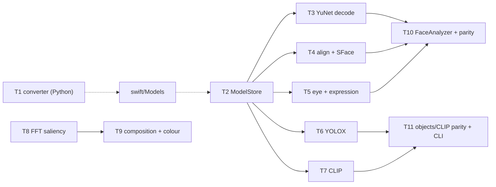
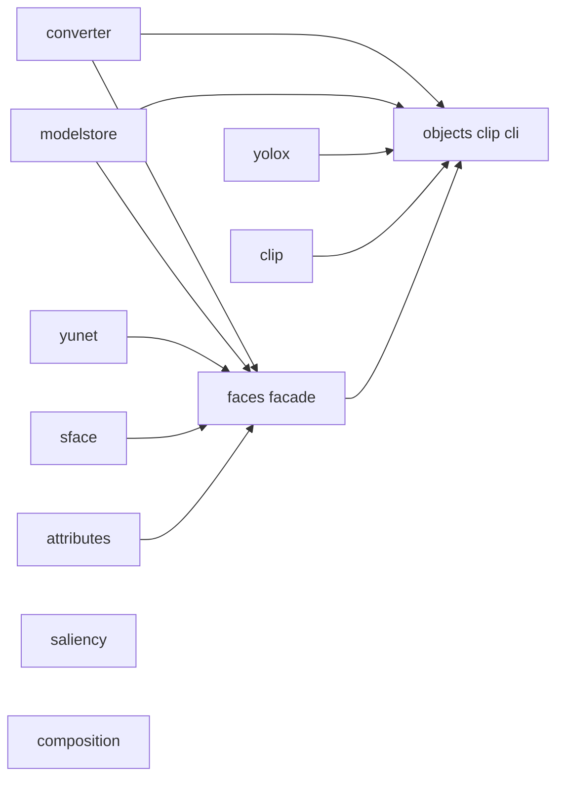

# Swift + Metal migration, phase 3: models (CoreML faces, objects, CLIP, aesthetics)

**Goal:** port src/ailbum/cv/{faces,objects,semantics,aesthetics}.py to AilbumCore. ONNX models and the CLIP image encoder run as CoreML; CLIP prompt embeddings are precomputed offline; composition/colour metrics are pure Swift.
**Architecture:** one offline Python converter writes `.mlpackage` files plus a JSON of CLIP text embeddings into `swift/Models/` (gitignored). Swift loads them through `ModelStore`. Model inputs are float32 MLMultiArrays (NCHW) built in Swift exactly like the Python preprocessing; postprocessing (YuNet decode, YOLOX decode, NMS, softmax, tag ranking) is pure Swift and unit-tested on synthetic outputs.
**Tech stack:** Swift 6.3 (mode 5), CoreML, Accelerate (vDSP FFT), Swift Testing; converter: `uv run --no-project --python 3.12 --with torch --with coremltools --with onnx2torch --with onnx --with transformers --with opencv-python-headless --with scikit-image`.
**Spec:** docs/plans/2026-11-07-swift-metal-migration-design.md
**Detail:** contracts
**Target-min:** 14

## Global constraints

- Phase 1-2 rules hold (`swift/` only, RGB `RGBImage`, Swift Testing, `.superlite/test-cmd.json`, goldens from Python). Design section 1 decisions, section 2 toolchain, section 3 phase 3 row, section 4 parity.
- Model files: ONNX sources in `/Users/ivan/projects/ailbum/models` (yunet, sface, eye, expression; YOLOX is fetched by the converter from the URL in src/ailbum/model_download.py), CLIP from the HF cache id `openai/clip-vit-base-patch32`. Outputs in `swift/Models/`: `yunet.mlpackage` (input `input` 1x3x640x640), `sface.mlpackage` (1x3x112x112), `eye.mlpackage` (1x3x32x32), `expression.mlpackage` (1x3x112x112), `yolox.mlpackage` (1x3x640x640), `clip_vision.mlpackage` (1x3x224x224 -> `image_embeds` 1x512), `clip_text.json`. All converted with `compute_precision=FLOAT32`, `minimum_deployment_target=macOS14`, output names kept from ONNX.
- `clip_text.json`: `{"model": str, "logit_scale": float (already exp'd), "aesthetic": [[512],[512]], "scenes": [{"key": str, "embedding": [512]}], "objects": [...]}` in the order of `SCENE_PROMPTS` / `OBJECT_PROMPTS`, embeddings L2-normalised.
- Models dir at runtime: env `AILBUM_MODELS_DIR`, else `<package>/Models` found by walking up from `#filePath` in tests. Model-dependent tests use `.enabled(if: ModelStore.available("<name>"))`.
- Wave 0 (`swift/Sources/AilbumCore/Models/ModelTypes.swift`, all public with memberwise inits): `struct FaceDetection { var bbox: (x: Int, y: Int, w: Int, h: Int); var confidence: Float; var landmarks: [SIMD2<Float>] }` (5 points: right eye, left eye, nose, right mouth, left mouth, image coords); `struct FaceAttributes: Equatable` mirroring Python `FaceAttributes` (+ `bothEyesOpen`, `smileProbability`); `struct DetectedObject: Equatable { var label: String; var score: Float; var bbox: SIMD4<Float> }` (x,y,w,h fractions); `struct TagRecord: Equatable { var label: String; var confidence: Double }`; `struct SemanticRecord { var aestheticScore: Double?; var model: String?; var scenes: [TagRecord]; var objects: [TagRecord]; var embedding: [Float]? }`; `struct SubjectRecord: Equatable { var bbox: SIMD4<Double>; var center: SIMD2<Double>; var source: String }`; `struct CompositionRecord: Equatable` and `struct ColorRecord: Equatable` mirroring src/ailbum/models.py. Wave 0 also adds `swift/Models/` to the repo `.gitignore`.
- Dropped from Python: Haar/HOG classic face backend (models are always bundled; ruling in design section 1), arbitrary `--clip-model` ids (only converted models).

## File structure

One file per component under `swift/Sources/AilbumCore/Models/` and `swift/Sources/AilbumCore/CV/`, paths as in each task's Owns.

## Task graph

```mermaid
%% schedule
gantt
  title Predicted schedule (mm:ss)
  dateFormat X
  axisFormat %M:%S
  section lane 1
  T1 Model converter :t1, 0, 176s
  T10 FaceAnalyzer facade and parity :t10, 176, 173s
  T11 Objects and CLIP parity  CLI analyze :t11, 349, 172s
  section lane 2
  T8 Spectral-residual saliency :t8, 0, 140s
  section lane 3
  T7 CLIP semantics :t7, 0, 138s
  section lane 4
  T4 Face alignment and SFace :t4, 0, 136s
  section lane 5
  T9 Composition and colour :t9, 0, 136s
  section lane 6
  T2 ModelStore and tensors :t2, 0, 133s
  section lane 7
  T3 YuNet face detection :t3, 0, 113s
  section lane 8
  T6 YOLOX object detection :t6, 0, 111s
  section lane 9
  T5 Eye state and expression :t5, 0, 107s
```

critical path: T1 → T10 → T11 (8.7 min) · peak width 9 · predicted build 8.7 min · predicted total ≈ 12.2 min (target ✓)

## Predicted schedule

## Package: Models (data pipeline: numeric, encoding, file)

**Probe entry:** run=swift run --package-path swift ailbum-swift

### T1 Model converter · Complexity 5 · Est. context 36k
**Owns:** swift/Tools/convert_models.py, swift/Tools/README.md
**Components:** 2
**LOC owned:** 200
**Tests:** slow
**Model:** sonnet
**Consumes:** none
**Produces:** none
**Review Focus:** `check yunet`: CoreML vs `cv2.dnn` ONNX on the same random 1x3x640x640 input, max abs diff per output < 1e-3; same check for sface, eye, expression, yolox; `check clip`: CoreML `image_embeds` vs transformers `get_image_features` cosine >= 0.9999 on a random tensor; `idempotent`: second run skips existing outputs unless `--force`.
**Test code:** the script's `--check` mode runs the comparisons above and exits non-zero on failure; run it once with `--check` and paste the per-model diffs in the report.
**Steps:** 1 write script, 2 run with --check: FAIL until correct, 3 fix, 4 run: PASS
**Notes:** ONNX -> torch via `onnx2torch.convert`, trace with `torch.jit.trace` at the fixed shapes above, `coremltools.convert(..., convert_to="mlprogram")`. If onnx2torch fails on a model, report which op; do not substitute another runtime. CLIP: `CLIPModel.get_image_features` wrapped in a module; text embeddings from `get_text_features` over the prompts imported from `ailbum.cv.semantics` (run with `PYTHONPATH=src`), normalised; `logit_scale = model.logit_scale.exp()`. README: one command to rebuild.

### T2 ModelStore and tensors · Complexity 3 · Est. context 28k
**Owns:** swift/Sources/AilbumCore/Models/ModelStore.swift, swift/Sources/AilbumCore/Models/Tensor.swift, swift/Tests/AilbumCoreTests/ModelStoreTests.swift
**Components:** 2
**LOC owned:** 150
**Tests:** fast
**Model:** sonnet
**Consumes:** none
**Produces:** ModelStore.available(_ name: String) -> Bool · ModelStore.predict(_ name: String, inputs: [String: MLMultiArray]) throws -> [String: [Float]] · Tensor.nchw(_ image: RGBImage, bgr: Bool, scale: Float, mean: [Float]) -> MLMultiArray
e.g. `Tensor.nchw(2x1 image [(10,20,30),(40,50,60)], bgr: true, scale: 1, mean: [0,0,0])` -> shape `[1,3,1,2]`, values `[30,60, 20,50, 10,40]`
e.g. `ModelStore.available("nope")` -> `false`
**Review Focus:** `testMeanScale`: value = (pixel - mean[c]) * scale, mean in model channel order; `testMissingModelThrows`: predict on a missing name throws `AilbumError.decode` with the path; `testCompiledCache`: second load of a model reuses the compiled `.mlmodelc` (no recompile; check mtime) - enabled only if `eye` is available.
**Steps:** 1 failing tests, 2 run: FAIL, 3 implement, 4 run: PASS
**Notes:** compile with `MLModel.compileModel(at:)` into `~/Library/Caches/ailbum/models/<name>-<sha256 of Manifest.json>.mlmodelc`; load with `MLModelConfiguration.computeUnits = .all`; cache loaded models in a locked dictionary. `predict` returns every output flattened to Float.

### T3 YuNet face detection · Complexity 5 · Est. context 32k
**Owns:** swift/Sources/AilbumCore/Models/YuNet.swift, swift/Tests/AilbumCoreTests/YuNetTests.swift
**Components:** 1
**LOC owned:** 180
**Tests:** fast
**Model:** sonnet
**Consumes:** none
**Produces:** YuNet.decode(_ outputs: [String: [Float]], inputSize: Int, scale: Float, scoreThreshold: Float, nmsThreshold: Float, topK: Int) -> [FaceDetection] · YuNet.detect(_ image: RGBImage, minFaceSize: Int) throws -> [FaceDetection]
e.g. outputs all zero except stride-8 cell (row 10, col 20) with cls 0.9, obj 0.9, bbox (0,0,ln 4,ln 4), kps 0, inputSize 640, scale 1 -> one face, bbox `(x: 144, y: 64, w: 32, h: 32)`, confidence 0.9, landmarks all `(160, 80)`
**Review Focus:** `testNmsSuppresses`: two overlapping cells (IoU 0.8) keep the higher score; `testScaleBack`: scale 0.5 doubles coordinates; `testClipToImage`: boxes are clipped to the image and dropped when `min(w,h) < minFaceSize` (as `_detect_dnn`); `testThreshold`: score 0.74 dropped at 0.75.
**Steps:** 1 failing tests, 2 run: FAIL, 3 implement, 4 run: PASS
**Notes:** YuNet 2023mar outputs `cls_8/16/32`, `obj_*`, `bbox_*`, `kps_*` (row-major cells of the 640/stride grid). score = `sqrt(clamp(cls,0,1)*clamp(obj,0,1))`; cx = `(col + bbox0)*s`, cy = `(row + bbox1)*s`, w = `exp(bbox2)*s`, h = `exp(bbox3)*s`; landmark k = `((kps[2k] + col)*s, (kps[2k+1] + row)*s)`; NMS IoU 0.3, topK 5000, thresholds as `cv2.FaceDetectorYN.create(..., 0.75, 0.3, 5000)`. `detect`: letterbox into the top-left of 640x640 (bilinear resize, pad 0), BGR, no scaling, then divide coordinates by the letterbox scale and round like `_detect_dnn`.

### T4 Face alignment and SFace · Complexity 5 · Est. context 30k
**Owns:** swift/Sources/AilbumCore/Models/FaceAlign.swift, swift/Tests/AilbumCoreTests/FaceAlignTests.swift
**Components:** 2
**LOC owned:** 170
**Tests:** fast
**Model:** sonnet
**Consumes:** none
**Produces:** FaceAlign.alignCrop(_ image: RGBImage, landmarks: [SIMD2<Float>]) -> RGBImage · FaceAlign.embed(_ aligned: RGBImage) throws -> [Float]
e.g. landmarks equal to the SFace template on a 112x112 image -> output equals the input (identity transform)
**Review Focus:** `testTemplateIdentity`: as the e.g.; `testParityWarp`: 200x160 gradient image, landmarks template*1.5 + (10,5) -> matches `cv2.FaceRecognizerSF.alignCrop` golden within 1 per channel; `testEmbedNormalised`: embedding length 128, L2 norm 1 (enabled if `sface` available).
**Steps:** 1 failing tests, 2 run: FAIL, 3 implement, 4 run: PASS
**Notes:** template `[(38.2946,51.6963),(73.5318,51.5014),(56.0252,71.7366),(41.5493,92.3655),(70.7299,92.2041)]`; similarity transform estimated like OpenCV's `FaceRecognizerSFImpl::getSimilarityTransformMatrix` (Umeyama, no reflection), `warpAffine` INTER_LINEAR, border 0, 112x112. Embedding input: RGB (`blobFromImage(..., swapRB=true)`), no scaling/mean; output 128 floats, L2-normalised as `_normalize`.

### T5 Eye state and expression · Complexity 3 · Est. context 26k
**Owns:** swift/Sources/AilbumCore/Models/FaceAttributesModel.swift, swift/Tests/AilbumCoreTests/FaceAttributesTests.swift
**Components:** 1
**LOC owned:** 140
**Tests:** fast
**Model:** sonnet
**Consumes:** none
**Produces:** FaceAttributesModel.asProbabilities(_ values: [Float]) throws -> [Float] · FaceAttributesModel.classify(_ aligned: RGBImage) throws -> FaceAttributes
e.g. `asProbabilities([0.2, 0.8])` -> `[0.2, 0.8]`; `asProbabilities([0, ln 3])` -> `[0.25, 0.75]`
**Review Focus:** `testEmptyThrows`; `testSquareCropEdges`: eye centre (2,2) side 16 gives an 10x10 crop (as `_square_crop`), resized to 32x32; `testRounding`: probabilities rounded to 4 places; `testMissingModels`: no eye/expression model -> `FaceAttributes()` all nil.
**Steps:** 1 failing tests, 2 run: FAIL, 3 implement, 4 run: PASS
**Notes:** eye centres fixed `right (38,52)`, `left (74,52)`; eye input BGR, `(v - 127)/255`, 32x32 via bilinear resize (blobFromImage resize), output `19`, open = p[0] >= 0.5. Expression: aligned resized 112 (area), RGB, `v/127.5 - 1`, output `label`, labels `EXPRESSION_LABELS`, argmax label + confidence.

### T6 YOLOX object detection · Complexity 4 · Est. context 30k
**Owns:** swift/Sources/AilbumCore/Models/YOLOX.swift, swift/Tests/AilbumCoreTests/YOLOXTests.swift
**Components:** 1
**LOC owned:** 170
**Tests:** fast
**Model:** sonnet
**Consumes:** none
**Produces:** YOLOX.decode(_ output: [Float], scale: Float, width: Int, height: Int) -> [DetectedObject] · YOLOX.detect(_ image: RGBImage) throws -> [DetectedObject]
e.g. 8400x85 zeros except row 0: `(0,0, ln 8, ln 8, obj 0.9, class 0 = 0.9)` -> one "person", score 0.81, bbox `(0, 0, 32/w, 32/h)` clipped
**Review Focus:** `testBatchedNms`: two overlapping boxes of different classes both kept, same class suppressed (IoU > 0.5); `testSortOrder`: by score desc then bbox; `testShapeMismatch`: wrong output length -> `[]`; `testLetterboxParity`: 300x200 image letterbox scale `640/300`, matches Python `letterbox` canvas within 1 per channel.
**Steps:** 1 failing tests, 2 run: FAIL, 3 implement, 4 run: PASS
**Notes:** port `src/ailbum/cv/objects.py` (grid, strides 8/16/32, score 0.35, NMS 0.5, `NMSBoxesBatched` = per-class NMS). Input: the RGB canvas as float, channel order as Python (RGB, no scaling), pad 114.

### T7 CLIP semantics · Complexity 4 · Est. context 32k
**Owns:** swift/Sources/AilbumCore/Models/Clip.swift, swift/Tests/AilbumCoreTests/ClipTests.swift
**Components:** 2
**LOC owned:** 190
**Tests:** fast
**Model:** sonnet
**Consumes:** none
**Produces:** Clip.preprocess(_ image: RGBImage) -> MLMultiArray · Clip.record(embedding: [Float], text: ClipText, threshold: Double, topK: Int) -> SemanticRecord · Clip.analyze(_ images: [RGBImage], threshold: Double, topK: Int) throws -> [SemanticRecord]
e.g. `Clip.record` with logits aesthetic `[2, 0]` -> aestheticScore `0.8808`
e.g. scene logits `[3, 1, 0]`, threshold 0.1, topK 2 -> labels of the top two with confidence `0.8438`, `0.1142`
**Review Focus:** `testPreprocessParity`: 300x200 gradient matches `CLIPImageProcessor` pixel_values within 0.02; `testRankThreshold`: tags below threshold dropped, cut to topK, order by probability desc; `testEmbeddingNormalised`; `testClipTextDecode`: `ClipText.load(url)` parses the schema in Global constraints and fails with `AilbumError.decode` on a missing key.
**Steps:** 1 failing tests, 2 run: FAIL, 3 implement, 4 run: PASS
**Notes:** `struct ClipText { model, logitScale, aesthetic, scenes: [(key, emb)], objects }` lives in this file. logits = `logitScale * dot(imageEmb, textEmb)`; `_softmax` in Double, `_rank_tags`, `aesthetic_score = softmax(logits[0..2])[0]`, rounding to 4 places. Preprocess: resize shortest side to 224 bicubic (CGContext high quality), centre crop 224, `/255`, mean `[0.48145466,0.4578275,0.40821073]`, std `[0.26862954,0.26130258,0.27577711]`, RGB.

### T8 Spectral-residual saliency · Complexity 5 · Est. context 30k
**Owns:** swift/Sources/AilbumCore/CV/Saliency.swift, swift/Tests/AilbumCoreTests/SaliencyTests.swift
**Components:** 2
**LOC owned:** 200
**Tests:** fast
**Model:** sonnet
**Consumes:** none
**Produces:** Saliency.dft2(_ re: [Double], _ im: [Double], width: Int, height: Int, inverse: Bool) -> ([Double], [Double]) · Saliency.subject(_ image: RGBImage, maxSide: Int) -> (SubjectRecord?, Double)
e.g. `dft2([1,0,0], [0,0,0], width: 3, height: 1, inverse: false)` -> `([1,1,1], [0,0,0])`
e.g. `Saliency.subject(uniform 50x50)` -> `(nil, 0.0)`
**Review Focus:** `testDftParity`: 7x5 random input equals `np.fft.fft2` within 1e-9 (Bluestein for non-power-of-two); `testSubjectParity`: 120x90 image with a bright square at (70,20,25,25) on noise matches Python `_subject_from_saliency` bbox within 0.02 and edge risk within 0.02; `testQuantile`: numpy linear-interpolation quantile; `testComponents`: 8-connectivity picks the largest component.
**Steps:** 1 failing tests, 2 run: FAIL, 3 implement, 4 run: PASS
**Notes:** port `_subject_from_saliency`: gray UInt8/255, fft2, `log(|F| + 1e-8)`, 3x3 box blur (REFLECT_101), residual, `|ifft2(exp(residual + i*angle))|^2`, Gaussian 9x9 sigma 2.5, normalise, border 4%, cutoff `max(0.35, quantile 0.82)`, largest 8-connected component. FFT: vDSP for power-of-two lengths, Bluestein chirp-z otherwise, rows then columns.

### T9 Composition and colour · Complexity 4 · Est. context 30k
**Owns:** swift/Sources/AilbumCore/CV/Aesthetics.swift, swift/Tests/AilbumCoreTests/AestheticsTests.swift
**Components:** 2
**LOC owned:** 170
**Tests:** fast
**Model:** sonnet
**Consumes:** Saliency.subject(_ image: RGBImage, maxSide: Int) -> (SubjectRecord?, Double) (T8)
**Produces:** Aesthetics.composition(_ image: RGBImage, faceBoxes: [SIMD4<Int>], maxSide: Int) -> CompositionRecord · Aesthetics.color(_ image: RGBImage, maxSide: Int) -> ColorRecord
e.g. `Aesthetics.color(16x16 gray 128)` -> `ColorRecord(balance: 1.0, harmony: 1.0, meanSaturation: 0.0)`
**Review Focus:** `testFacesSubject`: 300x200 image, faces `(100,50,40,40)` and `(160,60,40,40)` -> subject bbox `(0.3333, 0.25, 0.3333, 0.25)` source "faces" and score equal to Python; `testColorParity`: 80x60 hue-gradient image matches `analyze_color` within 1e-4; `testHarmonyComplementary`: red + cyan halves -> harmony ≈ Python value; `testRounding`: 4 places.
**Steps:** 1 failing tests, 2 run: FAIL, 3 implement, 4 run: PASS
**Notes:** port `analyze_composition`, `analyze_color`, `_subject_from_faces`, `_normalized_subject`, `_rule_of_thirds`, `_hue_harmony` (numpy histogram 36 bins, weighted average). HSV as phase 1 HashColor (OpenCV 8-bit). Call `Saliency.subject` only when there are no valid face boxes, so face tests do not depend on T8.

### T10 FaceAnalyzer facade and parity · Complexity 5 · Est. context 40k
**Owns:** swift/Sources/AilbumCore/Models/FaceAnalyzer.swift, swift/Tests/AilbumCoreTests/FaceParityTests.swift, swift/Tools/make_face_goldens.py, swift/Tests/AilbumCoreTests/Fixtures/astronaut.png, swift/Tests/AilbumCoreTests/Fixtures/faces_golden.json
**Components:** 2
**LOC owned:** 180
**Tests:** slow
**Model:** sonnet
**Consumes:** YuNet.detect(_ image: RGBImage, minFaceSize: Int) throws -> [FaceDetection] (T3) · FaceAlign.embed(_ aligned: RGBImage) throws -> [Float] (T4) · FaceAttributesModel.classify(_ aligned: RGBImage) throws -> FaceAttributes (T5)
**Produces:** FaceAnalyzer.analyze(_ image: RGBImage, minFaceSize: Int, minAttributeFaceSize: Int) throws -> [(detection: FaceDetection, embedding: [Float], attributes: FaceAttributes)]
**Review Focus:** on astronaut.png (scikit-image public-domain NASA photo, exported by the golden script): `testFaceCount` equals cv2 `FaceAnalyzer(backend="dnn")`; `testBoxIoU` >= 0.85; `testEmbeddingCosine` >= 0.98 vs cv2 SFace; `testAttributes`: same expression label, eye probabilities within 0.1; `testSmallFaceNoAttributes`: face below 64 px gets empty attributes.
**Steps:** 1 failing tests, 2 run: FAIL, 3 implement, 4 run: PASS
**Notes:** port `FaceAnalyzer.analyze` (defaults 40 / 64); aligns with `FaceAlign.alignCrop(image, landmarks:)` (T4) -> 112x112 RGBImage. The golden script runs the Python `FaceAnalyzer` with `/Users/ivan/projects/ailbum/models`.

### T11 Objects and CLIP parity, CLI analyze-image · Complexity 4 · Est. context 36k
**Owns:** swift/Sources/ailbum-swift/main.swift, swift/Tests/AilbumCoreTests/ObjectsClipParityTests.swift, swift/Tools/make_objects_clip_goldens.py, swift/Tests/AilbumCoreTests/Fixtures/objects_clip_golden.json
**Components:** 2
**LOC owned:** 170
**Tests:** slow
**Model:** sonnet
**Consumes:** FaceAnalyzer.analyze(_ image: RGBImage, minFaceSize: Int, minAttributeFaceSize: Int) throws -> [(detection: FaceDetection, embedding: [Float], attributes: FaceAttributes)] (T10) · YOLOX.detect(_ image: RGBImage) throws -> [DetectedObject] (T6) · Clip.analyze(_ images: [RGBImage], threshold: Double, topK: Int) throws -> [SemanticRecord] (T7)
**Produces:** none
**Review Focus:** on astronaut.png: `testObjectsParity`: label set equal to Python `ObjectDetector.detect`, scores within 0.05, boxes IoU >= 0.85; `testClipParity`: embedding cosine >= 0.995 vs transformers, aesthetic within 0.02, top scene label equal; `testAnalyzeImageCLI`: `ailbum-swift analyze-image <png>` prints one JSON line with `faces`, `objects`, `semantic` keys.
**Steps:** 1 failing tests, 2 run: FAIL, 3 implement, 4 run: PASS
**Notes:** reads astronaut.png written by T10. CLI keeps `quality`, `db-stats`, `compare`; `analyze-image` calls `FaceAnalyzer.analyze`; any missing model gives an empty list for that key.

## Review Focus

- Models (data pipeline): numeric (preprocessing order BGR/RGB, mean/scale, softmax, NMS, FFT), encoding (JSON schema, model output names), file (missing models, compiled cache). Cases are in each task.

## Self-review

Ruling: sequential [chain-bda4] - T10/T11 parity runs the real CoreML models, which exist only after T1 converts them; every model-free part (T2-T9) runs in parallel meanwhile - cost: about 9 min critical path.

Coverage: section 1 decisions and section 2 toolchain are Global constraints; section 3 phase 3 row maps to T1-T11; section 4 parity per task (CoreML vs ONNX in T1, end-to-end in T10/T11). Edges only where tests run real models (T10, T11).
