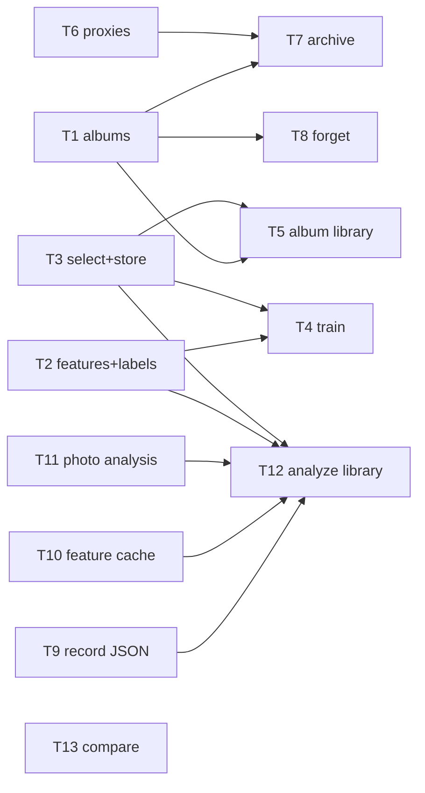
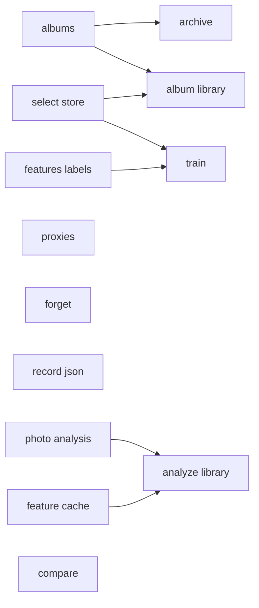

# Swift + Metal migration, phase 4b: albums, ranking, proxies, archive, forget, feature cache, pipeline

**Goal:** port albums, album_library, ranking (features, labels, select, store, train), proxies, archive, forget, feature_cache, pipeline and compare from src/ailbum to AilbumCore, with their pytest suites ported to Swift Testing.
**Architecture:** same as phase 4a: one Swift enum namespace per Python module; connection-level functions take `_ db: Database`, path-level ones take `database: String`; Python dicts become `JSONValue` with the same keys.
**Tech stack:** Swift 6.3 (mode 5), SQLite3 (`Database`), ImageIO/CoreGraphics, CryptoKit, Swift Testing.
**Spec:** docs/plans/2026-11-07-swift-metal-migration-design.md
**Detail:** contracts
**Target-min:** 14

## Global constraints

- Phase 1-4a rules hold (port rule, Russian messages, `AilbumError.invalid`, temp dirs only, never read `.ailbum` or real photos, edit only `swift/`). Each task ports the named pytest tests one to one (lowerCamelCase names, same inputs and asserted values).
- Existing APIs to call (do not change their files): `Catalog.utcNow()`, `Catalog.newRunId()`, `Metadata.collect`, `AnalysisStore.save`, `AnalysisStore.refreshCentroid`, `Stories.detect`, `StoryNamer`, `LogisticModel`, `Similarity.cluster`, `Vectors.clusterCosine`, `Quality.*`, `HashColor.*`, `SIFT.extract`, `Aesthetics.*`, `FaceAnalyzer.analyze`, `Clip.analyze`, `ImageLoader.load/discover`, `Resize.forAnalysis`, `ModelStore.available`.
- Python goldens: `HF_HUB_OFFLINE=1 PYTHONPATH=src uv run python ...` on synthetic inputs only.
- Test seams follow the existing `Clip.embedder` pattern (internal `nonisolated(unsafe) static var` override), never real Trash, network or user dirs.
- Not ported here: tests/test_cli_albums.py (CLI is phase 5), tests/test_migration_v12.py (Swift opens v12 only).

## File structure

`swift/Sources/AilbumCore/Albums/` (albums, album library, archive, forget), `Ranking/` (features, labels, select, store, train), `Catalog/` (proxies, record JSON, feature cache), `Pipeline/` (photo analysis, analyze library, compare); paths in each task's Owns.

## Task graph

```mermaid
%% schedule
gantt
  title Predicted schedule (mm:ss)
  dateFormat X
  axisFormat %M:%S
  section lane 1
  T11 Photo analysis :t11, 0, 153s
  T12 analyze library :t12, 153, 165s
  section lane 2
  T13 Compare :t13, 0, 139s
  section lane 3
  T2 Ranking features and labels :t2, 0, 136s
  T4 Ranking train :t4, 136, 119s
  section lane 4
  T3 Ranking select and store :t3, 0, 134s
  T5 Album library :t5, 134, 127s
  section lane 5
  T10 Feature cache :t10, 0, 119s
  section lane 6
  T8 Forget and usage :t8, 0, 114s
  section lane 7
  T6 Proxies :t6, 0, 113s
  section lane 8
  T1 Albums :t1, 0, 109s
  T7 Archive :t7, 109, 115s
  section lane 9
  T9 Record JSON :t9, 0, 98s
```

critical path: T11 → T12 (5.3 min) · peak width 9 · predicted build 5.3 min · predicted total ≈ 8.8 min (target ✓)

## Predicted schedule

## Package: Albums and ranking (state, protocol, numeric)

**Probe entry:** run=swift run --package-path swift ailbum-swift

### T1 Albums · Complexity 3 · Est. context 28k
**Owns:** swift/Sources/AilbumCore/Albums/Albums.swift, swift/Tests/AilbumCoreTests/AlbumsTests.swift
**Components:** 1
**LOC owned:** 150
**Tests:** fast
**Model:** sonnet
**Consumes:** none
**Produces:** Albums.create(_ db: Database, title: String, sources: [String], runId: String?, targetCount: Int) throws -> Int · Albums.get(_ db: Database, _ albumId: Int) throws -> JSONValue · Albums.list(_ db: Database) throws -> JSONValue · Albums.setStatus(_ db: Database, _ albumId: Int, _ status: String) throws -> JSONValue · Albums.rename(_ db: Database, _ albumId: Int, title: String) throws -> JSONValue · Albums.delete(_ db: Database, _ albumId: Int, forgetDecisions: Bool) throws · Albums.attachRun(_ db: Database, runId: String, sources: [String]) throws -> Int · Albums.requireDraft(_ db: Database, _ albumId: Int) throws
e.g. `Albums.create(db, title: "A", sources: ["/b", "/a", "/a"], runId: nil, targetCount: 24)` on an empty DB -> `1`; then `Albums.get(db, 1)["sources"]` -> `["/a", "/b"]`, `["status"]` -> `"draft"`, `["photo_count"]` -> `0`
e.g. `Albums.get(db, 99)` -> throws `AilbumError.invalid("Альбом не найден")`
**Review Focus:** port all 7 tests of tests/test_albums.py; forbidden transition draft -> archived throws the Python text.
**Steps:** 1 failing tests, 2 run: FAIL, 3 implement, 4 run: PASS
**Notes:** port src/ailbum/albums.py whole (`STATUS_ORDER`, `TRANSITIONS`, uuid4 public ids, `_now` = `Catalog.utcNow()`).

### T2 Ranking features and labels · Complexity 4 · Est. context 30k
**Owns:** swift/Sources/AilbumCore/Ranking/RankingFeatures.swift, swift/Sources/AilbumCore/Ranking/RankingLabels.swift, swift/Tests/AilbumCoreTests/RankingFeaturesTests.swift
**Components:** 2
**LOC owned:** 170
**Tests:** fast
**Model:** sonnet
**Consumes:** none
**Produces:** RankingFeatures.version: Int · RankingFeatures.names: [String] · RankingFeatures.fromRecord(_ record: PhotoRecord, groupSize: Int, groupRank: Int) -> [Double] · RankingFeatures.fromRows(_ db: Database, runId: String) throws -> [Int: [Double]] · RankingLabels.explicit: [String] · RankingLabels.groupPairs(events: [JSONValue], final: Set<Int>, groups: [Int: [Int]]) -> [(Int, Int)]
e.g. `RankingFeatures.names.count` -> `19`, `names[0]` -> `"quality"`, `RankingFeatures.version` -> `1`
e.g. `RankingFeatures.fromRecord(r, groupSize: 3, groupRank: 1)` for quality 0.5, sharpness 100, exposure 0.8, no composition/color/semantics/faces, not blurry -> `[0.5, 100, 0.8, 0, 0, 0, 0, 0, 0, 0, 0, 0, 0, 0, 0, 0, 0, 3, 1]`
e.g. `RankingLabels.groupPairs(events: [["image_id": 1, "source": "manual"]], final: [1], groups: [5: [1, 2, 3]])` -> `[(1, 2), (1, 3)]`
**Review Focus:** port tests/test_ranking_core.py `test_missing_values_zero_with_flag`, `test_from_record_equals_from_rows`, `test_zero_variance_column_no_nan` (the fit/json tests already exist in LogisticModelTests); `groupPairs` skips groups with no explicit event.
**Steps:** 1 failing tests, 2 run: FAIL, 3 implement, 4 run: PASS
**Notes:** port src/ailbum/ranking/features.py and labels.py whole. `fromRows` reads the same columns Python reads; the test inserts rows with SQL.

### T3 Ranking select and store · Complexity 4 · Est. context 30k
**Owns:** swift/Sources/AilbumCore/Ranking/RankingSelect.swift, swift/Sources/AilbumCore/Ranking/RankingStore.swift, swift/Tests/AilbumCoreTests/RankingSelectTests.swift
**Components:** 2
**LOC owned:** 160
**Tests:** fast
**Model:** sonnet
**Consumes:** none
**Produces:** RankingCandidate(imageId: Int, score: Double, storyId: Int?, similarCluster: Int?, embedding: [Double]?) · RankingSelect.selectForTarget(_ candidates: [RankingCandidate], target: Int, keep: [Int]) -> [Int] · RankingStore.saveModel(_ db: Database, kind: String, model: LogisticModel, metrics: JSONValue, active: Bool) throws -> Int · RankingStore.activeRow(_ db: Database, kind: String) throws -> [String: SQLValue]? · RankingStore.activeModel(_ db: Database, kind: String) throws -> (id: Int, model: LogisticModel)?
e.g. candidates 1, 2, 3 with scores 0.9, 0.8, 0.7 and no story, cluster or embedding: `selectForTarget(c, target: 2, keep: [])` -> `[1, 2]`; `keep: [3]` -> `[3, 1]`
e.g. `RankingStore.activeModel(db, kind: "pairwise")` on an empty DB -> `nil`; after `saveModel(db, kind: "pairwise", model: m, metrics: [:], active: true)` -> `(id: 1, model: m)`
**Review Focus:** port tests/test_ranking_select.py `test_plan_examples`, `test_keep_all_even_over_target_and_unknown`, `test_exhausted_candidates`, `test_embedding_penalty`, `test_similar_cluster_not_twice_while_others_remain`, `test_ties_by_image_id`; `activeModel` returns nil for a stale `feature_version`.
**Steps:** 1 failing tests, 2 run: FAIL, 3 implement, 4 run: PASS
**Notes:** port src/ailbum/ranking/select.py and store.py whole. `RankingCandidate` lives in RankingSelect.swift.

### T4 Ranking train · Complexity 6 · Est. context 36k
**Owns:** swift/Sources/AilbumCore/Ranking/RankingTrain.swift, swift/Tests/AilbumCoreTests/RankingTrainTests.swift
**Components:** 1
**LOC owned:** 230
**Tests:** fast
**Model:** sonnet
**Consumes:** RankingFeatures.fromRows(_ db: Database, runId: String) throws -> [Int: [Double]] (T2) · RankingLabels.groupPairs(events: [JSONValue], final: Set<Int>, groups: [Int: [Int]]) -> [(Int, Int)] (T2) · RankingStore.saveModel(_ db: Database, kind: String, model: LogisticModel, metrics: JSONValue, active: Bool) throws -> Int (T3) · RankingStore.activeRow(_ db: Database, kind: String) throws -> [String: SQLValue]? (T3) · RankingStore.activeModel(_ db: Database, kind: String) throws -> (id: Int, model: LogisticModel)? (T3)
**Produces:** RankingTrain.train(_ db: Database) throws -> JSONValue · RankingTrain.evaluate(_ db: Database) throws -> JSONValue · RankingTrain.status(_ db: Database) throws -> JSONValue
**Review Focus:** port all 7 tests of tests/test_ranking_train.py; reason texts identical to Python `REASON` / `POINTWISE_REASON`; fold split by sha components identical to Python `_components`.
**Steps:** 1 failing tests, 2 run: FAIL, 3 implement, 4 run: PASS
**Notes:** port src/ailbum/ranking/train.py whole; `LogisticModel.fit(x:y:l2:)` exists.

### T5 Album library · Complexity 6 · Est. context 40k
**Owns:** swift/Sources/AilbumCore/Albums/AlbumLibrary.swift, swift/Tests/AilbumCoreTests/AlbumLibraryTests.swift
**Components:** 1
**LOC owned:** 290
**Tests:** fast
**Model:** sonnet
**Consumes:** Albums.create(_ db: Database, title: String, sources: [String], runId: String?, targetCount: Int) throws -> Int (T1) · Albums.get(_ db: Database, _ albumId: Int) throws -> JSONValue (T1) · Albums.requireDraft(_ db: Database, _ albumId: Int) throws (T1)
**Produces:** AlbumLibrary.setPhoto(_ db: Database, albumId: Int, imageId: Int, selected: Bool, source: String) throws -> JSONValue · AlbumLibrary.selectionHash(_ db: Database, albumId: Int) throws -> String · AlbumLibrary.setTarget(_ db: Database, albumId: Int, targetCount: Int) throws -> JSONValue · AlbumLibrary.autofill(_ db: Database, albumId: Int) throws -> JSONValue · AlbumLibrary.getLibrary(database: String, albumId: Int?) throws -> JSONValue
**Review Focus:** port all 9 tests of tests/test_album_library.py; `selectionHash` equals the Python sha256 hex for the same ids.
**Steps:** 1 failing tests, 2 run: FAIL, 3 implement, 4 run: PASS
**Notes:** port src/ailbum/album_library.py whole (same SQL incl. `_NO_ANALYSIS`, same JSON keys); autofill calls T3 `RankingSelect.selectForTarget(_:target:keep:)`, whose examples are in the T3 block).

### T6 Proxies · Complexity 4 · Est. context 32k
**Owns:** swift/Sources/AilbumCore/Catalog/Proxies.swift, swift/Tests/AilbumCoreTests/ProxiesTests.swift
**Components:** 1
**LOC owned:** 180
**Tests:** fast
**Model:** sonnet
**Consumes:** none
**Produces:** Proxies.build(database: String, imageIds: [Int]) throws -> JSONValue · Proxies.imageSource(database: String, image: [String: SQLValue]) -> String? · Proxies.faceThumbnail(database: String, faceId: Int) throws -> Data · Proxies.photoProxy(database: String, sha256: String) -> String
e.g. `Proxies.build(database: d, imageIds: [])` -> `{"built": [], "failed": []}`
e.g. `Proxies.photoProxy(database: "/x/catalog.sqlite3", sha256: "ab")` -> the path Python `_photo_proxy` gives
**Review Focus:** port all 7 tests of tests/test_proxies.py (the sqlite-row test passes a `[String: SQLValue]` row); EXIF orientation 6 rotates; atomic write leaves no `.tmp` on failure.
**Steps:** 1 failing tests, 2 run: FAIL, 3 implement, 4 run: PASS
**Notes:** port src/ailbum/proxies.py whole (PHOTO_SIDE 1600 q82, FACE_SIZE 240 q86); JPEG via ImageIO, resize via CoreGraphics.

### T7 Archive · Complexity 5 · Est. context 36k
**Owns:** swift/Sources/AilbumCore/Albums/Archive.swift, swift/Tests/AilbumCoreTests/ArchiveTests.swift
**Components:** 1
**LOC owned:** 200
**Tests:** fast
**Model:** sonnet
**Consumes:** Albums.create(_ db: Database, title: String, sources: [String], runId: String?, targetCount: Int) throws -> Int (T1) · Albums.setStatus(_ db: Database, _ albumId: Int, _ status: String) throws -> JSONValue (T1) · Proxies.build(database: String, imageIds: [Int]) throws -> JSONValue (T6)
**Produces:** Archive.prepare(database: String, albumId: Int) throws -> JSONValue · Archive.complete(database: String, albumId: Int, trashed: [String]) throws -> JSONValue · Archive.trashPaths(_ paths: [String]) -> [String] · Archive.confirmMissing(database: String, imageIds: [Int]) throws -> Int
**Review Focus:** port tests/test_archive.py except `test_osascript_fallback_escapes_cyrillic_quotes_spaces`; tests that call `export_originals` insert the `layouts`/`album_exports` rows with SQL instead; `test_trash_paths_backend` uses the trasher override.
**Steps:** 1 failing tests, 2 run: FAIL, 3 implement, 4 run: PASS
**Notes:** port src/ailbum/archive.py; `trashPaths` uses `FileManager.trashItem` behind an internal static `trasher` override (no osascript).

### T8 Forget and usage · Complexity 4 · Est. context 32k
**Owns:** swift/Sources/AilbumCore/Albums/Forget.swift, swift/Tests/AilbumCoreTests/ForgetTests.swift
**Components:** 1
**LOC owned:** 190
**Tests:** fast
**Model:** sonnet
**Consumes:** Albums.create(_ db: Database, title: String, sources: [String], runId: String?, targetCount: Int) throws -> Int (T1) · Albums.get(_ db: Database, _ albumId: Int) throws -> JSONValue (T1)
**Produces:** Forget.plan(database: String, albumId: Int?, source: String?) throws -> JSONValue · Forget.forget(database: String, albumId: Int?, source: String?) throws -> JSONValue · Forget.usage(database: String) throws -> JSONValue
**Review Focus:** port all 6 tests of tests/test_forget.py; both or neither scope throws the Python text; forget is one transaction.
**Steps:** 1 failing tests, 2 run: FAIL, 3 implement, 4 run: PASS
**Notes:** port src/ailbum/forget.py whole; centroid refresh via `AnalysisStore.refreshCentroid(_:personId:)`; proxy paths as T6 `Proxies.photoProxy` names them (compute the same path inline).

## Package: Pipeline (data pipeline: numeric, encoding, state, file)

**Probe entry:** run=swift run --package-path swift ailbum-swift

### T9 Record JSON · Complexity 2 · Est. context 24k
**Owns:** swift/Sources/AilbumCore/Catalog/RecordJSON.swift, swift/Tests/AilbumCoreTests/RecordJSONTests.swift
**Components:** 1
**LOC owned:** 130
**Tests:** fast
**Model:** sonnet
**Consumes:** none
**Produces:** PhotoRecord.toJSON() -> JSONValue · PersonRecord.toJSON() -> JSONValue · StoryRecord.toJSON() -> JSONValue · FaceRecord.toJSON() -> JSONValue
e.g. `PersonRecord(clusterId: 1, faceIds: ["f1"], photoIds: ["p1"], embeddingModel: "m", centroid: [1]).toJSON()` -> `{"person_cluster": 1, "person_id": null, "public_id": null, "name": null, "faces": ["f1"], "photos": ["p1"]}`
e.g. `PhotoRecord.toJSON()` has every `asdict` key of Python PhotoRecord, faces without `embedding`, semantics without `embedding`
**Review Focus:** `testPhotoRecordKeys`, `testFaceRecordDropsEmbedding`, `testSemanticsDropsEmbedding`, `testStoryRecordKeys`: key sets and values equal Python `to_dict` on the same record (golden JSON).
**Steps:** 1 failing tests, 2 run: FAIL, 3 implement, 4 run: PASS
**Notes:** snake_case keys exactly as Python `asdict` (nested composition, color, subject, semantics, tags, eyes, expression); nil -> `.null`.

### T10 Feature cache · Complexity 5 · Est. context 34k
**Owns:** swift/Sources/AilbumCore/Catalog/FeatureCache.swift, swift/Tests/AilbumCoreTests/FeatureCacheTests.swift
**Components:** 1
**LOC owned:** 230
**Tests:** fast
**Model:** sonnet
**Consumes:** none
**Produces:** FeatureCache.signature(_ settings: JSONValue) -> String · FeatureCache(root: String, signature: String) · FeatureCache.load(sha256: String, photoId: String, path: String, takenAt: String?, sharpnessThreshold: Double) -> (PhotoRecord, PhotoFeatures)? · FeatureCache.store(sha256: String, record: PhotoRecord, features: PhotoFeatures) · FeatureCache.stats() -> JSONValue
e.g. `FeatureCache.signature(["max_image_side": 1600, "semantic_threshold": 0.15, "face_backend": "dnn"])` -> `"31bc0ca0291b1e2e7033"`
e.g. `FeatureCache.load(sha256: "s", photoId: "p", path: "/x.jpg", takenAt: nil, sharpnessThreshold: 80)` on a new cache -> `nil`, and `misses` becomes 1
e.g. `FeatureCache.stats()` on a new cache -> `{"enabled": true, "directory": "<root>/<sig>", "hits": 0, "misses": 0, "writes": 0, "error": null}`
**Review Focus:** `testSignatureMatchesPython`, `testRoundTrip` (record with 2 faces, semantics, geometric keypoints/descriptors -> load equals stored, path/photoId/takenAt replaced, isBlurry recomputed from threshold), `testMissCounts`, `testCorruptFileIsMiss`, `testUnwritableRootDisables`.
**Steps:** 1 failing tests, 2 run: FAIL, 3 implement, 4 run: PASS
**Notes:** port src/ailbum/feature_cache.py; class is `final class FeatureCache`. Same metadata JSON as `_record_metadata`, but the file is `<sha256>.swcache`: UInt32 little-endian JSON length, JSON, then phash bytes, histogram/keypoints/descriptors as float32 LE (shapes in the JSON). Write to `.tmp` then rename.

### T11 Photo analysis · Complexity 5 · Est. context 36k
**Owns:** swift/Sources/AilbumCore/Pipeline/PhotoAnalysis.swift, swift/Tests/AilbumCoreTests/PhotoAnalysisTests.swift
**Components:** 1
**LOC owned:** 210
**Tests:** slow
**Model:** sonnet
**Consumes:** none
**Produces:** PhotoAnalysis.faceBackend(_ requested: String) throws -> String · PhotoAnalysis.semanticBackend(_ requested: String) throws -> String · PhotoAnalysis.analyze(path: String, photoId: String, takenAt: String?, config: PipelineConfig, faceBackend: String) throws -> (record: PhotoRecord, features: PhotoFeatures, preview: RGBImage)
e.g. `PhotoAnalysis.faceBackend("off")` -> `"off"`; `faceBackend("classic")` -> `"off"`; `faceBackend("auto")` without YuNet/SFace models -> `"off"`; `faceBackend("x")` -> throws
e.g. `analyze` of a 320x320 striped JPEG with `faceBackend: "off"` -> record with `width 320`, `faces []`, `composition` and `color` non-nil, `semantics nil`
**Review Focus:** sharpness/exposure/quality of the tests/test_pipeline.py `detailed` image equal Python (rounded 3/4/4 digits, parity tolerance 2e-2 where resized); `isBlurry` uses `<` threshold; face ids `photo-00001-face-01`; eyes/expression built only under the Python conditions; `faceBackend("dnn")` without models throws the Python text.
**Steps:** 1 failing tests, 2 run: FAIL, 3 implement, 4 run: PASS
**Notes:** port the per-photo body of `analyze_library` (pipeline.py lines 186-277) minus caching and semantics batching. Pyramid levels via `Resize.forAnalysis` (maxImageSide, 800, 256). `"classic"` maps to `"off"` (Haar backend dropped in phase 3).

### T12 analyze library · Complexity 7 · Est. context 44k
**Owns:** swift/Sources/AilbumCore/Pipeline/Pipeline.swift, swift/Tests/AilbumCoreTests/PipelineTests.swift
**Components:** 1
**LOC owned:** 300
**Tests:** slow
**Model:** sonnet
**Consumes:** PhotoAnalysis.analyze(path: String, photoId: String, takenAt: String?, config: PipelineConfig, faceBackend: String) throws -> (record: PhotoRecord, features: PhotoFeatures, preview: RGBImage) (T11) · PhotoAnalysis.faceBackend(_ requested: String) throws -> String (T11) · PhotoAnalysis.semanticBackend(_ requested: String) throws -> String (T11) · FeatureCache.signature(_ settings: JSONValue) -> String (T10) · FeatureCache.load(sha256: String, photoId: String, path: String, takenAt: String?, sharpnessThreshold: Double) -> (PhotoRecord, PhotoFeatures)? (T10) · FeatureCache.store(sha256: String, record: PhotoRecord, features: PhotoFeatures) (T10) · FeatureCache.stats() -> JSONValue (T10) · PhotoRecord.toJSON() -> JSONValue (T9) · PersonRecord.toJSON() -> JSONValue (T9) · StoryRecord.toJSON() -> JSONValue (T9) · RankingFeatures.fromRecord(_ record: PhotoRecord, groupSize: Int, groupRank: Int) -> [Double] (T2) · RankingStore.activeModel(_ db: Database, kind: String) throws -> (id: Int, model: LogisticModel)? (T3)
**Produces:** Pipeline.analyzeLibrary(source: String, output: String, config: PipelineConfig, recursive: Bool, progress: ((String) -> Void)?, database: String?) throws -> JSONValue
**Review Focus:** port both tests of tests/test_pipeline.py and `test_pipeline_without_model_records_quality`, `test_pipeline_with_fake_model_picks_by_score` of tests/test_ranking_select.py (fake model via an internal static `pairwiseOverride`), with `faceBackend: "off"`, `semanticBackend: "off"`, `storyNamingBackend: "rules"`; progress stage texts identical; analysis.json `schema_version` 6; selection.csv header identical; one corrupt file gives an error record and the run continues.
**Steps:** 1 failing tests, 2 run: FAIL, 3 implement, 4 run: PASS
**Notes:** port the rest of pipeline.py (`_feature_cache`, `_group_winner`, people clustering, stories, manifest, `_write_outputs`). Validate `storySemanticBreakMinutes >= 1` with the Python stories text (Swift `Stories.detect` does not take it). Cache signature `face_models` = sorted `(name, size, mtime_ns)` of `*.mlpackage/Manifest.json` in the models dir; face similarity default 0.36 for dnn, 0.82 otherwise.

### T13 Compare · Complexity 3 · Est. context 26k
**Owns:** swift/Sources/AilbumCore/Pipeline/Compare.swift, swift/Tests/AilbumCoreTests/CompareTests.swift
**Components:** 1
**LOC owned:** 100
**Tests:** slow
**Model:** sonnet
**Consumes:** none
**Produces:** Compare.images(left: String, right: String, hashDistance: Int, histogramThreshold: Double, geometricThreshold: Double, geometricMaxFeatures: Int, maxImageSide: Int) throws -> JSONValue
**Review Focus:** `testSameImageMatches` (hash 0, both matches true), `testKeysMatchPython` (key tree of Python `compare_images` on two synthetic JPEGs, timings excluded), `testScoresMatchPython` (hash exact, colour 1e-3, geometric score 2e-2).
**Steps:** 1 failing tests, 2 run: FAIL, 3 implement, 4 run: PASS
**Notes:** port src/ailbum/compare.py whole; timings in ms via `DispatchTime`.

## Review Focus

- Albums and ranking (state, protocol, numeric): status transitions, transactional deletes, selection hash, greedy select ties, train folds and thresholds. Cases are in each task.
- Pipeline (data pipeline): numeric (quality rounding, centroids), encoding (manifest keys, CSV, cache file), state (cache hits, run ids), file (atomic writes, corrupt inputs).

## Self-review

Coverage: design section 3 phase 4 row minus layout (4c); section 4 parity via ported suites and Python goldens. Edges only where tests run another task's code.

Ruling: face backend "classic" maps to "off" - Haar/HOG dropped in phase 3 - cost: manifest says "off" where Python said "classic".
Ruling: Swift feature cache uses its own `.swcache` file, not npz - no numpy in Swift; Python caches are simply misses - cost: one re-analysis after migration.
Ruling: test_cli_albums and test_migration_v12 are not ported in 4b - CLI is phase 5, Swift opens v12 only - cost: none now.
